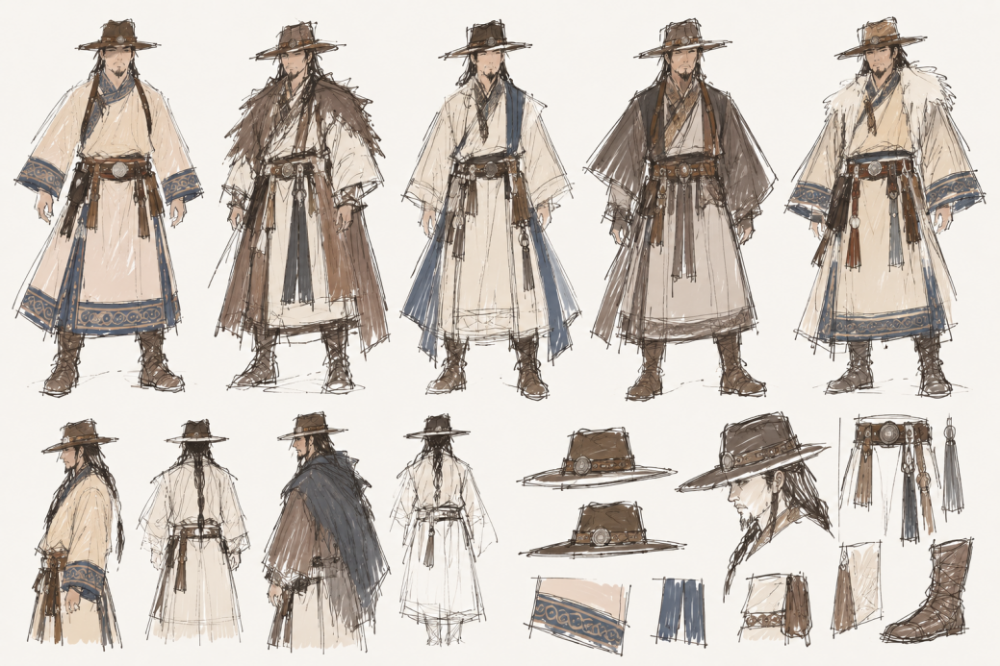
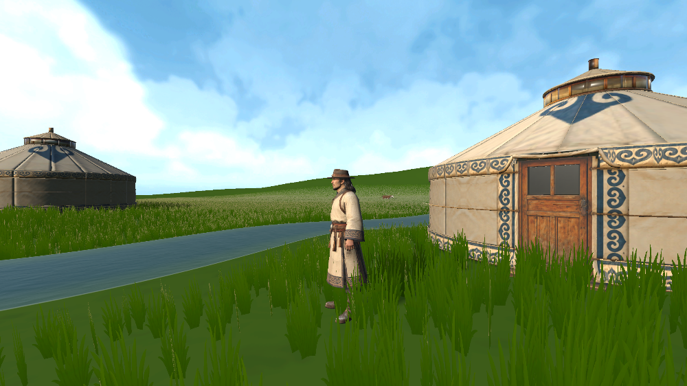
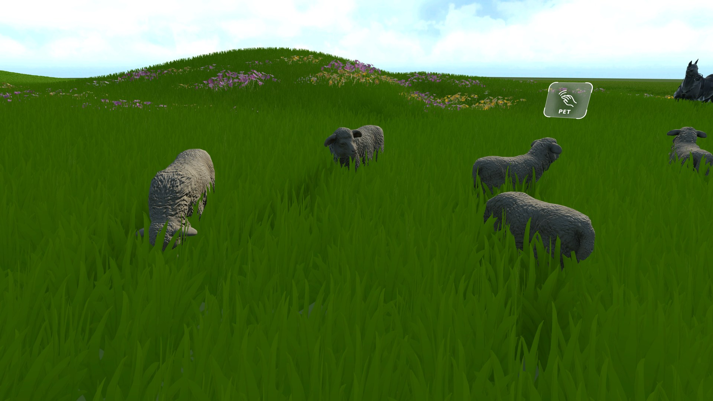
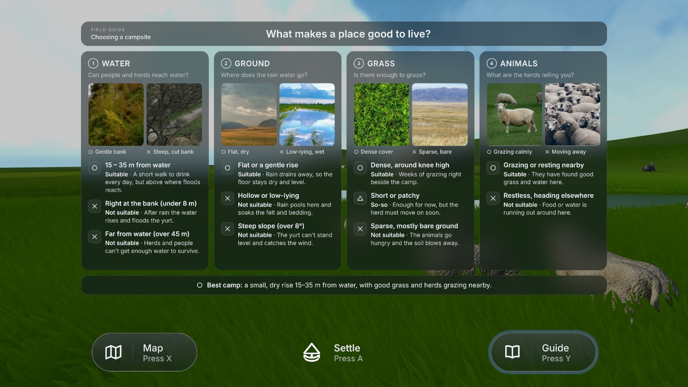
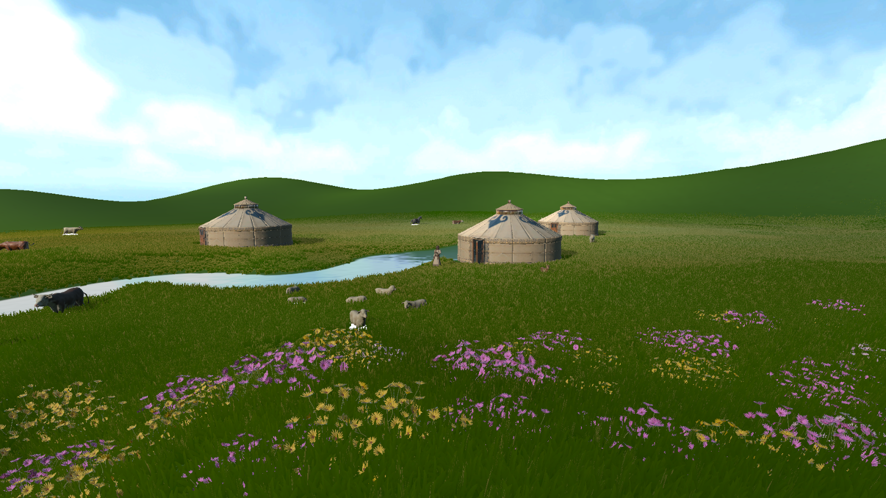
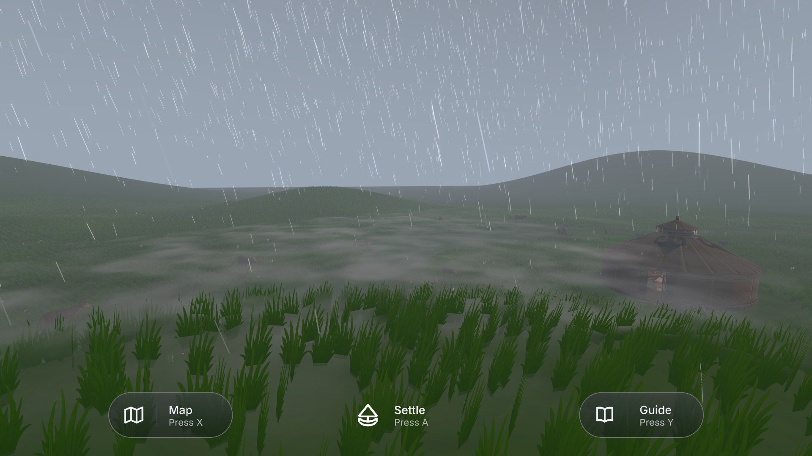
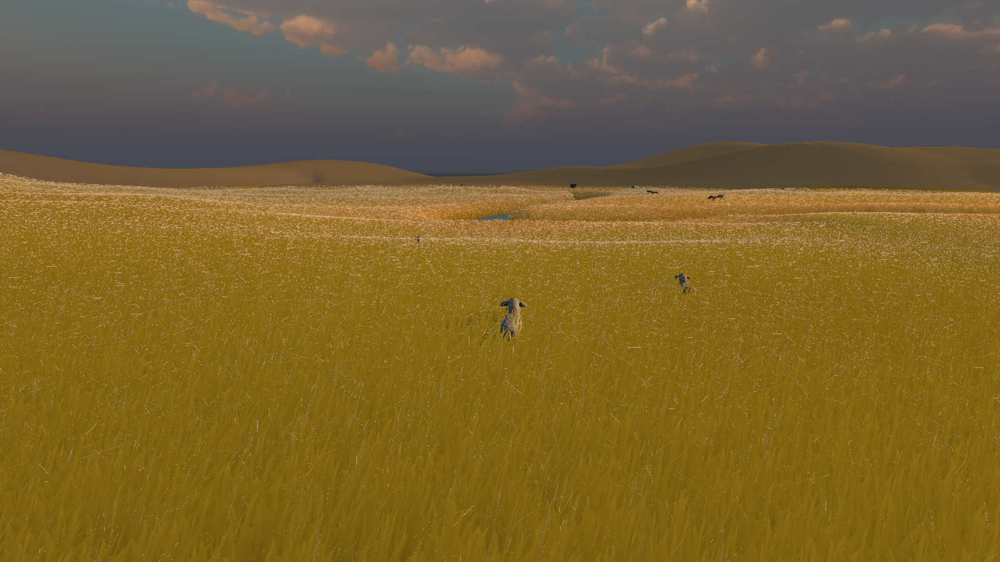
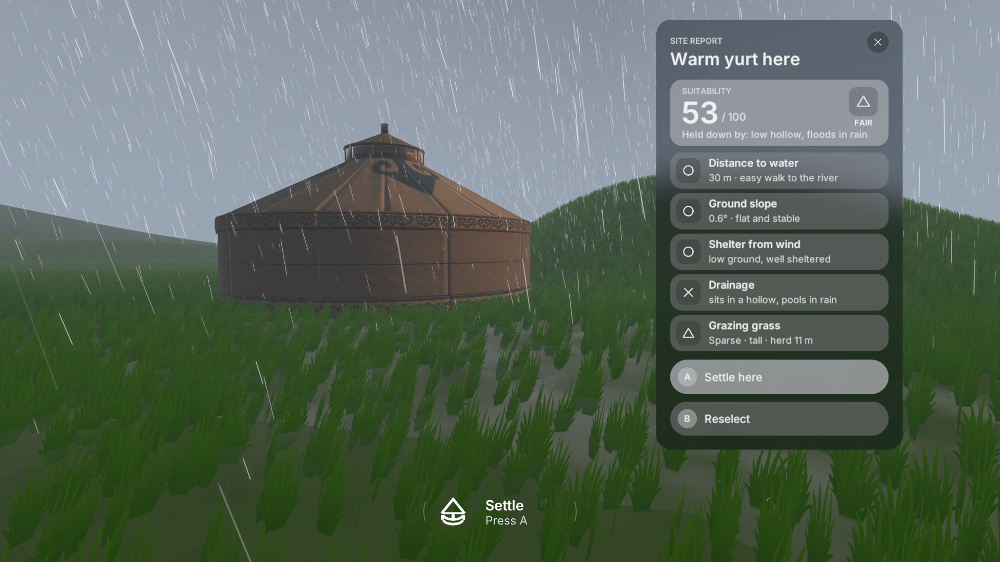

# Following the Grass — Where Should We Move Our Home?

### A VR game about Mongolian seasonal camp selection, where players follow a herd, read the landscape and choose where to move their home.

## 📌 Table of Contents

- **YouTube walkthrough** <!-- Add the YouTube URL here -->
- **Playable game build** <!-- Add the game download URL here -->
- **Unity project files** <!-- Add the project URL here -->

---

## 1. Why I Created This Work

### The Core Question

**How can someone with little experience of herding learn to judge a campsite by looking, listening and moving through the land?**

During my visit to Mongolia, I noticed how differently people could read the same grassland. I saw an open view. The herders I spoke to were thinking about where their animals could drink and what pasture would still be available as the weather changed. I chose moving camp as the task because it gives the player a practical reason to look twice at the land.

*Ger near Mandalgovi, Mongolia. Photograph by Fischer (2010), [CC BY-SA 2.0](https://commons.wikimedia.org/wiki/File:Mongolian_Ger.jpg).*

### From research to a playable task

I used the research on seasonal movement to decide what the player could learn by walking. A river is easy to spot from a distance. Whether its bank is level, wet or sheltered takes a closer look. I built the patrol around that change of scale, then added a map so players could bring observations from different places back to camp.

 <em>Observe, interpret, decide and reflect.</em>

 <em>The furnished ger where the spring patrol begins.</em>

---

## 2. Technology Used

| Component | What I built with it |
|---|---|
| Blender | Modelled the ger and furniture, checked the decorative bands around the curved wall, and prepared Bataa’s face for speech. |
| Unity Terrain and C# | Built the patrol route and sampled the ground beneath each proposed camp. |
| GrassPhysics and URP water | Set grass height and coverage independently and adjusted the reflection on the river. |
| LipSync Pro | Matched dialogue to mouth movement and checked the result alongside Bataa’s gestures. |
| VR headset and controllers | Let players turn towards sound, approach livestock and mark observations. The project also has a PC version. |

　　 <em>Blender · Unity</em>

---

## 3. Modelling the ger and its guide

### Building the ger

I modelled the circular wall, roof, central opening and door separately in Blender. I checked the roof poles from above and rotated the wall to align the blue band with the door frame. Four variations make each shelter recognisable during selection.

 &nbsp;  <em>Standard ger · Wind ropes</em>

 &nbsp;  <em>Rain cover · Winter covering</em>

I moved the spring starting point indoors. Furniture follows the curved wall, leaving a clear path to the door. I adjusted the furniture shadows under the light entering through the roof.

 &nbsp;  <em>Furniture placement · Roof light</em>

### Bataa

I modelled the guide in Blender and matched his facial movements to his dialogue in Unity. The pointing gesture gives the player a direction to look when he introduces the pasture.

 <em>Bataa character design</em>

## 4. Playing a chapter

**Leave home.** Spring opens inside the furnished ger. Walk through the doorway and meet Bataa. He asks you to scout a place where the family can move with its animals.

**Explore the pasture.** Follow Bataa to the flock, approach a sheep and walk down to the river. Climb the ridge to compare the banks from above. Take the saddled horse to cover the longer stretches between possible camps.

 &nbsp;  <em>Meeting the guide · Approaching the flock</em>

**Mark and compare.** Drop pins on the map while exploring. The field guide helps you check what you saw at each stop, from grass cover to shelter and access to water.

 &nbsp;  <em>Map markers · Field guide</em>

**Choose where to settle.** Ride back to camp, mark your preferred site and select a ger. The report shows the strengths and risks of that choice. You can select another site and compare the result.

### Spring · Warm grassland

I placed the herd near the river and used patches of short grass to break up the taller meadow. From the ridge, players can see the bends in the river and compare three possible camps. Spring gives them time to walk down and check what the view from above leaves out: how level the bank feels underfoot and how far the animals would have to travel to drink.

 <em>The spring pasture from the ridge.</em>

### Summer · Rain and flooding

Rain and fog shorten the view across the lake basin. Tall grass can make a shallow hollow look much like the rise beside it. Players can follow the herd towards water, then inspect the shape of the ground before marking a camp. A small gain in elevation can keep the ger on drier ground while leaving the lake within reach.

 <em>Rain across the summer lake basin.</em>

### Autumn · Wind and shelter

Gusts pass through the straw-coloured grass. On the open ridge the moving stems make the exposure easy to see. Farther down, the sheep draw attention to patches where they can graze. Players compare the shelter offered by the slope with the journey the herd would make from there to the river.

 <em>Sheep grazing in the tall autumn pasture.</em>

### Winter · Snow and frozen water

Most of the river freezes. Players must follow the channel to find open water and check whether the snowy bank is passable. Behind a ridge, shelter from the wind can come with deep drifts. Dry tufts showing through shallower snow help players find a site where animals can still reach both grass and water.

 <em>An open reach in the winter river.</em>

## 5. How the campsite score works

When you mark a site, the evaluator samples the terrain around the pin. It checks water access, slope, drainage, wind shelter and grass. Grass height and density each contribute half of the grass value. The selected ger sets the starting weight of each factor.

| Ger type | Water | Flat ground | Dryness | Wind shelter | Grass |
|---|---:|---:|---:|---:|---:|
| Warm / standard | 30% | 25% | 20% | 10% | 15% |
| Wind-resistant | 20% | 20% | 15% | 35% | 10% |
| Rain-resistant | 15% | 25% | 40% | 5% | 15% |
| Cold / insulated | 30% | 15% | 15% | 15% | 25% |

Summer and autumn adjust the base score for the weather. In summer, the base contributes 40% and the seasonal factors contribute 60%, including flood risk and distance to the herd. Winter uses its own calculation for snow, forage, shelter and reachable water. A difficult walk to open water can cap the score even when the river looks close.

In the summer trial below, the same ger scored **53** in a grassy hollow and **82** on slightly raised ground west of the lake. Rain collects in the hollow. The higher site drains well and is within easy reach of water. The report lets the player see what they gained and gave up by moving.

 <em>Grassy hollow · 53/100. Rain collects here.</em>

 <em>Rise west of the lake · 82/100. The ground drains well.</em>

[Read the scoring code and calibration notes](week14.md)

## 6. Playtesting and feedback

Five people tried the game with a headset and controllers. After the session, I asked them to describe their task and explain how they chose a campsite. Three understood that they were finding a new home for the family. One missed that goal, and the fifth response was too brief to interpret.

    

| What players reported | What I would change |
|---|---|
| Three felt dizzy or uncomfortable. | Offer a more comfortable movement option. |
| Two found it difficult to choose a site. | Ask players to compare two places and name the clue that guided their choice before showing the score. |
| Two found the repeated journey monotonous. | Shorten the return trip after players finish marking the map. |

Each player could report more than one difficulty. In a follow-up session, I would use an unfamiliar map to see whether players can explain a fresh decision using what they noticed on the first patrol.

 &nbsp;  <em>Projected game dialogue during a test session · Projected grassland and livestock during a test session</em>

