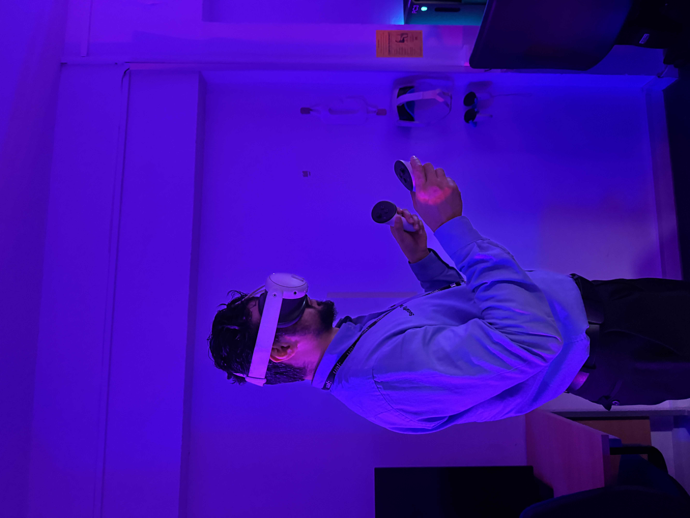

# Final Outcome

## Project Links

- Game build:
- Walkthrough video:
- Project presentation:

## Introduction

Following the Grass is a virtual reality game about how Mongolian herding families choose seasonal camps. The idea began during my visit to Mongolia. I could see the same open grassland as the people I spoke with, but I read it mainly as scenery. They described looking at the weather, pasture and water before deciding where to take their animals. I wanted to make that difference in perspective something a player could explore.

My research question was: how can an embodied game help people with little experience of herding understand the environmental conditions involved in choosing a camp? The project does not try to teach one universal answer. It asks players to observe several clues, compare places and explain the trade-offs behind their choice.

The game was built in Unity for a VR headset and controllers, with a PC version as an alternative. Players enter the home of a herding family, meet Bataa, explore the grassland on foot and horseback, record observations on a map, and choose a new campsite. A report then explains how the selected location performs against the conditions in that chapter.

## Research and Design Framework

The design draws on research into Mongolian pastoral mobility, environmental perception, embodied learning and serious games. Seasonal movement is connected to changing pasture, water and weather, but real decisions also depend on family labour, land use and community relationships. Those wider conditions are beyond this prototype, so the game focuses on environmental clues that players can see and compare.

I organised the experience around a learning cycle: observe the environment, interpret and record what was seen, decide where to camp, and reflect on the result. A short orientation inside the ger prepares players for the task. Walking and riding provide different viewpoints; map markers make separate observations easier to compare; the campsite report connects the final choice back to grass, water, terrain and weather. This structure is informed by Kolb's experiential learning cycle and research on embodied VR learning (Kolb, 1984; Johnson-Glenberg, 2018).

The environmental relationships are grounded in literature, while the score weights, thresholds and animal responses are design decisions for this prototype. The report is a way to compare locations inside the game, not a universal formula for real Mongolian camps.

## Design and Development

### Four weather chapters

The same grassland changes through four chapters. Spring introduces the basic route and camp choice. In summer, rain makes low ground and drainage more important. Autumn uses strong wind, tall grass and sheltered slopes to change how players read the land. In winter, snow covers much of the pasture and most of the river is frozen, so players have to look for exposed grass and the few open-water sections.

The player can walk close to grass, animals and riverbanks, then ride to see a wider area. Bataa gives a reason to begin the patrol and introduces the next task. Sheep, cattle and horses help make the environment feel lived in. Their positions can suggest a place worth checking, but they do not provide a guaranteed answer to the campsite decision.

### Ger design and the scoring table

In Blender, I modelled a circular wall, roof structure, central roof opening, felt covering and wooden door. The four ger types share the same basic outline. Their outer details communicate different priorities: a raised central crown and blue decoration for the standard ger; a darker cover over the roof opening for rain; visible tie-down ropes for wind; and a thicker felt envelope for cold weather. Traditional ger structure and craft references informed the common form, while the four specialised game types are my own readable design simplification (UNESCO, 2013; Tsovoodavaa et al., 2018).

The appearance connects to the base scoring weights shown below. A visible feature helps players recognise what a ger type is designed to handle, while the table makes its effect on the campsite report explicit.

| Ger type | Water | Flat ground | Dryness | Wind shelter | Grass |
|---|---:|---:|---:|---:|---:|
| Warm / standard | 30% | 25% | 20% | 10% | 15% |
| Wind-resistant | 20% | 20% | 15% | 35% | 10% |
| Rain-resistant | 15% | 25% | 40% | 5% | 15% |
| Cold / insulated | 30% | 15% | 15% | 15% | 25% |

The rain-resistant type gives the largest base weight to dry ground; its roof covering cannot prevent a low campsite from collecting water. The wind-resistant type gives the largest weight to shelter, while the cold type places more weight on water and grass. These weights help players see that a shelter can reduce one risk but cannot make every location suitable. Seasonal rules add further checks, so the table is the starting profile rather than the whole scoring system.

### Home, interface and feedback

The spring chapter begins inside the ger. Furniture suggests eating, heating, storage and rest, and the open doorway frames the first view of the grassland. This makes the home a place the player can leave and later return to before choosing a new camp.

The map lets players mark places they want to compare. A field guide summarises what to look for in water, ground, grass and animals. After a site is submitted, the report shows the overall score and explains strengths and risks in plain language. Bataa's dialogue introduces the route and tasks; subtitles and translucent panels keep instructions readable while leaving the landscape visible. Spatial sounds, including the river and nearby animals, help players locate parts of the scene before they see them clearly.

### Seasonal campsite scoring

The score combines terrain, vegetation, water access and seasonal conditions. In summer, the report checks drainage because a low hollow can flood even when it looks grassy and convenient. In autumn, wind shelter and the route to water become more important. In winter, the system checks accessible open water and visible grass rather than treating the frozen river as usable water. I set the percentages and thresholds to make these comparisons legible in play; they are not measurements of every herding family's priorities.

## User Testing

The first test round involved five people. The original plan was to recruit eight to ten. Participants tried the prototype with a headset and controllers, and the test focused on whether they understood the relocation task, what they noticed during exploration, and how they chose a campsite.

Three of the five participants understood that they were choosing a place for the family to move to. One did not understand the goal, and one record did not contain enough information to decide. Three participants reported dizziness or discomfort, two found the site choice difficult, and two described the repeated journey as monotonous. These reports overlap, so they do not add up to five separate outcomes. They point to different issues: task explanation, comparing environmental clues, route pacing and VR comfort.

This is a small first-round test. It does not show that the game has already changed players' knowledge or cross-cultural understanding. It shows where the current prototype needs clearer evidence and more comfortable testing. Future sessions should record each player's route and reasoning, ask for a campsite explanation before showing the score, and test whether players can apply what they noticed to an unfamiliar location.

### Headset sessions

<table>
<tr>
<td></td>
<td></td>
<td></td>
</tr>
<tr>
<td>Headset test session</td>
<td>Headset test session</td>
<td>Controller interaction</td>
</tr>
<tr>
<td></td>
<td></td>
<td></td>
</tr>
<tr>
<td>Headset test session</td>
<td>Controller interaction</td>
<td></td>
</tr>
</table>

### Projected gameplay sessions

<table>
<tr>
<td></td>
<td></td>
</tr>
<tr>
<td>Dialogue and the riverside scene</td>
<td>Grassland and livestock exploration</td>
</tr>
</table>

## Reflection and Future Work

The project brings environmental observation and campsite choice into one playable sequence. The player can see the river from the slope, walk down to inspect the bank, record a location, and later compare that experience with the score report. The four chapters reuse familiar actions while changing which environmental risks matter most.

The first tests also showed why one score cannot explain a player's reasoning by itself. Two people may choose a low site for different reasons: one may not notice the risk of water collecting there, while another may notice it but value convenient access to water more. The next version should ask players what they saw and why they chose a site before revealing the report. I also need to make the return journey less repetitive and offer movement options that reduce discomfort.

The prototype simplifies regional and household differences. A future review with people who have local herding experience could identify missing environmental or social conditions and check whether the visual cues are fair. Further tests should use an unfamiliar map and ask players to explain a new choice, rather than treating a high score or a completed route as proof of learning.

## References

Braun, V. and Clarke, V. (2006) ‘Using thematic analysis in psychology’, *Qualitative Research in Psychology*, 3(2), pp. 77–101. https://doi.org/10.1191/1478088706qp063oa

Johnson-Glenberg, M.C. (2018) ‘Immersive VR and education: embodied design principles that include gesture and hand controls’, *Frontiers in Robotics and AI*, 5, article 81. https://doi.org/10.3389/frobt.2018.00081

Jensen, L. and Konradsen, F. (2018) ‘A review of the use of virtual reality head-mounted displays in education and training’, *Education and Information Technologies*, 23, pp. 1515–1529. https://doi.org/10.1007/s10639-017-9676-0

Kolb, D.A. (1984) *Experiential learning: experience as the source of learning and development*. Englewood Cliffs, NJ: Prentice-Hall.

Michler, L.M. et al. (2022) ‘Moving toward the greener side: environmental aspects guiding pastoral mobility and impacting vegetation in the Dzungarian Gobi, Mongolia’, *Rangeland Ecology & Management*, 83, pp. 149–160. https://doi.org/10.1016/j.rama.2022.03.006

Ono, C. and Ishikawa, M. (2020) ‘Pastoralists’ herding strategies and camp selection in the local commons—a case study of pastoral societies in Mongolia’, *Land*, 9(12), article 496. https://doi.org/10.3390/land9120496

Tsovoodavaa, G., Shih, R.R.L., Bonjar, M.R.G. and Kistelegdi, I. (2018) ‘A review and systemization of the traditional Mongolian yurt (GER)’, *Pollack Periodica*, 13(3), pp. 19–30. https://doi.org/10.1556/606.2018.13.3.3

UNESCO (2013) *Traditional craftsmanship of the Mongol Ger and its associated customs*. https://ich.unesco.org/en/RL/00872
