# Following the Grass — Where Should We Move Our Home?

### A VR game about Mongolian seasonal camp selection, where players follow a herd, read the landscape and choose where to move their home.

## 📌 Table of Contents

- **YouTube walkthrough** <!-- Add the YouTube URL here -->
- **Playable game build** <!-- Add the game download URL here -->
- **Unity project files** <!-- Add the project URL here -->

---

## 1. Why I Created This Work

### The Core Question

**How can someone with little experience of herding learn to judge a campsite by looking, listening and moving through the land?**

During my visit to Mongolia, I noticed how differently people could read the same grassland. I saw an open view. The herders I spoke to were thinking about where their animals could drink and what pasture would still be available as the weather changed. I chose moving camp as the task because it gives the player a practical reason to look twice at the land.

Ono and Ishikawa found that herders in their Mongolian study area used river valleys for summer and autumn camps, while more sheltered sites at the foot of mountains were important in winter and spring. That observation shaped my four chapters. Players revisit a familiar landscape, but a bend in the river that was worth exploring in spring raises a different question after heavy rain. [Ono and Ishikawa, 2020](https://doi.org/10.3390/land9120496)

*Ger near Mandalgovi, Mongolia. Photograph by Fischer (2010), [CC BY-SA 2.0](https://commons.wikimedia.org/wiki/File:Mongolian_Ger.jpg).*

### From research to a playable task

I used the research on seasonal movement to decide what the player could learn by walking. A river is easy to spot from a distance. Whether its bank is level, wet or sheltered takes a closer look. I built the patrol around that change of scale, then added a map so players could bring observations from different places back to camp.

 <em>Observe, interpret, decide and reflect.</em>

---

## 2. Technology Used

| Component | What I built with it |
|---|---|
| Blender | Modelled the ger and furniture, checked the decorative bands around the curved wall, and prepared Bataa’s face for speech. |
| Unity Terrain and C# | Built the patrol route and sampled the ground beneath each proposed camp. |
| GrassPhysics and URP water | Set grass height and coverage independently and adjusted the reflection on the river. |
| LipSync Pro | Matched dialogue to mouth movement and checked the result alongside Bataa’s gestures. |
| VR headset and controllers | Let players turn towards sound, approach livestock and mark observations. The project also has a PC version. |

　　 <em>Blender · Unity</em>

---

## 3. Modelling the ger and its guide

### Building the ger

I modelled the circular wall, roof, central opening and door separately in Blender. I checked the roof poles from above and rotated the wall to align the blue band with the door frame. Four variations make each shelter recognisable during selection.

 &nbsp;  <em>Standard ger · Wind ropes</em>

 &nbsp;  <em>Rain cover · Winter covering</em>

I moved the spring starting point indoors. Furniture follows the curved wall, leaving a clear path to the door. I adjusted the furniture shadows under the light entering through the roof.

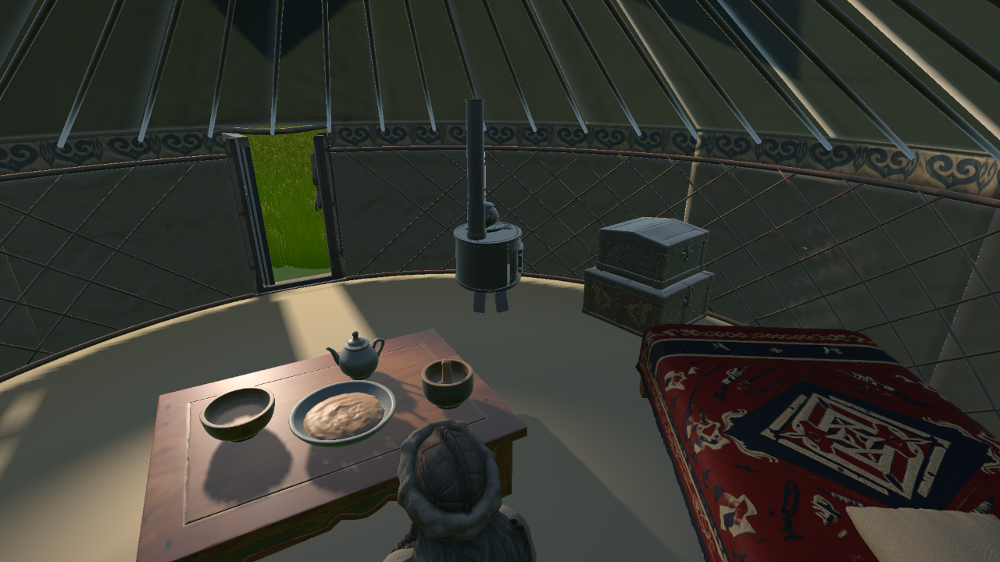 &nbsp;  <em>Furniture placement · Roof light</em>

### Bataa

I modelled the guide in Blender and matched his facial movements to his dialogue in Unity. The pointing gesture gives the player a direction to look when he introduces the pasture.

 <em>Bataa character design</em>

## 4. Playing a chapter

### How to play

| Action | VR controllers | PC keyboard and mouse |
|---|---|---|
| Look around | Turn your head. | Move the mouse. |
| Walk or steer the horse | Move the left thumbstick. | Use W, A, S and D. |
| Ride faster | Hold the right trigger while riding. | Hold the right mouse button while riding. |
| Speak to Bataa or mount the horse | When the prompt appears, press A on the right controller. | When the prompt appears, press E. |
| Pet a sheep | Look at the sheep you want to pet and hold the trigger. | When the prompt appears, hold E to pet the nearest sheep. |

### The spring tutorial

**1. Talk to Bataa**

Step outside the family ger and speak to Bataa. He explains why you are going out onto the pasture: the family needs somewhere to move, and you will help choose the site.

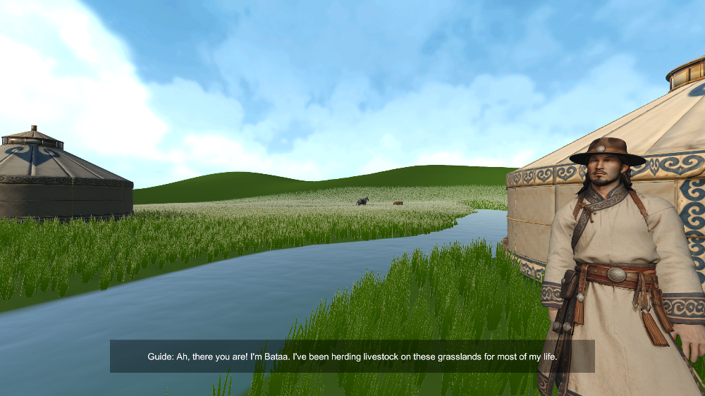

**2. Pet a sheep**

Follow Bataa to the flock. Walk up to a sheep until the pet prompt appears, then use it to pet the animal. This is the first interaction on the patrol.

**3. Climb the hill**

Leave the flock and walk uphill. Pause on the ridge to trace the river and see how the herd, the water and the camp sit in relation to one another.

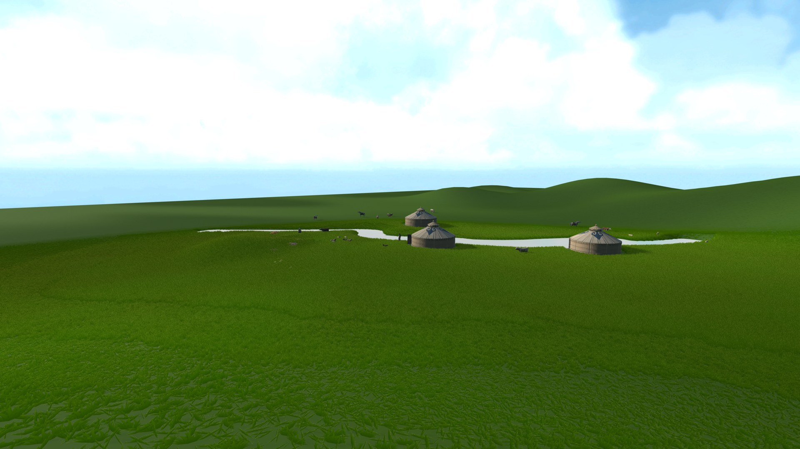

**4. Walk down to the river**

Descend to the bank you saw from above. At water level, look at the slope of the bank and the ground beside it. This is where Bataa draws attention to the trade-off between easy access to water and a suitable place to pitch the ger.

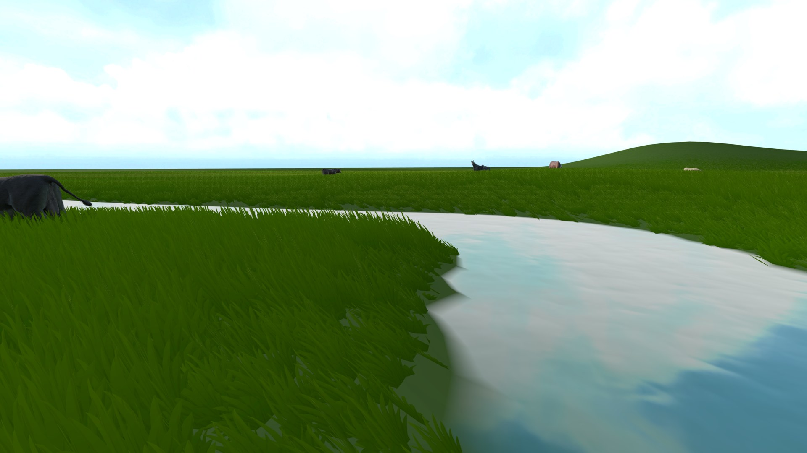

**5. Ride the horse**

Find the saddled horse near the river, approach it and mount. Ride across the pasture and back towards camp, looking again at the places you passed on foot.

**6. Read the field guide and use the map**

After the ride, open the field guide. Use its entries on water, ground, grass and animals to review what you saw. Then open the map and drop pins at places you want to compare.

 &nbsp; 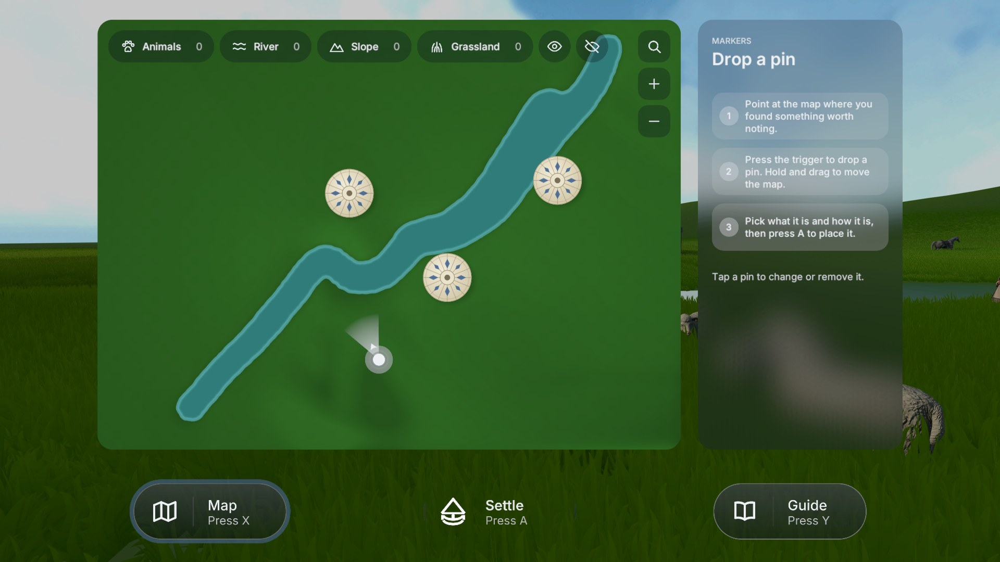

**7. Settle the camp**

Open Settle, mark your chosen campsite and select a ger type. Read the site report to see how the ground, pasture and water access affected your choice. Confirm the site or choose another location.

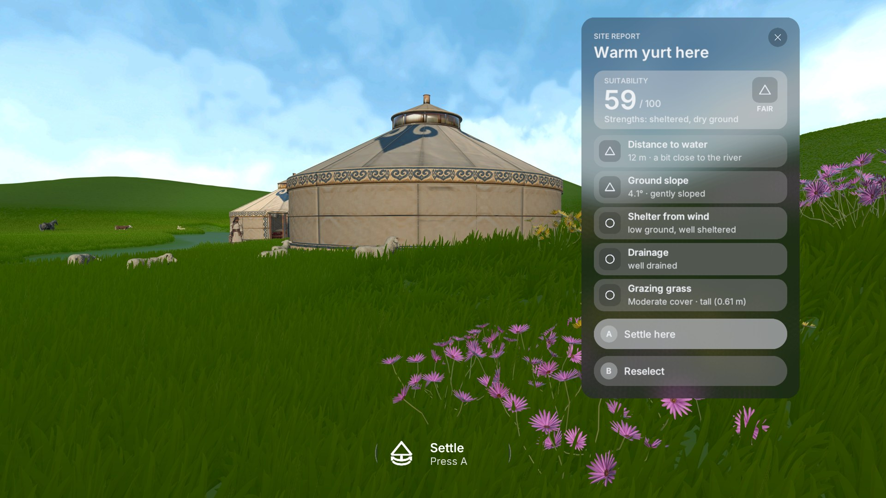

### UI design

**Talking to Bataa.** I wanted players to see the riverbank while Bataa was describing it. I placed the talk prompt beside him and the subtitles just below eye level. The short lines draw on the dialogue in *Red Dead Redemption 2*. White Inter text on a dark, frosted panel keeps the words readable against grass, sky and snow. Pressing A advances the conversation, giving players time to look up between lines.

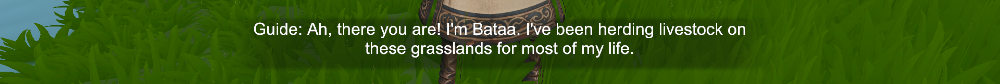

**Reading the pasture in VR.** I kept three controls low in the view: Map, Settle and Guide. Each pairs an icon with its name and controller button. After riding, players can open the guide to compare examples of water, ground, grass and animals. On the map they can pin what they actually saw and filter those pins when comparing places.

**Placing the ger.** The settlement interface reveals one choice at a time. Players point to the ground, see a full-size ger appear and choose its type. I drew the four selection icons from above so the crown, cover and ropes distinguish the roofs at a small size. The final panel lists the conditions behind the score and lets players confirm the site or try another spot.

 <em>Ger roof shapes and settlement icons from Figure 5.22 of the thesis.</em>

[Dialogue and visual references](week10.md) · [Map, guide and settlement screens](week13.md)

### Spring · Warm grassland

**Tutorial · Choose among three plausible camps**

The river is easy to spot from the ridge, and the herd makes the nearest bank an inviting first choice. From that height, though, a level patch and a sloping bank can look equally suitable. Walk down to each candidate, check the ground underfoot and look back towards the grazing animals. The first decision is how much walking to water is worth accepting for a flatter pitch.

 <em>From the ridge, the river gives the player a route to follow.</em>

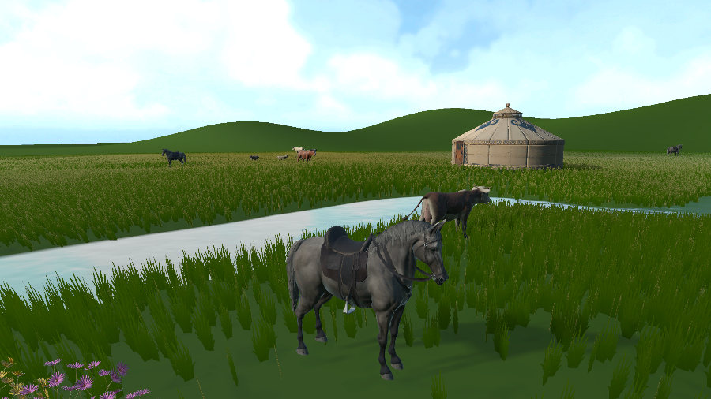 <em>At the bank, the herd brings drinking water and grazing into the same view.</em>

### Summer · Rain and flooding

**Easy · Spot a hollow under tall grass**

Rain and fog shorten the view across the lake basin. Even at close range, tall grass can hide a dip where water will collect. Follow the animals to locate the lake, then walk across the bank and look for a gentle rise. Moving a little uphill can improve drainage, but moving too far makes the journey to water and the herd longer.

 <em>From above, water collects in the low basin.</em>

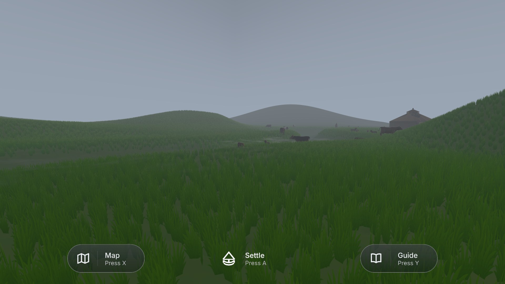 <em>At walking height, summer grass hides small changes in ground level.</em>

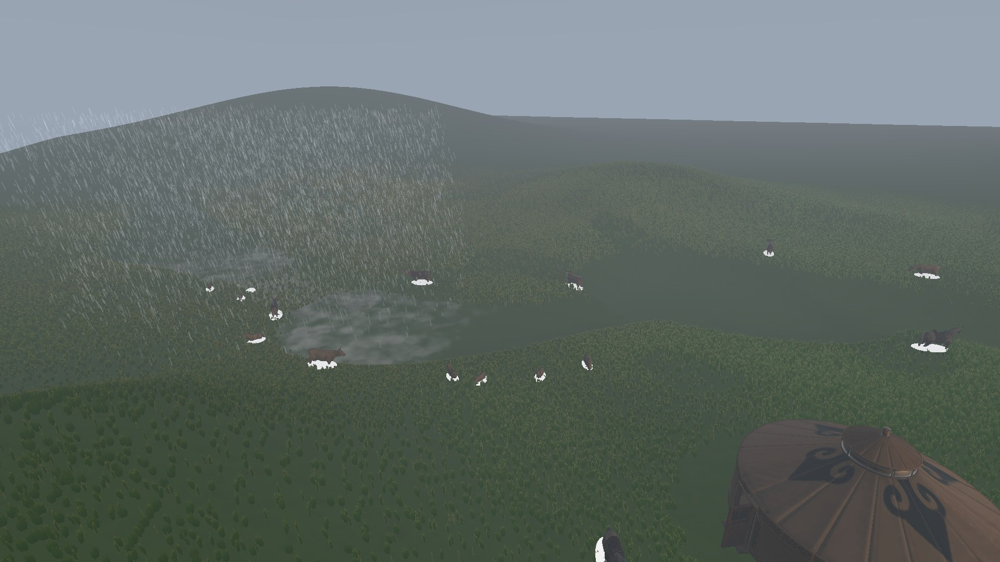 <em>Livestock gather at the lake, giving players a reason to stay within reach of the shore.</em>

### Autumn · Wind and shelter

**Normal · Find a windbreak with a usable route to water**

The ridge that helped players survey the spring pasture is now exposed to gusts. Watch the grass move, then cross to the sheltered side and trace the route back to the river. A site can offer cover while leaving the herd a long walk around the slope. The sheep indicate where forage is available, so their position is one more clue to check before pitching the ger.

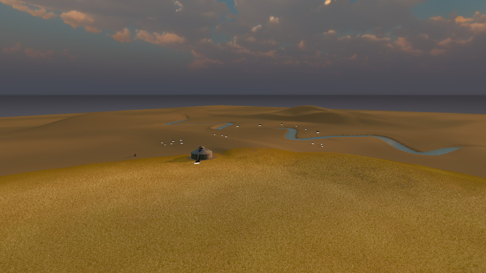 <em>The river bends around the pasture, with higher ground beyond it.</em>

 <em>The sheep mark a grazing patch. Players still need to check wind exposure and water access.</em>

### Winter · Snow and frozen water

**Hard · Keep shelter, reachable water and exposed grass within the same camp area**

A site beside the frozen channel may still be a long walk from drinking water. Follow the bank until there is an open reach, then check whether the herd can get down to it. Snow gathers in deep drifts behind sheltered ridges, while thinner snow on an exposed slope leaves more grass visible. The player has to compare both sides of the ridge and decide which risks the family can manage.

 <em>Only short stretches of river remain open between the ice.</em>

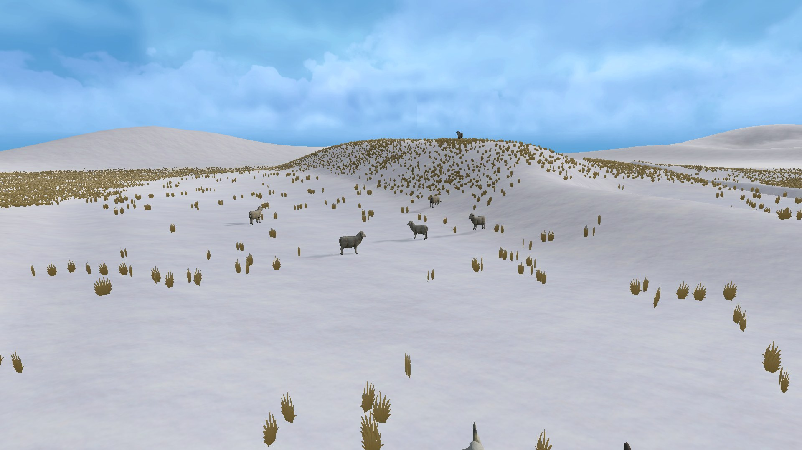 <em>Sheep graze where dry grass shows through shallow snow.</em>

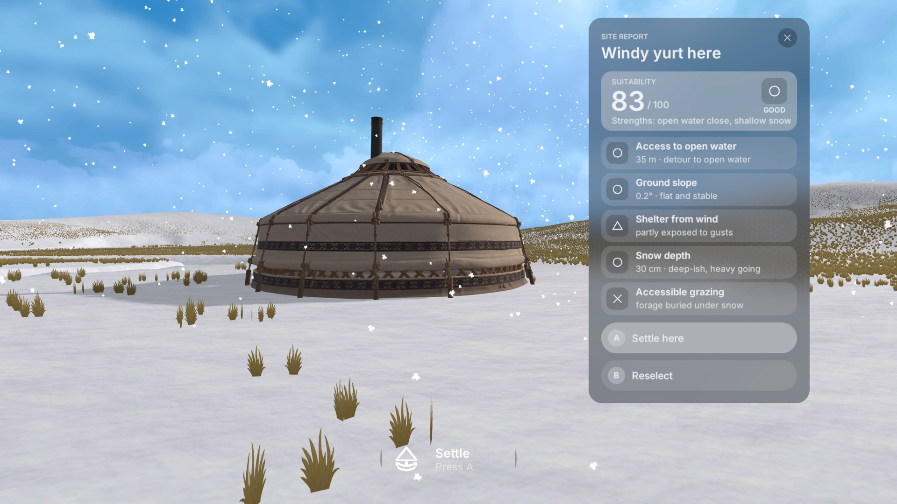 <em>The flat site east of the river scores 83/100 with a wind-resistant ger, although grazing is still poor.</em>

### Designing grass the player can read

I painted short grass along the spring riverbank, about 6–14 cm high, and used tufts around 80 cm tall in the meadow. In summer, grass around 50–100 cm high can hide a shallow hollow. Autumn grass reaches about 140 cm in places, making gusts easy to follow across the field. In winter, dry grass is roughly 10–50 cm high before snow cover. The tufts still visible above the snow give the player a reason to stop and inspect a patch.

To judge how much of that difference would be visible from the headset, I set up two small test plots with the same camera position. First I kept the number of tufts fixed and changed their height from 14 to 90 cm. Then I kept the height fixed and compared 30 tufts with 180 over the same area. This helped me tune two separate clues: how far the player can see through the grass, and how much ground the plants actually cover.

 &nbsp;  <em>Same tuft count and viewpoint, with only the grass height changed.</em>

## 5. How the campsite score works

When you mark a site, the evaluator samples the terrain around the pin. It checks water access, slope, drainage, wind shelter and grass. Grass height and density each contribute half of the grass value. The selected ger sets the starting weight of each factor.

### Ground slope and drainage

I scored the angle under the ger separately from the shape of the surrounding ground. A site at **2° or less** receives the full flatness score. Between **2° and 6°**, that score falls gradually, reaching zero at **6°**. Above **8°**, the prototype caps the overall site score at **30/100**. I chose these thresholds so players could compare nearby pitches in the game.

A hollow can have an almost level floor and still collect rain. For the summer chapter, the evaluator also compares the height of the marked point with the land around it. That is why the site report has separate rows for slope and drainage, and why walking a few metres uphill can improve a camp even if the two pitches look equally flat.

### Ger type and seasonal weights

| Ger type | Water | Flat ground | Dryness | Wind shelter | Grass |
|---|---:|---:|---:|---:|---:|
| Warm / standard | 30% | 25% | 20% | 10% | 15% |
| Wind-resistant | 20% | 20% | 15% | 35% | 10% |
| Rain-resistant | 15% | 25% | 40% | 5% | 15% |
| Cold / insulated | 30% | 15% | 15% | 15% | 25% |

Summer and autumn adjust the base score for the weather. In summer, the base contributes 40% and the seasonal factors contribute 60%, including flood risk and distance to the herd. Winter uses its own calculation for snow, forage, shelter and reachable water. A difficult walk to open water can cap the score even when the river looks close.

In the summer trial below, the same ger scored **53** in a grassy hollow and **82** on slightly raised ground west of the lake. Rain collects in the hollow. The higher site drains well and is within easy reach of water. The report lets the player see what they gained and gave up by moving.

 <em>Grassy hollow · 53/100. Rain collects here.</em>

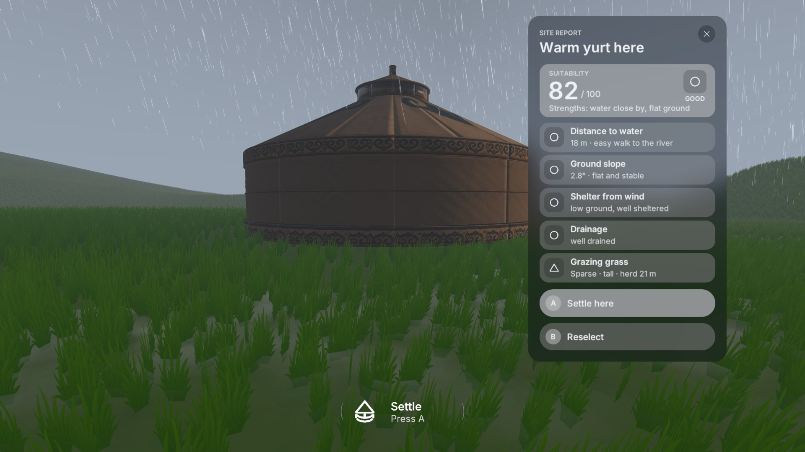 <em>Rise west of the lake · 82/100. The ground drains well.</em>

[Read the scoring code and calibration notes](week14.md)

## 6. Playtesting and feedback

Five people tried the game with a headset and controllers. After the session, I asked them to describe their task and explain how they chose a campsite. Three understood that they were finding a new home for the family. One missed that goal, and the fifth response was too brief to interpret.

  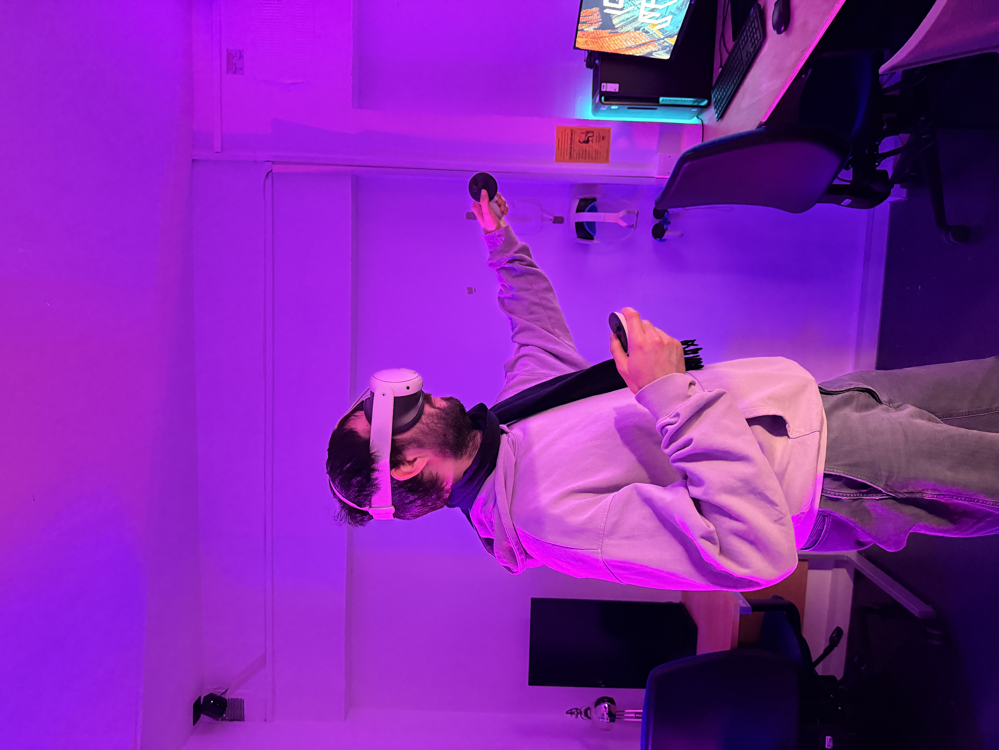  

| What players reported | What I would change |
|---|---|
| Three felt dizzy or uncomfortable. | Offer a more comfortable movement option. |
| Two found it difficult to choose a site. | Ask players to compare two places and name the clue that guided their choice before showing the score. |
| Two found the repeated journey monotonous. | Shorten the return trip after players finish marking the map. |

Each player could report more than one difficulty. In a follow-up session, I would use an unfamiliar map to see whether players can explain a fresh decision using what they noticed on the first patrol.

 &nbsp;  <em>Projected game dialogue during a test session · Projected grassland and livestock during a test session</em>

