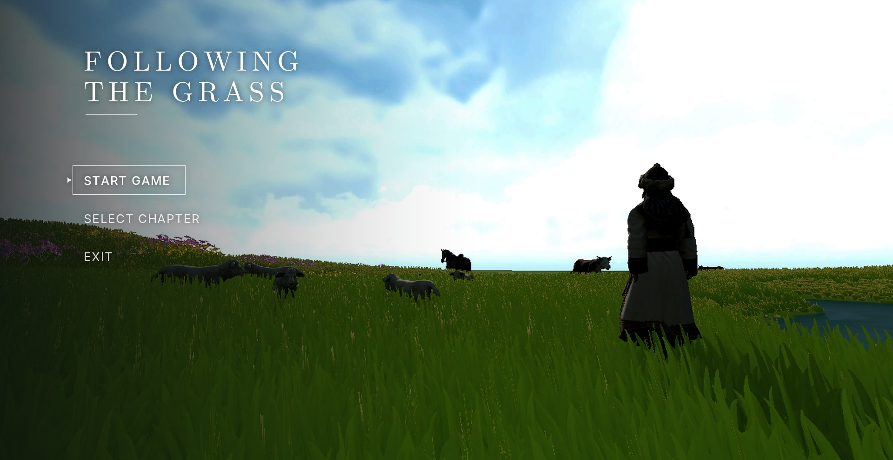
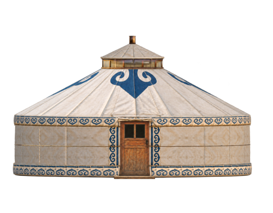
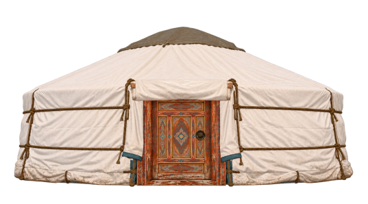
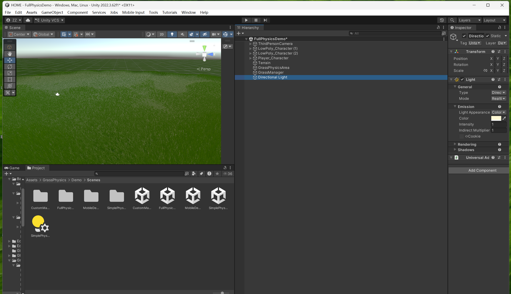
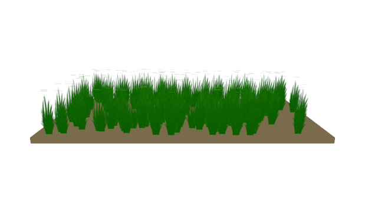
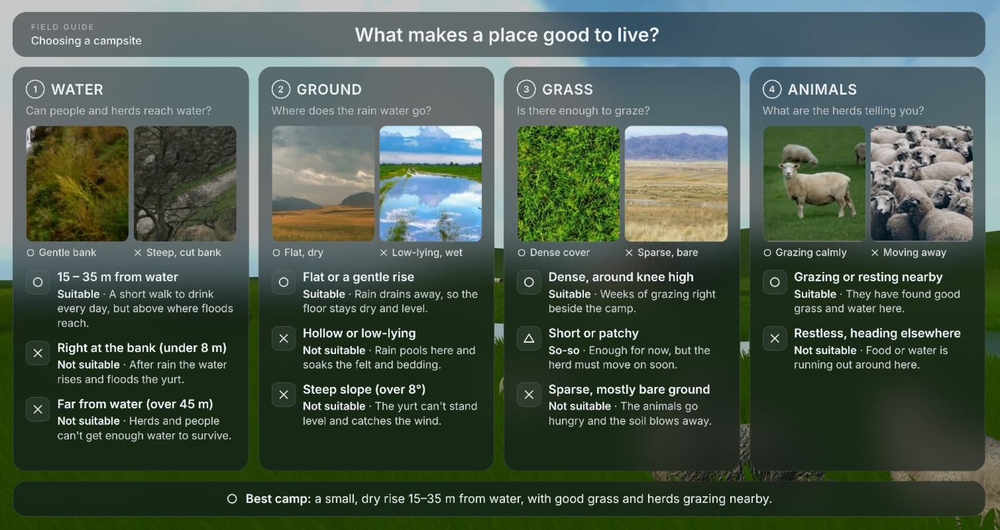
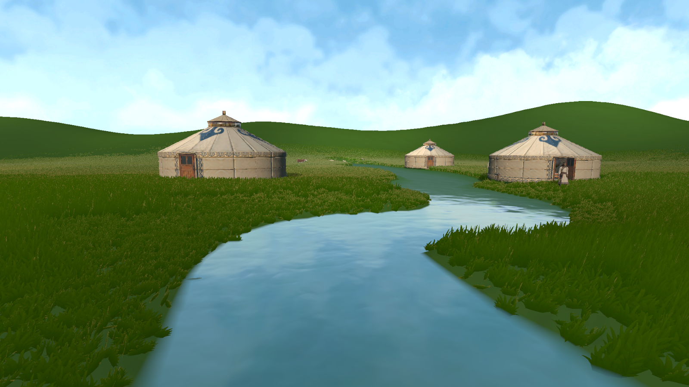
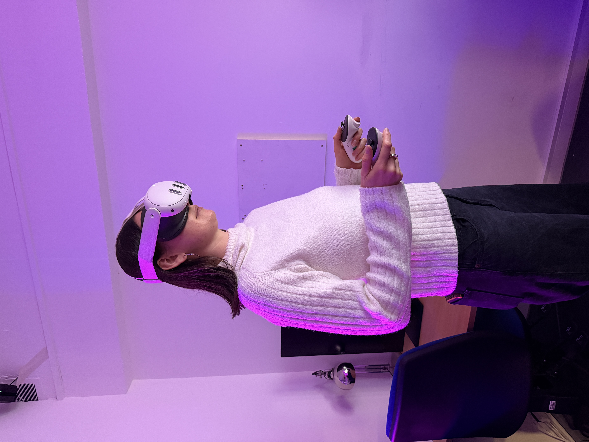
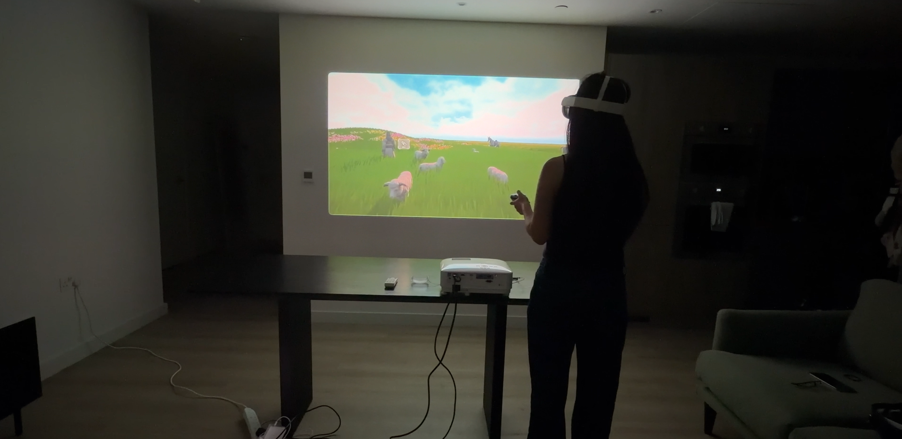

# Following the Grass — Where Should We Move Our Home?

### A VR game about Mongolian seasonal camp selection, where players follow a herd, read the landscape and choose where to move their home.



## Table of Contents

- **YouTube walkthrough** <!-- Add the YouTube URL here -->
- **Playable game build** <!-- Add the game download URL here -->
- **Unity project files** <!-- Add the project URL here -->

---

## 1. Why I Created This Work

### The Core Question

**How can someone with little experience of herding learn to judge a campsite by looking, listening and moving through the land?**

During my visit to Mongolia, I noticed how differently people could read the same grassland. I saw an open view. The herders I spoke to were thinking about where their animals could drink and what pasture would still be available as the weather changed. I chose moving camp as the task because it gives the player a practical reason to look twice at the land.


*Ger near Mandalgovi, Mongolia. Photograph by Fischer (2010), [CC BY-SA 2.0](https://commons.wikimedia.org/wiki/File:Mongolian_Ger.jpg).*

#### Table 3.1  Tourist and herder perspectives on the same grassland

| Dimension | Tourist perspective | Herder perspective |
|---|---|---|
| Focus | Whether the scenery is open and attractive | Whether livestock can graze, drink and survive winter safely |
| Grassland | The lusher the grass, the better | Judged by height, cover and palatability together |
| River | Close to water: convenient and scenic | Convenient for drinking, but low ground, flooding and freezing must be considered |
| Hillslope | Good view, good for photos | Aspect affects wind shelter and sunlight; enough flat space is needed to set up the ger |
| Way of judging | A single intuitive impression | Comparing and trading off several conditions |

### From research to a playable task

I used the research on seasonal movement to decide what the player could learn by walking. A river is easy to spot from a distance. Whether its bank is level, wet or sheltered takes a closer look. I built the patrol around that change of scale, then added a map so players could bring observations from different places back to camp.

<p align="center"><br><em>Observe, interpret, decide and reflect.</em></p>

<p align="center"><br><em>The furnished ger where the spring patrol begins.</em></p>

---

#### Table 3.2  Qualitative importance of environmental factors by season

| Environmental factor | Warm season (spring, summer, autumn) | Cold season (winter) | Literature basis |
|---|---|---|---|
| Pasture | High | Medium | Sections 2.3.2, 2.3.4 |
| Water | High | Medium | Section 2.3.3 |
| Wind shelter and slope aspect | Low | High | Section 2.3.4 |
| Terrain height and flooding | Medium | Low | Section 2.3.3 |
| Flat ground for setting up | Medium | Medium | Section 2.3.4 |

## 2. Technology Used

| Component | What I built with it |
|---|---|
| Blender | Modelled the ger and furniture, checked the decorative bands around the curved wall, and prepared Bataa’s face for speech. |
| Unity Terrain and C# | Built the patrol route and sampled the ground beneath each proposed camp. |
| GrassPhysics and URP water | Set grass height and coverage independently and adjusted the reflection on the river. |
| LipSync Pro | Matched dialogue to mouth movement and checked the result alongside Bataa’s gestures. |
| VR headset and controllers | Let players turn towards sound, approach livestock and mark observations. The project also has a PC version. |

<p align="center">　　<br><em>Blender · Unity</em></p>

---

## 3. Building the home and the grassland

### Building the ger

I modelled the circular wall, roof, central opening and door separately in Blender. I checked the roof poles from above and rotated the wall to align the blue band with the door frame. Four variations make each shelter recognisable during selection.

<p align="center"> &nbsp; <br><em>Standard ger · Wind ropes</em></p>

<p align="center"> &nbsp; <br><em>Rain cover · Winter covering</em></p>

I moved the spring starting point indoors. Furniture follows the curved wall, leaving a clear path to the door. I adjusted the furniture shadows under the light entering through the roof.

<p align="center"> &nbsp; <br><em>Furniture placement · Roof light</em></p>

#### Table 5.1  Ger types and their functions in the prototype

| Ger type | Appearance and top-view icon | Function in the prototype |
|---|---|---|
| Warm (standard) | Blue ring pattern around the central skylight | General evaluation; suited to comparing the conditions of the sites themselves |
| Windy (wind-resistant) | Low profile; roof poles evenly spaced | Reduces the wind-exposure penalty in autumn and winter |
| Rainy (rain-proof) | Dark waterproof cover over the skylight | Reduces the waterlogging penalty in summer |
| Cold (insulated) | Thicker felt; stitching on the inner ring emphasises its thickness | Reduces the penalty for deep snow and low-lying cold ground in winter |

### A landscape players can read

I used free assets for the environment and livestock alongside my ger, furniture and character models. GrassPhysics mesh patches let me cover the terrain with moving grass. I adjusted height and coverage independently, enlarged the map and shaped the river channel. With the skybox in place, I tuned the URP water material so the river reflected the sky.

<p align="center"> &nbsp; <br><em>Grass setup · River material</em></p>

<p align="center"><br><em>Three candidate sites</em></p>

<p align="center"> &nbsp; <br><em>Short grass at fixed density · Tall grass at the same density</em></p>

---

#### Table 5.2  Grass parameters in the scenes and in scoring

| Item | Spring | Summer | Autumn | Winter |
|---|---|---|---|---|
| Grass height in the scene | Low grass near the river 6–14 cm; tall tufts about 80 cm | About 50–100 cm | Up to about 140 cm | Dry grass about 10–50 cm, partly covered by snow |
| Grass sampling | About 12 m around the candidate site | Same as spring | Same as spring | Grass visible above the snow surface |
| Grass sub-score | Density and height weighted 50% each | Same as spring | Same as spring | Based on visible grass density |
| Engine scoring range | Density 5–14; height 0.12–0.50 m | Same as spring | Same as spring | Visible density 1–5 |

## 4. Designing the patrol

#### Table 3.3  Game stages and their roles in the OIDR model

| Game stage | OIDR stage | Role in the framework |
|---|---|---|
| Orientation by the guide inside the ger | Preparation | Introduces controls and the task; lowers the entry barrier |
| Close-range walking observation | Observe | Shows the details of grass, water and terrain |
| Riding patrol | Observe | Reaches more locations and shows terrain at a larger scale |
| Map marking and recording | Interpret | Organises scattered observations into comparable evidence |
| Camp-moving decision | Decide | Choice based on the information the player has recorded |
| Explanatory feedback and review | Reflect | Shows the advantages and risks of the choice and prompts the player to re-examine the judgement |

### The playable route

| Step | Action | What it reveals |
|---|---|---|
| 1 | Leave the ger and meet Bataa. | The family needs a new home. |
| 2 | Follow the flock to the river. | Water and grazing coincide here. |
| 3 | Climb the ridge and ride between sites. | The higher viewpoint reveals the route back to water. |
| 4 | Mark places on the map and consult the field guide. | The player can compare observations made far apart. |
| 5 | Select a site and ger, then read the report. | The choice has consequences for shelter, drainage and access. |

<p align="center"> &nbsp; <br><em>Meeting the guide · Approaching the flock</em></p>

<p align="center"><br><em>Riding</em></p>

### Why the patrol starts at home

I first considered starting outside the ger. Moving the starting point indoors made the final choice easier to understand. The player sees the furniture, walks through the doorway and meets Bataa outside. Later, when the map asks where to settle, the player already knows what they are moving.

### Dialogue and gesture

I wrote short prompts around what players can see. At the river, Bataa asks them to consider more than the distance to water. I aligned facial topology in Blender with the Unity lip-sync setup and tested the speaking and pointing animations. The closed mouth texture leaves little detail visible when the lips part.

<p align="center"><br><em>Bataa character design</em></p>

### Recording observations

I kept dialogue panels translucent so the landscape stays visible behind the subtitles. Map pins record where an observation was made. The field guide explains what to look for. At settlement, roof outlines help players recognise the four ger types from above.

<p align="center"> &nbsp; <br><em>Map markers · Field guide</em></p>

<p align="center"><br><em>Ger selection icons</em></p>

#### Table 5.4  Controls on the VR and PC versions

| Action | VR | PC |
|---|---|---|
| Look around | Turn the head; the headset follows head pose | Move the mouse to rotate the view |
| Steer (walking or riding) | Left thumbstick | W, A, S, D |
| Speed up while riding | Hold the right trigger | Hold the right mouse button |
| Talk or mount | Press right-hand A after the prompt appears | Press E after the prompt appears |
| Pet a sheep | Look at the target sheep and hold the trigger | Hold E after the prompt appears; the nearest sheep is selected |

### Finding places by ear

I built the soundscape around three listening positions. Wind and grass become clearer on leaving the ger. The river grows louder on approach, giving players a sense of distance even while they look towards the herd.

<p align="center"> &nbsp; <br><em>Doorway · Meadow</em></p>

<p align="center"><br><em>Riverbank</em></p>

### What changes each season

| Spring | Summer rain | Autumn wind | Winter snow |
|---|---|---|---|
| Use the river and herd to learn the route. | Tall grass hides hollows. Inspect the ground for drainage. | Compare an exposed ridge with a sheltered route to water. | Trace the frozen channel to open water and check the remaining grazing. |

<p align="center"> &nbsp; <br><em>Spring ridge · Summer basin</em></p>

<p align="center"> &nbsp; <br><em>Autumn pasture · Winter open water</em></p>

---

## 5. Terrain → Campsite Score

### Reading the terrain

**Map pin → terrain sample → environmental factors → seasonal rules → campsite report**

#### Table 5.3  Terrain, water, wind and livestock parameters by level

| Design variable | Value or condition | Effect on site choice |
|---|---|---|
| Ground slope | ≤2°: full flatness score; ≥6°: zero; above 8°: total score capped at 30 | Flat ground and surrounding drainage are scored separately |
| Relative elevation | Compared with the surroundings within 10 m (spring) and 15 m (summer) | Identifies hollows lower than their surroundings |
| Distance to water | Full score at 15–60 m (spring) and 12–35 m (summer) | The suitable range narrows in summer; waterlogging risk is checked at the same time |
| Water route | Autumn: total score limited when the detour exceeds 70 m; winter: three open-water sections | Autumn and winter are scored by walking route; winter adds a snow-depth cost |
| Wind direction and shelter | Fixed westerly wind; terrain sampled every 4 m upwind, up to 80 m | Earth banks and river banks change the exposure of a candidate site |
| Sheep sheltering | Shelter when wind strength >0.78 for 3 s; return when <0.50 for 8 s | Guides players to look for sheltered positions |
| Summer herd distance | Full score if the nearest livestock is ≤20 m away; zero at ≥55 m | The benefit of being near the herd must be weighed against basin waterlogging risk |

### Grass mapping

The evaluator samples the selected point on Unity Terrain. Height and density each contribute half the grass value. This lets a dense patch of short grass score differently from equally dense tall grass.

> ```csharp
> float cGrass = 0.5f * Ramp(grassDensity, 5f, 14f)
>              + 0.5f * Ramp(grassHeight, 0.12f, 0.50f);
> ```

### Ger type and scoring weights

| Ger type | Water | Flat ground | Dryness | Wind shelter | Grass |
|---|---:|---:|---:|---:|---:|
| Warm / standard | 30% | 25% | 20% | 10% | 15% |
| Wind-resistant | 20% | 20% | 15% | 35% | 10% |
| Rain-resistant | 15% | 25% | 40% | 5% | 15% |
| Cold / insulated | 30% | 15% | 15% | 15% | 25% |

These are my base weights for the game. Summer blends 40% of the house score with 60% seasonal factors, including flood risk and herd distance. Autumn emphasises shelter and the route to water. Winter uses a separate formula for accessible resources. [Scoring code and calibration](week14.md)

<p align="center"><br><em>Summer campsite scores. The hollow scored 53 and the raised ground scored 82.</em></p>

<p align="center"><br><em>The two reports show how conditions differed between the summer sites.</em></p>

### Winter changes the route to water

In winter the evaluator estimates a walking route across a two-metre grid. Steep cells block travel and snow raises the cost of crossing. If the estimated walk to water exceeds 90 metres, the code caps the normalised score at 0.45. A site beside a frozen bend can therefore score poorly even when the map shows water nearby.

> ```csharp
> if (r.walkWater > 90f) s = Mathf.Min(s, 0.45f);
> ```

---

## 6. Playtesting

Five players tried the prototype with a headset and controllers. I looked at whether they understood the move and where the experience became difficult.

### Task understanding and player comfort

| Observation | Pilot result |
|---|---|
| Understood the relocation goal | 3 of 5 understood, 1 missed the goal, and 1 record was inconclusive. |
| Dizziness or discomfort | 3 of 5 reported discomfort. |
| Choosing between sites | 2 of 5 found the decision difficult. |
| Repeating the journey | 2 of 5 found the return trip monotonous. |

A participant could report several difficulties.

#### Table 6.1  Post-play questionnaire (ten items)

| No. | Question | Response format |
|---|---|---|
| 1 | In your own words, what task did this game ask you to complete? | Short answer |
| 2 | When deciding where to camp, what did you notice first? | Short answer; a location may be named |
| 3 | Both sites are near a river; one is low-lying, the other slightly higher. Which would you choose in the rainy season, and why? | Lower / higher / cannot decide yet, with an explanation |
| 4 | Before submitting a camp site, how confident were you that you could explain your choice? | 1 (not at all confident) to 5 (very confident) |
| 5 | What role did the map markers play when you compared locations? | Short answer; “did not use” allowed |
| 6 | After reading the score report, where would you look at the environment again, and why? | Short answer; “did not view” allowed |
| 7 | Which part of the route was most worth stopping to observe? What did you see? | Short answer; “none” allowed |
| 8 | Which part of the route did you want to skip? What did you already know at that point? | Short answer; “none” allowed |
| 9 | How severe was your physical discomfort at its worst during play? | None / mild / moderate / severe; comments optional |
| 10 | If you felt discomfort, what were you doing the first time, and did you pause or stop afterwards? | Walking / turning / riding / mounting or dismounting / other / cannot recall / no discomfort; comments optional |

### Headset sessions

<p align="center">    </p>

### Projected gameplay sessions

<p align="center"> &nbsp; <br><em>Projected game dialogue during a test session · Projected grassland and livestock during a test session</em></p>

---

#### Table 6.2  Existing play-test feedback and what it can support (qualitative summary)

| Feedback theme | Existing feedback | Question still to verify |
|---|---|---|
| Task understanding | 3 players understood, 1 did not, 1 had an insufficient record | Can players independently explain camp-moving conditions at a new site? |
| Site judgement | 2 players reported difficulty judging which site is more habitable | Was the height difference not visible, or hard to weigh once it was seen? |
| Motion comfort | 3 players reported motion sickness | Which action first triggered the discomfort, and did it change the later route? |
| Exploration pace | 2 players found the repeated back-and-forth monotonous | Is it the travel time, or does the return trip offer no new judgement to make? |

## 7. Core Contribution of the Work

**The player chooses where to put a home they have already lived in.** The doorway, herd and river encountered during the first walk all matter again when placing the ger.

The scoring system connects a player’s observation to a consequence they can inspect. In summer, a green riverbank offers grazing but may collect rain. In winter, the same stretch of river prompts a different question: how far would the family have to walk to reach open water? Comparing those decisions is the central interaction of the project.

---

## 8. Limitations & Future Improvements

| Current limit | Next revision |
|---|---|
| Discomfort and repetitive travel interrupted exploration. | Offer a more comfortable movement option and shorten the return ride. |
| A score records a choice but leaves the player’s reason unknown. | Ask for a reason before revealing the report, then repeat on an unfamiliar map. |
| Five sessions give limited evidence of learning. | Run a larger follow-up and compare the clues players use across maps. |
| The four chapters simplify local practice. | Review the terrain cues and seasonal trade-offs with herders. |

#### Weekly production notes

- [Week 01 — Initial Research and Reflection](week1.md)
- [Week 02 — Choosing a Direction](week2.md)
- [Week 03 — Research and Early Game Direction](week3.md)
- [Week 04 — Researching a Living Pasture](week4.md)
- [Week 05 — Four Seasons, One Decision](week5.md)
- [Week 06 — Modeling](week6.md)
- [Week 07 — Spring Grassland Blockout](week7.md)
- [Week 08 — Landscape Tuning and Ger Interior](week8.md)
- [Week 09 — Establishing the Grassland and Player Route](week9.md)
- [Week 10 — Dialogue UI, Subtitles and Lip Sync](week10.md)
- [Week 11 — Designing the Grassland Soundscape](week11.md)
- [Week 12 — Making the Whole Flow Work](week12.md)
- [Week 13 — UI Design Across the Game](week13.md)
- [Week 14 — The Campsite Score: Making the Core Decision Work](week14.md)
- [Week 15 — The Summer Chapter](week15.md)
- [Week 16 — Wind, Grass and Choosing an Autumn Camp](week16.md)
- [Week 17 — The Winter Chapter](week17.md)
- [Week 18 — Cover and Level Select Design](week18.md)
- [Week 19 — Four Seasons, Four Sets of Rules](week19.md)

## References

Braun, V. and Clarke, V. (2006) ‘Using thematic analysis in psychology’, *Qualitative Research in Psychology*, 3(2), pp. 77–101. https://doi.org/10.1191/1478088706qp063oa

Johnson-Glenberg, M.C. (2018) ‘Immersive VR and education: embodied design principles that include gesture and hand controls’, *Frontiers in Robotics and AI*, 5, article 81. https://doi.org/10.3389/frobt.2018.00081

Jensen, L. and Konradsen, F. (2018) ‘A review of the use of virtual reality head-mounted displays in education and training’, *Education and Information Technologies*, 23, pp. 1515–1529. https://doi.org/10.1007/s10639-017-9676-0

Kolb, D.A. (1984) *Experiential learning: experience as the source of learning and development*. Englewood Cliffs, NJ: Prentice-Hall.

Michler, L.M. et al. (2022) ‘Moving toward the greener side: environmental aspects guiding pastoral mobility and impacting vegetation in the Dzungarian Gobi, Mongolia’, *Rangeland Ecology & Management*, 83, pp. 149–160. https://doi.org/10.1016/j.rama.2022.03.006

Ono, C. and Ishikawa, M. (2020) ‘Pastoralists’ herding strategies and camp selection in the local commons—a case study of pastoral societies in Mongolia’, *Land*, 9(12), article 496. https://doi.org/10.3390/land9120496

Tsovoodavaa, G., Shih, R.R.L., Bonjar, M.R.G. and Kistelegdi, I. (2018) ‘A review and systemization of the traditional Mongolian yurt (GER)’, *Pollack Periodica*, 13(3), pp. 19–30. https://doi.org/10.1556/606.2018.13.3.3

UNESCO (2013) *Traditional craftsmanship of the Mongol Ger and its associated customs*. https://ich.unesco.org/en/RL/00872
