# Following the Grass

**Choosing a seasonal camp on the Mongolian grassland** · Jiayue Tao · VR and PC


| Game build | Walkthrough video | Presentation |
|---|---|---|
| | | |

## Why move camp?

On my visit to Mongolia I could see a river, grass and grazing animals. The herders I spoke with were looking ahead to where their families could move. I wanted players to stand on the same riverbank and have a reason to ask whether it would make a good home.

| The river, camps and herd | Reading the pasture from horseback |
|---|---|
|  |  |

## Research into play

| Research | Design choice | Player action |
|---|---|---|
| Ono and Ishikawa (2020), Michler et al. (2022) describe how pasture and water shape camp selection. | Give each site advantages and drawbacks. | Compare a convenient riverbank with drier ground. |
| Kolb (1984) and Johnson-Glenberg (2018) connect action with learning. | Show feedback after the decision. | Observe, mark a site, commit and review. |
| UNESCO (2013) and Tsovoodavaa et al. (2018) document ger construction. | Make the portable home the starting point. | Walk out of the dwelling you will later relocate. |

| Observation and decision cycle | Interior of the portable home |
|---|---|
|  |  |

## Building the ger

I modelled the circular wall, roof, central opening and door separately in Blender. I checked the roof poles from above and rotated the wall to align the blue band with the door frame. Four variations make each shelter recognisable during selection.

| Standard ger | Wind ropes | Rain cover | Winter covering |
|---|---|---|---|
|  |  |  | 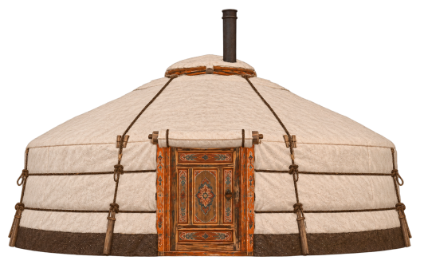 |

I moved the spring starting point indoors. Furniture follows the curved wall, leaving a clear path to the door. I adjusted the furniture shadows under the light entering through the roof.

| Furniture placement | Roof light |
|---|---|
|  | 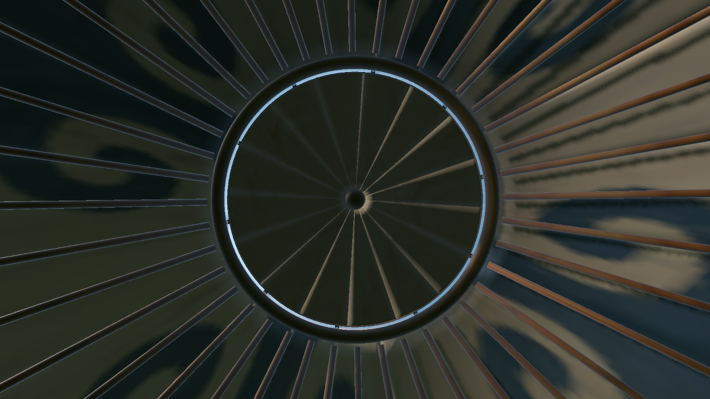 |

## Making Bataa speak

I wrote short prompts around what players can see. At the river, Bataa asks them to consider more than the distance to water. I aligned facial topology in Blender with the Unity lip-sync setup and tested the speaking and pointing animations. The closed mouth texture leaves little detail visible when the lips part.

| Character design | Facial topology and lip sync | Pointing animation |
|---|---|---|
|  | 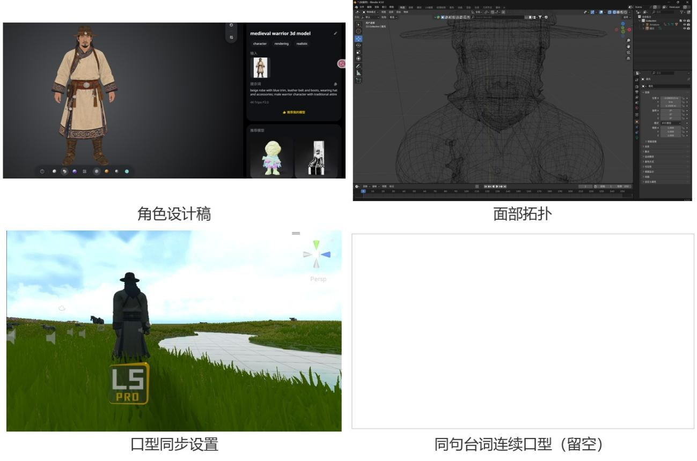 |  |

## Constructing the pasture

I used free assets for the environment and livestock alongside my ger, furniture and character models. GrassPhysics mesh patches let me cover the terrain with moving grass. I adjusted height and coverage independently, enlarged the map and shaped the river channel. With the skybox in place, I tuned the URP water material so the river reflected the sky.

| Grass setup | River material | Three candidate sites |
|---|---|---|
|  |  |  |

| Short grass at fixed density | Tall grass at the same density |
|---|---|
| 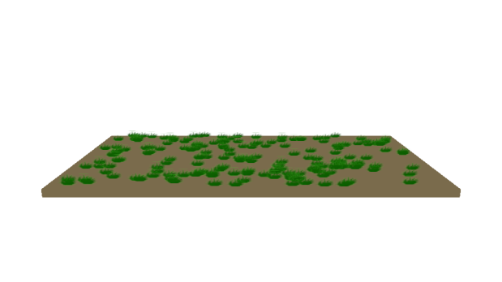 |  |

## From the doorway to a new camp

| Step | Action | What it reveals |
|---|---|---|
| 1 | Leave the ger and meet Bataa. | The family needs a new home. |
| 2 | Follow the flock to the river. | Water and grazing coincide here. |
| 3 | Climb the ridge and ride between sites. | The higher viewpoint reveals the route back to water. |
| 4 | Mark places on the map and consult the field guide. | The player can compare observations made far apart. |
| 5 | Select a site and ger, then read the report. | The choice has consequences for shelter, drainage and access. |

| Meeting the guide | Approaching the flock | Riding |
|---|---|---|
|  | 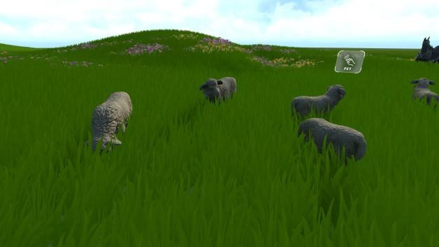 |  |

## Interface and sound

I kept dialogue panels translucent so the landscape stays visible behind the subtitles. Map pins record where an observation was made. The field guide explains what to look for. At settlement, roof outlines help players recognise the four ger types from above.

| Map markers | Field guide | Ger selection icons |
|---|---|---|
| 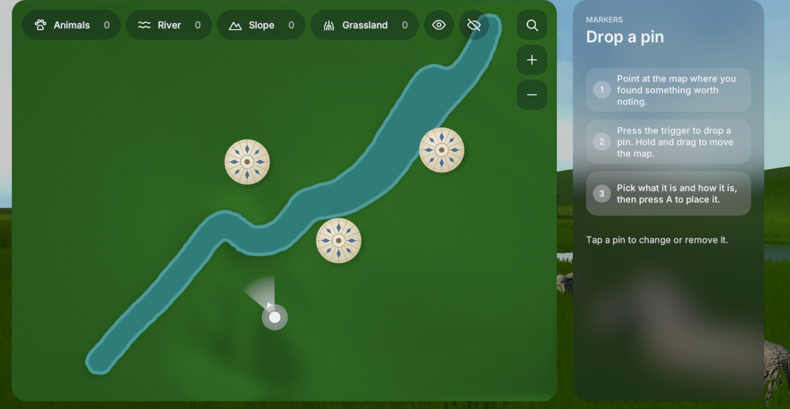 |  | 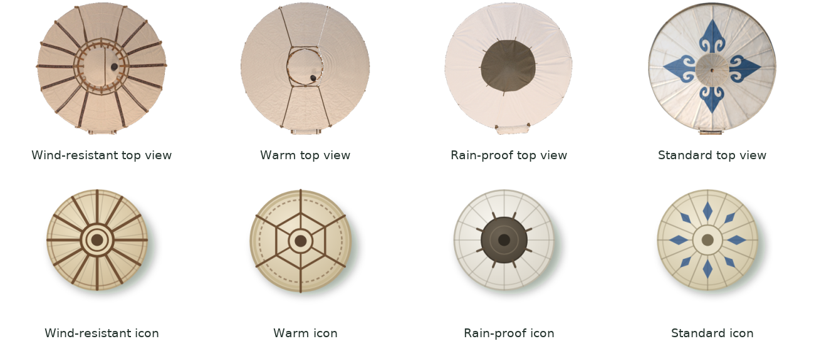 |

I built the soundscape around three listening positions. Wind and grass become clearer on leaving the ger. The river grows louder on approach, giving players a sense of distance even while they look towards the herd.

| Doorway | Meadow | Riverbank |
|---|---|---|
|  | 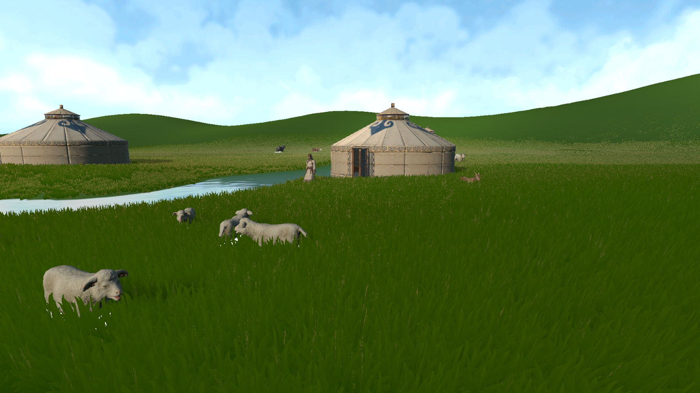 |  |

I developed the cover through several menu layouts. The chapter selector previews the weather before players enter the grassland.

| Early menu | Revised layout | Season selection |
|---|---|---|
|  |  |  |

## Turning terrain into a campsite score

The evaluator samples the selected point on Unity Terrain. Height and density each contribute half the grass value. This lets a dense patch of short grass score differently from equally dense tall grass.

```csharp
float cGrass = 0.5f * Ramp(grassDensity, 5f, 14f)
             + 0.5f * Ramp(grassHeight, 0.12f, 0.50f);
```

| Ger type | Water | Flat ground | Dryness | Wind shelter | Grass |
|---|---:|---:|---:|---:|---:|
| Warm / standard | 30% | 25% | 20% | 10% | 15% |
| Wind-resistant | 20% | 20% | 15% | 35% | 10% |
| Rain-resistant | 15% | 25% | 40% | 5% | 15% |
| Cold / insulated | 30% | 15% | 15% | 15% | 25% |

These are my base weights for the game. Summer blends 40% of the house score with 60% seasonal factors, including flood risk and herd distance. Autumn emphasises shelter and the route to water. Winter uses a separate formula for accessible resources. [Scoring code and calibration](week14.md)

| Summer site comparison | Hollow and raised ground |
|---|---|
|  |  |

## Four seasons, four decisions

| Spring | Summer rain | Autumn wind | Winter snow |
|---|---|---|---|
| Use the river and herd to learn the route. | Tall grass hides hollows. Inspect the ground for drainage. | Compare an exposed ridge with a sheltered route to water. | Trace the frozen channel to open water and check the remaining grazing. |

| Spring ridge | Summer basin | Autumn pasture | Winter open water |
|---|---|---|---|
|  |  |  | 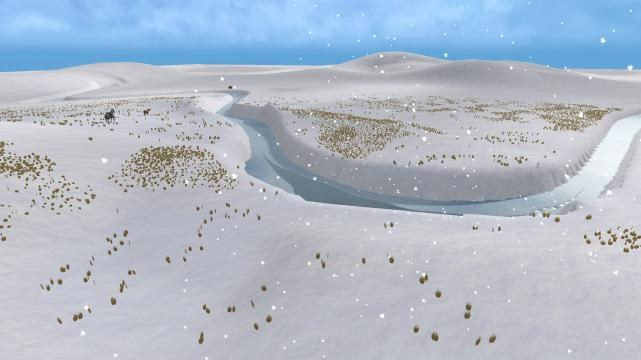 |

## Testing the prototype

Five people tried the prototype. Three understood the relocation task, one missed it and one record was inconclusive. Three reported discomfort, two struggled to choose a site and two found the return journey repetitive. Participants could report several difficulties.

### Headset sessions

<table>
<tr>
<td></td>
<td>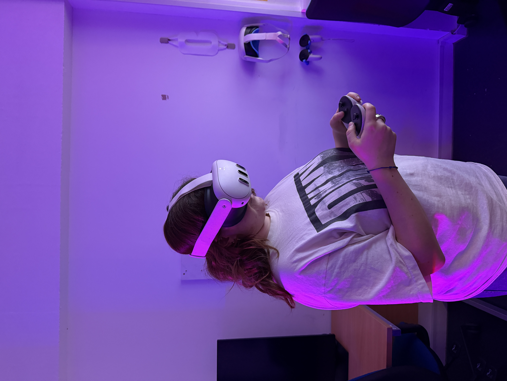</td>
<td></td>
</tr>
<tr>
<td>Headset test session</td>
<td>Headset test session</td>
<td>Controller interaction</td>
</tr>
<tr>
<td></td>
<td>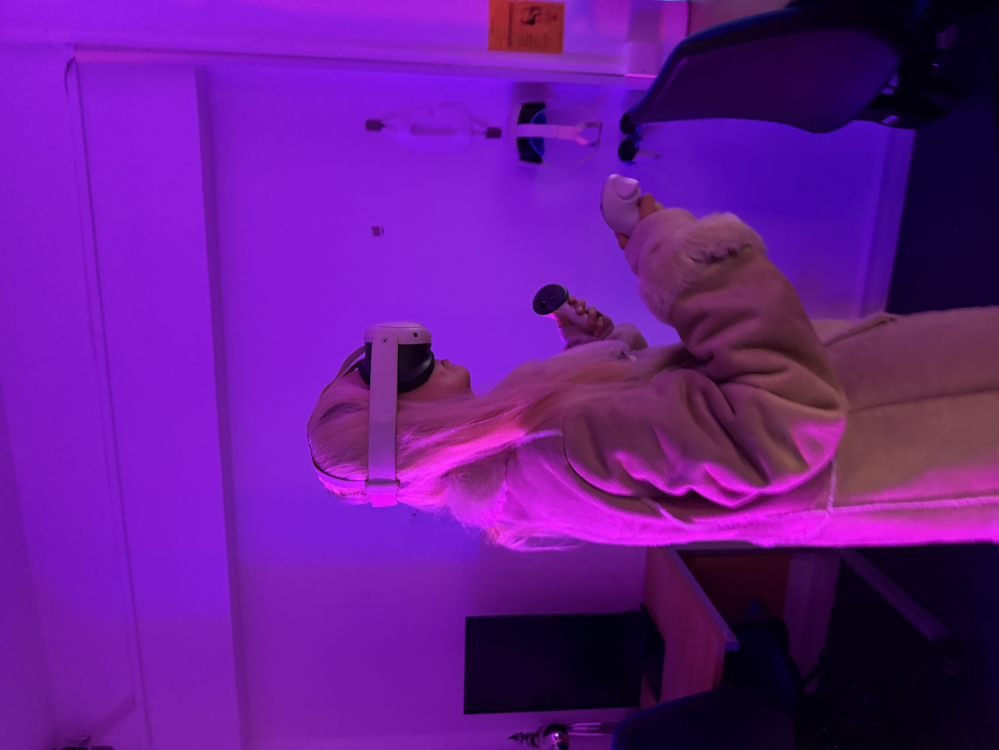</td>
<td></td>
</tr>
<tr>
<td>Headset test session</td>
<td>Controller interaction</td>
<td></td>
</tr>
</table>

### Projected gameplay sessions

<table>
<tr>
<td></td>
<td></td>
</tr>
<tr>
<td>Dialogue and the riverside scene</td>
<td>Grassland and livestock exploration</td>
</tr>
</table>

## Next iteration

Shorten the repeated journey and offer more comfortable movement. Ask players to explain their choice before revealing the score, then see how they judge a site on an unfamiliar map. Review the seasonal cues with herders who can identify local conditions missing from the prototype.

<details><summary>Weekly production notes</summary>

- [Week 01 — Initial Research and Reflection](week1.md)
- [Week 02 — Choosing a Direction](week2.md)
- [Week 03 — Research and Early Game Direction](week3.md)
- [Week 04 — Researching a Living Pasture](week4.md)
- [Week 05 — Four Seasons, One Decision](week5.md)
- [Week 06 — Modeling](week6.md)
- [Week 07 — Spring Grassland Blockout](week7.md)
- [Week 08 — Landscape Tuning and Ger Interior](week8.md)
- [Week 09 — Establishing the Grassland and Player Route](week9.md)
- [Week 10 — Dialogue UI, Subtitles and Lip Sync](week10.md)
- [Week 11 — Designing the Grassland Soundscape](week11.md)
- [Week 12 — Making the Whole Flow Work](week12.md)
- [Week 13 — UI Design Across the Game](week13.md)
- [Week 14 — The Campsite Score: Making the Core Decision Work](week14.md)
- [Week 15 — The Summer Chapter](week15.md)
- [Week 16 — Wind, Grass and Choosing an Autumn Camp](week16.md)
- [Week 17 — The Winter Chapter](week17.md)
- [Week 18 — Cover and Level Select Design](week18.md)
- [Week 19 — Four Seasons, Four Sets of Rules](week19.md)

</details>

## References

Braun, V. and Clarke, V. (2006) ‘Using thematic analysis in psychology’, *Qualitative Research in Psychology*, 3(2), pp. 77–101. https://doi.org/10.1191/1478088706qp063oa

Johnson-Glenberg, M.C. (2018) ‘Immersive VR and education: embodied design principles that include gesture and hand controls’, *Frontiers in Robotics and AI*, 5, article 81. https://doi.org/10.3389/frobt.2018.00081

Jensen, L. and Konradsen, F. (2018) ‘A review of the use of virtual reality head-mounted displays in education and training’, *Education and Information Technologies*, 23, pp. 1515–1529. https://doi.org/10.1007/s10639-017-9676-0

Kolb, D.A. (1984) *Experiential learning: experience as the source of learning and development*. Englewood Cliffs, NJ: Prentice-Hall.

Michler, L.M. et al. (2022) ‘Moving toward the greener side: environmental aspects guiding pastoral mobility and impacting vegetation in the Dzungarian Gobi, Mongolia’, *Rangeland Ecology & Management*, 83, pp. 149–160. https://doi.org/10.1016/j.rama.2022.03.006

Ono, C. and Ishikawa, M. (2020) ‘Pastoralists’ herding strategies and camp selection in the local commons—a case study of pastoral societies in Mongolia’, *Land*, 9(12), article 496. https://doi.org/10.3390/land9120496

Tsovoodavaa, G., Shih, R.R.L., Bonjar, M.R.G. and Kistelegdi, I. (2018) ‘A review and systemization of the traditional Mongolian yurt (GER)’, *Pollack Periodica*, 13(3), pp. 19–30. https://doi.org/10.1556/606.2018.13.3.3

UNESCO (2013) *Traditional craftsmanship of the Mongol Ger and its associated customs*. https://ich.unesco.org/en/RL/00872
