# Following the Grass — Where Should We Move Our Home?

### A VR game about Mongolian seasonal camp selection, where players follow a herd, read the landscape and choose where to move their home.


## Table of Contents

- **YouTube walkthrough** <!-- Add the YouTube URL here -->
- **Playable game build** <!-- Add the game download URL here -->
- **Unity project files** <!-- Add the project URL here -->

---

## 1. Why I Created This Work

### The Core Question

**How can someone with little experience of herding learn to judge a campsite by looking, listening and moving through the land?**

On my visit to Mongolia I could see a river, grass and grazing animals. The herders I spoke with were looking ahead to where their families could move. I wanted players to stand on the same riverbank and have a reason to ask whether it would make a good home.

<p align="center">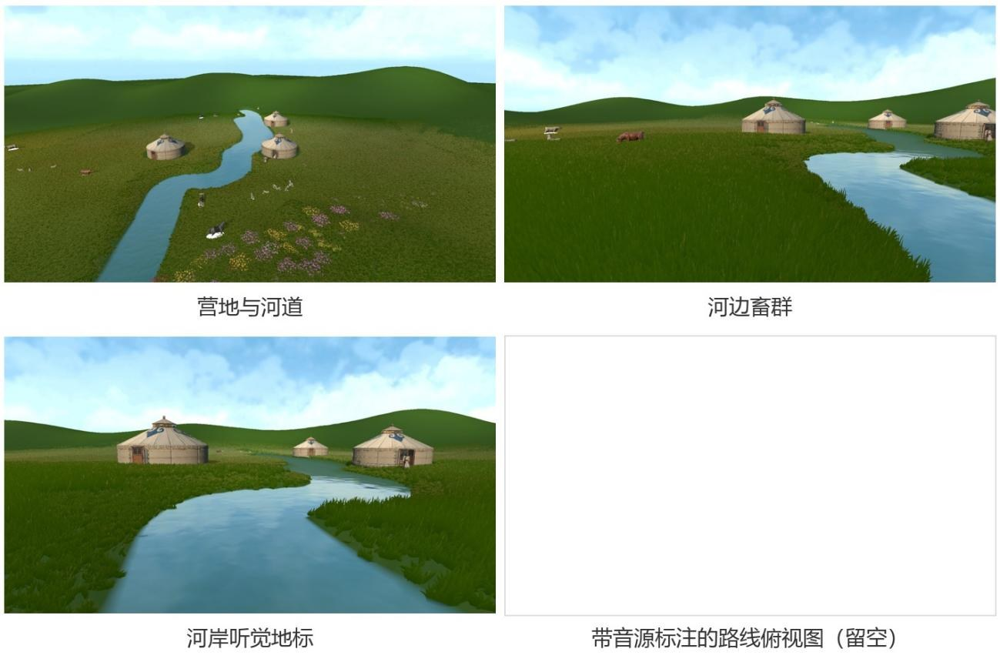 &nbsp; 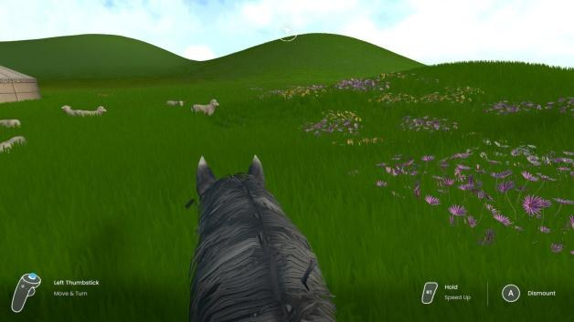<br><em>The river, camps and herd · Reading the pasture from horseback</em></p>

### What the literature changed in the game

| Research | Design choice | Player action |
|---|---|---|
| Ono and Ishikawa (2020), Michler et al. (2022) describe how pasture and water shape camp selection. | Give each site advantages and drawbacks. | Compare a convenient riverbank with drier ground. |
| Kolb (1984) and Johnson-Glenberg (2018) connect action with learning. | Show feedback after the decision. | Observe, mark a site, commit and review. |
| UNESCO (2013) and Tsovoodavaa et al. (2018) document ger construction. | Make the portable home the starting point. | Walk out of the dwelling you will later relocate. |

<p align="center">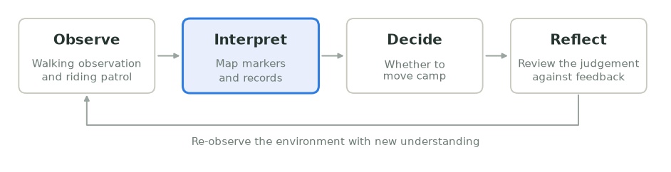 &nbsp; 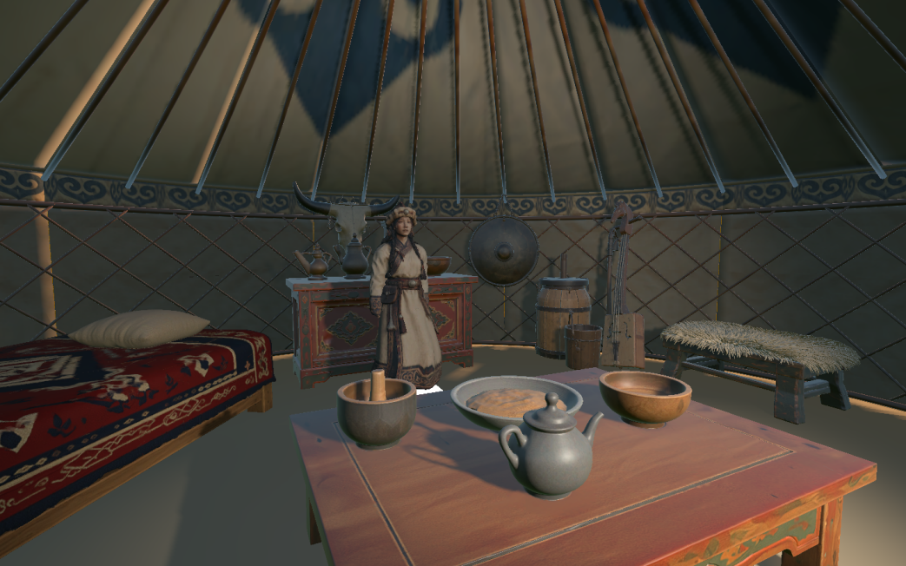<br><em>Observation and decision cycle · Interior of the portable home</em></p>

---

## 2. Technology Used

| Component | What I built with it |
|---|---|
| Blender | Modelled the ger and furniture, checked the decorative bands around the curved wall, and prepared Bataa’s face for speech. |
| Unity Terrain and C# | Built the patrol route and sampled the ground beneath each proposed camp. |
| GrassPhysics and URP water | Set grass height and coverage independently and adjusted the reflection on the river. |
| LipSync Pro | Matched dialogue to mouth movement and checked the result alongside Bataa’s gestures. |
| VR headset and controllers | Let players turn towards sound, approach livestock and mark observations. The project also has a PC version. |


---

## 3. Visual Style

### Influences

I used photographs of felt, timber doors and roof openings to establish the shared form of the four ger models. The roof silhouette and blue ornament carry my own design choices.

### Themes

**Home and movement.** The ger is the one place players know from the inside before they have to decide where it belongs.

**Reading the land.** Grass height, running water and exposed ridges give players visible clues to compare across chapters.

### Building the ger

I modelled the circular wall, roof, central opening and door separately in Blender. I checked the roof poles from above and rotated the wall to align the blue band with the door frame. Four variations make each shelter recognisable during selection.

<p align="center"> &nbsp; <br><em>Standard ger · Wind ropes</em></p>

<p align="center"> &nbsp; <br><em>Rain cover · Winter covering</em></p>

I moved the spring starting point indoors. Furniture follows the curved wall, leaving a clear path to the door. I adjusted the furniture shadows under the light entering through the roof.

<p align="center"> &nbsp; <br><em>Furniture placement · Roof light</em></p>

### A landscape players can read

I used free assets for the environment and livestock alongside my ger, furniture and character models. GrassPhysics mesh patches let me cover the terrain with moving grass. I adjusted height and coverage independently, enlarged the map and shaped the river channel. With the skybox in place, I tuned the URP water material so the river reflected the sky.

<p align="center"> &nbsp; <br><em>Grass setup · River material</em></p>

<p align="center"><br><em>Three candidate sites</em></p>

<p align="center"> &nbsp; <br><em>Short grass at fixed density · Tall grass at the same density</em></p>

### Cover and chapter selection

I developed the cover through several menu layouts. The chapter selector previews the weather before players enter the grassland.

<p align="center">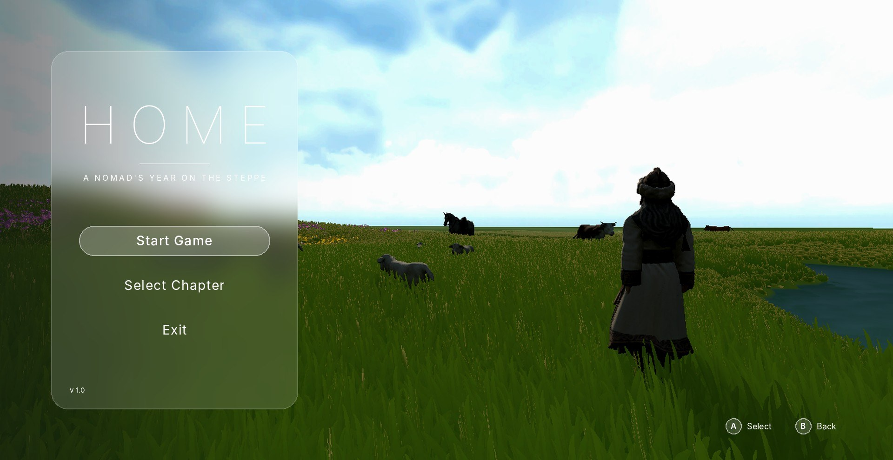 &nbsp; 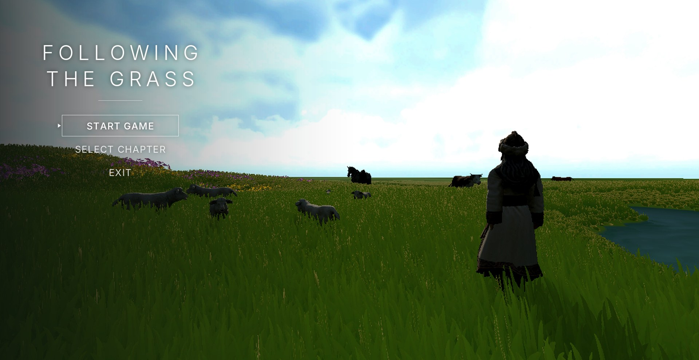<br><em>Early menu · Revised layout</em></p>

<p align="center">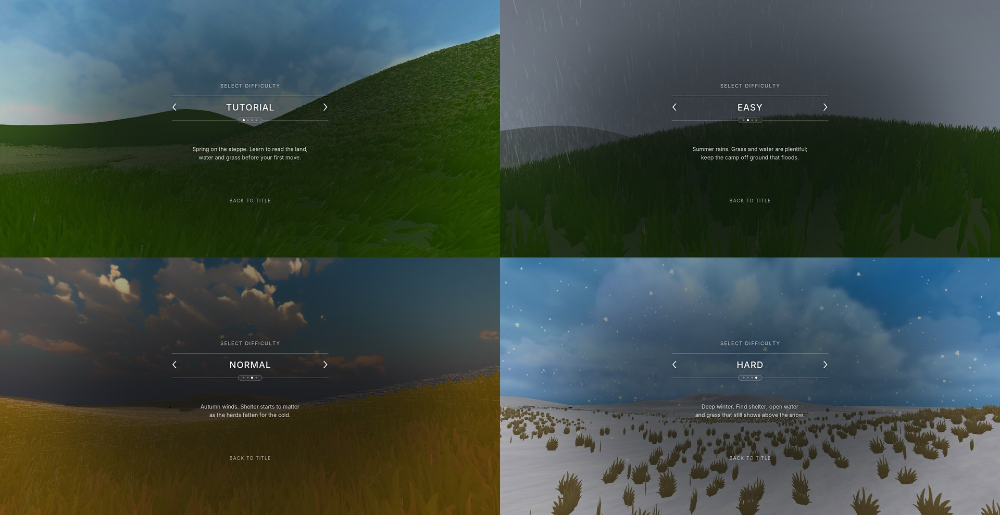<br><em>Season selection</em></p>

---

## 4. Game Structure & Mechanics

### The playable route

| Step | Action | What it reveals |
|---|---|---|
| 1 | Leave the ger and meet Bataa. | The family needs a new home. |
| 2 | Follow the flock to the river. | Water and grazing coincide here. |
| 3 | Climb the ridge and ride between sites. | The higher viewpoint reveals the route back to water. |
| 4 | Mark places on the map and consult the field guide. | The player can compare observations made far apart. |
| 5 | Select a site and ger, then read the report. | The choice has consequences for shelter, drainage and access. |

<p align="center"> &nbsp; <br><em>Meeting the guide · Approaching the flock</em></p>

<p align="center"><br><em>Riding</em></p>

### Narrative

The family is preparing to move. The player starts inside the spring ger, steps out to meet Bataa and follows him to the animals. By the time the player returns to choose a camp, the home they are moving and the herd that needs pasture are both familiar.

### Dialogue and gesture

I wrote short prompts around what players can see. At the river, Bataa asks them to consider more than the distance to water. I aligned facial topology in Blender with the Unity lip-sync setup and tested the speaking and pointing animations. The closed mouth texture leaves little detail visible when the lips part.

<p align="center"> &nbsp; <br><em>Character design · Facial topology and lip sync</em></p>

<p align="center">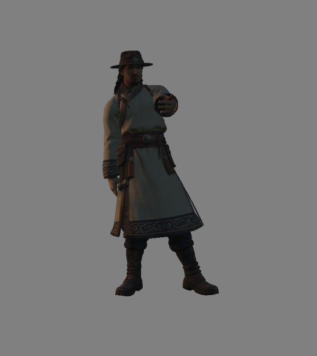<br><em>Pointing animation</em></p>

### Recording observations

I kept dialogue panels translucent so the landscape stays visible behind the subtitles. Map pins record where an observation was made. The field guide explains what to look for. At settlement, roof outlines help players recognise the four ger types from above.

<p align="center"> &nbsp; <br><em>Map markers · Field guide</em></p>

<p align="center"><br><em>Ger selection icons</em></p>

### Finding places by ear

I built the soundscape around three listening positions. Wind and grass become clearer on leaving the ger. The river grows louder on approach, giving players a sense of distance even while they look towards the herd.

<p align="center">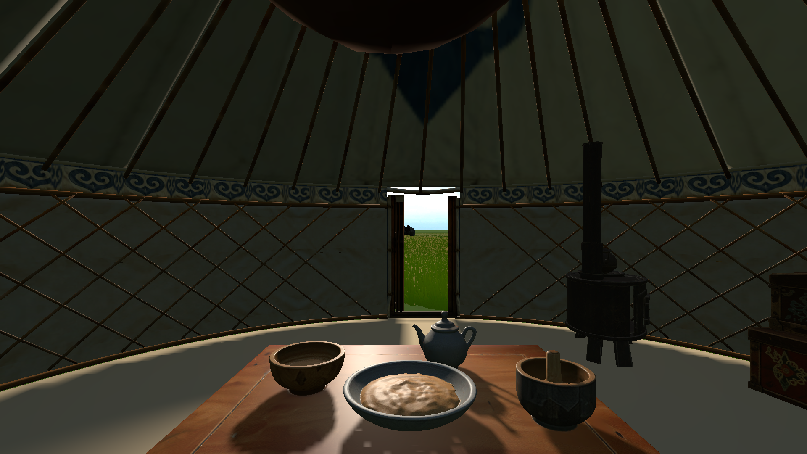 &nbsp; <br><em>Doorway · Meadow</em></p>

<p align="center"><br><em>Riverbank</em></p>

### What changes each season

| Spring | Summer rain | Autumn wind | Winter snow |
|---|---|---|---|
| Use the river and herd to learn the route. | Tall grass hides hollows. Inspect the ground for drainage. | Compare an exposed ridge with a sheltered route to water. | Trace the frozen channel to open water and check the remaining grazing. |

<p align="center"> &nbsp; <br><em>Spring ridge · Summer basin</em></p>

<p align="center">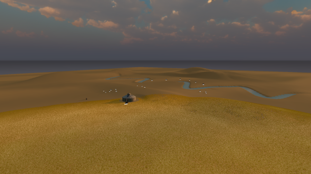 &nbsp; <br><em>Autumn pasture · Winter open water</em></p>

---

## 5. Terrain → Campsite Score

### Reading the terrain

**Map pin → terrain sample → environmental factors → seasonal rules → campsite report**

### Grass mapping

The evaluator samples the selected point on Unity Terrain. Height and density each contribute half the grass value. This lets a dense patch of short grass score differently from equally dense tall grass.

> ```csharp
> float cGrass = 0.5f * Ramp(grassDensity, 5f, 14f)
>              + 0.5f * Ramp(grassHeight, 0.12f, 0.50f);
> ```

### Ger type and scoring weights

| Ger type | Water | Flat ground | Dryness | Wind shelter | Grass |
|---|---:|---:|---:|---:|---:|
| Warm / standard | 30% | 25% | 20% | 10% | 15% |
| Wind-resistant | 20% | 20% | 15% | 35% | 10% |
| Rain-resistant | 15% | 25% | 40% | 5% | 15% |
| Cold / insulated | 30% | 15% | 15% | 15% | 25% |

These are my base weights for the game. Summer blends 40% of the house score with 60% seasonal factors, including flood risk and herd distance. Autumn emphasises shelter and the route to water. Winter uses a separate formula for accessible resources. [Scoring code and calibration](week14.md)

<p align="center">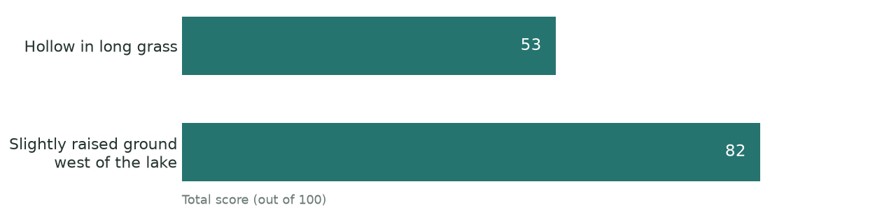 &nbsp; <br><em>Summer site comparison · Hollow and raised ground</em></p>

### Winter changes the route to water

In winter the evaluator estimates a walking route across a two-metre grid. Steep cells block travel and snow raises the cost of crossing. If the estimated walk to water exceeds 90 metres, the code caps the normalised score at 0.45. A site beside a frozen bend can therefore score poorly even when the map shows water nearby.

> ```csharp
> if (r.walkWater > 90f) s = Mathf.Min(s, 0.45f);
> ```

---

## 6. Playtesting

Five players tried the prototype with a headset and controllers. I looked at whether they understood the move and where the experience became difficult.

### Task understanding and player comfort

| Observation | Pilot result |
|---|---|
| Understood the relocation goal | 3 of 5 understood, 1 missed the goal, and 1 record was inconclusive. |
| Dizziness or discomfort | 3 of 5 reported discomfort. |
| Choosing between sites | 2 of 5 found the decision difficult. |
| Repeating the journey | 2 of 5 found the return trip monotonous. |

A participant could report several difficulties.

### Headset sessions

<p align="center"> &nbsp; <br><em>Participant using the VR prototype · Participant wearing a headset during testing</em></p>

<p align="center"> &nbsp; <br><em>Participant holding VR controllers · Side view of a headset test</em></p>

<p align="center"><br><em>Participant using controllers in VR</em></p>

### Projected gameplay sessions

<p align="center">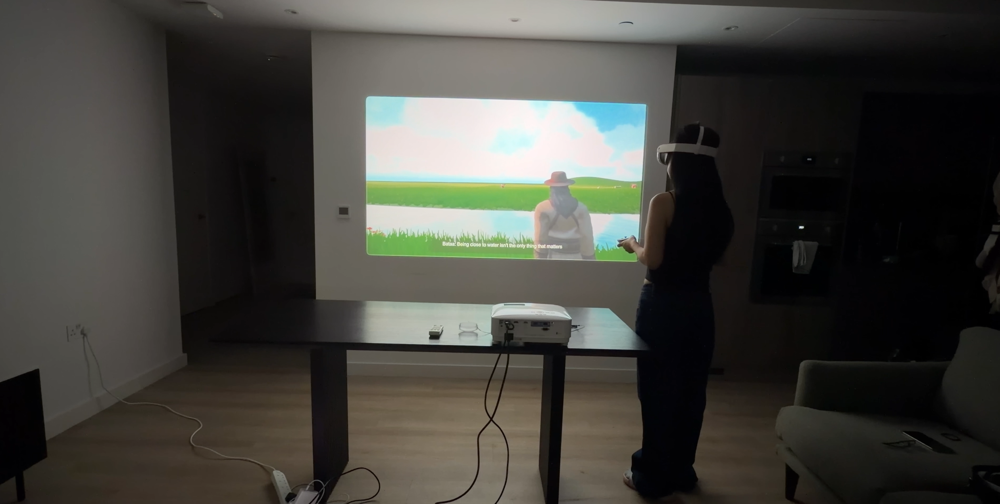 &nbsp; <br><em>Projected game dialogue during a test session · Projected grassland and livestock during a test session</em></p>

---

## 7. Core Contribution of the Work

**The player chooses where to put a home they have already lived in.** The doorway, herd and river encountered during the first walk all matter again when placing the ger.

The scoring system connects a player’s observation to a consequence they can inspect. In summer, a green riverbank offers grazing but may collect rain. In winter, the same stretch of river prompts a different question: how far would the family have to walk to reach open water? Comparing those decisions is the central interaction of the project.

---

## 8. Limitations & Future Improvements

| Current limit | Next revision |
|---|---|
| Discomfort and repetitive travel interrupted exploration. | Offer a more comfortable movement option and shorten the return ride. |
| A score records a choice but leaves the player’s reason unknown. | Ask for a reason before revealing the report, then repeat on an unfamiliar map. |
| Five sessions give limited evidence of learning. | Run a larger follow-up and compare the clues players use across maps. |
| The four chapters simplify local practice. | Review the terrain cues and seasonal trade-offs with herders. |

<details><summary>Weekly production notes</summary>

- [Week 01 — Initial Research and Reflection](week1.md)
- [Week 02 — Choosing a Direction](week2.md)
- [Week 03 — Research and Early Game Direction](week3.md)
- [Week 04 — Researching a Living Pasture](week4.md)
- [Week 05 — Four Seasons, One Decision](week5.md)
- [Week 06 — Modeling](week6.md)
- [Week 07 — Spring Grassland Blockout](week7.md)
- [Week 08 — Landscape Tuning and Ger Interior](week8.md)
- [Week 09 — Establishing the Grassland and Player Route](week9.md)
- [Week 10 — Dialogue UI, Subtitles and Lip Sync](week10.md)
- [Week 11 — Designing the Grassland Soundscape](week11.md)
- [Week 12 — Making the Whole Flow Work](week12.md)
- [Week 13 — UI Design Across the Game](week13.md)
- [Week 14 — The Campsite Score: Making the Core Decision Work](week14.md)
- [Week 15 — The Summer Chapter](week15.md)
- [Week 16 — Wind, Grass and Choosing an Autumn Camp](week16.md)
- [Week 17 — The Winter Chapter](week17.md)
- [Week 18 — Cover and Level Select Design](week18.md)
- [Week 19 — Four Seasons, Four Sets of Rules](week19.md)

</details>

## References

Braun, V. and Clarke, V. (2006) ‘Using thematic analysis in psychology’, *Qualitative Research in Psychology*, 3(2), pp. 77–101. https://doi.org/10.1191/1478088706qp063oa

Johnson-Glenberg, M.C. (2018) ‘Immersive VR and education: embodied design principles that include gesture and hand controls’, *Frontiers in Robotics and AI*, 5, article 81. https://doi.org/10.3389/frobt.2018.00081

Jensen, L. and Konradsen, F. (2018) ‘A review of the use of virtual reality head-mounted displays in education and training’, *Education and Information Technologies*, 23, pp. 1515–1529. https://doi.org/10.1007/s10639-017-9676-0

Kolb, D.A. (1984) *Experiential learning: experience as the source of learning and development*. Englewood Cliffs, NJ: Prentice-Hall.

Michler, L.M. et al. (2022) ‘Moving toward the greener side: environmental aspects guiding pastoral mobility and impacting vegetation in the Dzungarian Gobi, Mongolia’, *Rangeland Ecology & Management*, 83, pp. 149–160. https://doi.org/10.1016/j.rama.2022.03.006

Ono, C. and Ishikawa, M. (2020) ‘Pastoralists’ herding strategies and camp selection in the local commons—a case study of pastoral societies in Mongolia’, *Land*, 9(12), article 496. https://doi.org/10.3390/land9120496

Tsovoodavaa, G., Shih, R.R.L., Bonjar, M.R.G. and Kistelegdi, I. (2018) ‘A review and systemization of the traditional Mongolian yurt (GER)’, *Pollack Periodica*, 13(3), pp. 19–30. https://doi.org/10.1556/606.2018.13.3.3

UNESCO (2013) *Traditional craftsmanship of the Mongol Ger and its associated customs*. https://ich.unesco.org/en/RL/00872
