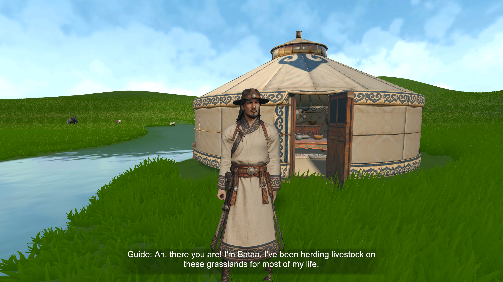
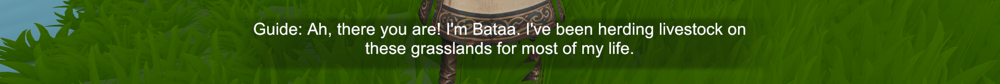
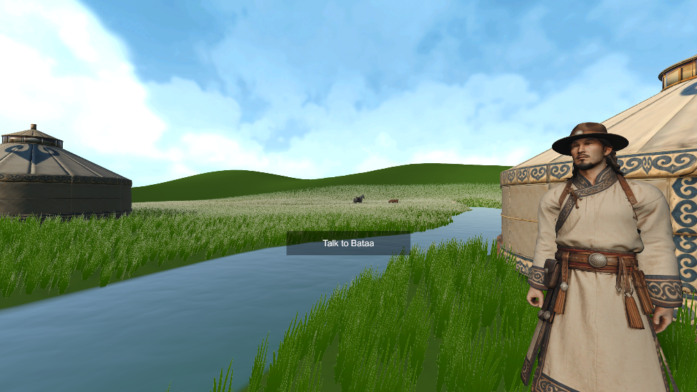
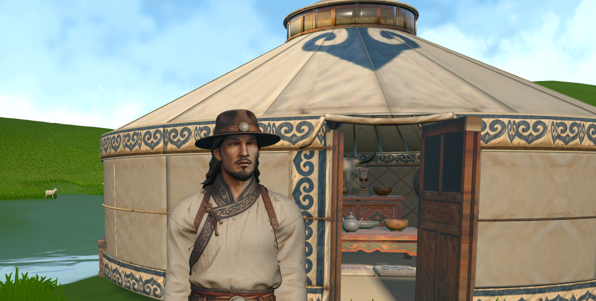

# Week 10 — Dialogue UI, Subtitles and Lip Sync

This week focused on one moment: the first conversation with Bataa, the herder who guides the player through the grassland. The aim was to make that conversation readable in VR, give it a clear purpose, and connect the spoken line to the character's mouth.

## 1. Designing the dialogue UI

*Source files from `Assets/UI/`: the subtitle bar (`dialog_bar.png`), the "continue" arrow (`dialog_arrow.png`) and the TALK interaction icon (`talk_full.png`).*

The dialogue UI has three parts:

- **TALK icon** (`talk_full.png`). A rounded square with corner brackets and a speech-bubble glyph. It appears above Bataa when the player is close enough to talk, so the player knows that he can be interacted with.
- **Subtitle bar** (`dialog_bar.png`). A dark, soft-edged strip. It has no hard frame, so it sits on the scene and does not cover it like a window.
- **Continue arrow** (`dialog_arrow.png`). A small white triangle that shows the line is finished and the player can press A to move on.

The logic is in `GuideGreetingInteraction.cs`, which shows the prompt, steps through the lines and starts the lip-sync clip for each line. The frosted panel style shared with the rest of the UI comes from `UIFrost.cs` and `UIFrostedGlass.shader`. The text uses Inter.

**Design references.** I looked at how VR and narrative games present speech:

- *Half-Life: Alyx* (Valve, 2020) keeps almost all information in the world and uses only small, quiet prompts.
- *The Long Dark* (Hinterland, 2017) uses plain white subtitles on a soft dark band, which stays readable in both snow and daylight.
- *Red Dead Redemption 2* (Rockstar, 2018) uses short, low-placed subtitles with a speaker name and a contextual "talk" prompt near the character.

My version follows the same idea: the world comes first and the UI stays small, neutral and only appears when it is needed.

**Why it looks like this: VR guidelines**

- *Placement and comfort.* Meta advises placing UI at a comfortable distance (around 1–3 m) and within a comfortable field of view, so the player does not need to turn their head or refocus to read it (Meta, 2026b). The subtitle bar sits at a fixed position below the line of sight, and the TALK icon is attached to Bataa's position in the world rather than to the screen.
- *Legibility.* Meta's typography guidance recommends a clear sans-serif font, a large enough size and high contrast, because headset resolution and lens blur make thin or coloured text hard to read (Meta, 2026a). This is why the text is white Inter on a dark band, with no coloured text.
- *Calm presentation.* Kojić et al. (2020) found that how subtitles are positioned in 360° video affects presence and comfort. A subtitle that stays still and readable without searching worked best. A short, single-line subtitle with a soft background follows that finding.
- *Controller wording.* Prompts use the actual controller buttons (A / B) so that the instruction matches what the hands are holding.

## 2. Subtitles and dialogue content: how they guide the player

*The first line: "Guide: Ah, there you are! I'm Bataa. I've been herding livestock on these grasslands for most of my life."*

*The subtitle bar in the build. The speaker label comes first, then one short line.*

*The "Talk to Bataa" prompt before the conversation starts.*

**Why the subtitles are written this way**

- Each subtitle is one or two short lines. In VR the player reads while also looking around, so long paragraphs are skipped.
- Each line starts with a speaker label ("Guide:"), so the player knows who is speaking even if they are not looking at Bataa.
- The player moves through the lines with A. Nothing advances on a timer, so a slow reader is never cut off.

**How the dialogue guides the player.** The conversation is the tutorial. Instead of a separate instruction screen, Bataa's lines do the teaching:

1. **Who he is.** "I'm Bataa. I've been herding livestock on these grasslands…" This gives him authority as a guide and sets the place.
2. **What to do.** He asks the player for help with the herd, which gives the first goal.
3. **Where to go.** He points to the next place, and the map and route markers (Week 9) take over from there.

This follows Barnabé (2021), who argues that tutorials work best when the instructions are part of the fiction and a character in the world gives them. The player learns the goal because a person asks for help, not because a menu says so.

## 3. Lip sync: LipSync Pro in Unity and the Blender connection

*Bataa's model in Blender.*

*Wireframe of the head. The edge loops around the mouth are what the shape keys deform.*

To make Bataa's mouth move with his lines, I used **LipSync Pro** (Rogo Digital) in Unity.

- **Phonemes.** LipSync Pro uses a small set of mouth poses: **AI, E, U, O, MBP** and **Rest** (Rogo Digital, n.d.). For each voice line, a `LipSyncData` asset (`Assets/SpringGrassland/DialogueLipSync/Bataa_*.asset`) stores when each phoneme happens.
- **Shape keys from Blender.** Each phoneme pose was made in Blender as a shape key on Bataa's head mesh. A shape key only stores vertex offsets, so every key must use exactly the same vertices, in the same order, as the base mesh (Blender Documentation Team, 2025). I kept the topology fixed while sculpting the poses and exported the model as `Bataa_LipSync.fbx`. In Unity these become blend shapes, and I matched each LipSync Pro phoneme to the blend shape with the same name.
- **Jaw.** The shape keys move the lips, but the jaw also has to open. `LipSyncLowerJawDriver.cs` rotates the jaw bone according to how open the current phoneme is, so wide vowels (AI, O) open the mouth more than closed sounds (MBP).

## 4. Limitation: the closed mouth

*Close-up of Bataa. When the mouth opens, there is no visible interior.*

The lip sync works, but it is less convincing than I hoped. The original character mesh and its texture were made with the mouth **closed**: the lips are one continuous surface, and there is no mouth cavity, no teeth and no tongue behind them. When the shape keys and the jaw open the mouth, the gap shows either the stretched lip texture or nothing at all, instead of a dark mouth with teeth.

I tried a second version with a separate dental mesh (`Bataa_DentalMouth_LipSync.fbx`), but without a proper mouth cavity in the UV layout and texture, it still looked flat. Fixing this properly would mean remodelling the inside of the mouth, adding teeth and a tongue, and repainting the texture. That was outside the time I had this week.

Because of this, I kept the mouth movement small. Small movements read as "talking" from normal distance, and they hide the missing interior better than wide ones.

## References

Barnabé, F. (2021) 'Narrative tutorials: teaching players through the fiction', *Cahiers de Narratologie*, 39. Available at: https://doi.org/10.4000/narratologie.11676

Blender Documentation Team (2025) *Shape Keys: Workflow*. Blender Manual. Available at: https://docs.blender.org/manual/en/latest/animation/shape_keys/workflow.html

Hinterland Studio (2017) *The Long Dark* [Video game]. Vancouver: Hinterland Studio.

Kojić, T., Ali, D., Greinacher, R., Möller, S. and Voigt-Antons, J.-N. (2020) 'User experience of reading in virtual reality: finding values for text distance, size and contrast', *2020 Twelfth International Conference on Quality of Multimedia Experience (QoMEX)*. Available at: https://doi.org/10.1109/QoMEX48832.2020.9123091

Meta (2026a) *Typography*. Meta Horizon Developers. Available at: https://developers.meta.com/vr/design/styles_typography/

Meta (2026b) *Hands UI Best Practices*. Meta Horizon Developers. Available at: https://developers.meta.com/vr/design/hands-ui-best-practices/

Rockstar Games (2018) *Red Dead Redemption 2* [Video game]. New York: Rockstar Games.

Rogo Digital (n.d.) *Your First Character*. LipSync Pro Documentation. Available at: https://rogodigital.gitbook.io/lipsync-pro/getting-started/your-first-character

Valve (2020) *Half-Life: Alyx* [Video game]. Bellevue: Valve Corporation.
