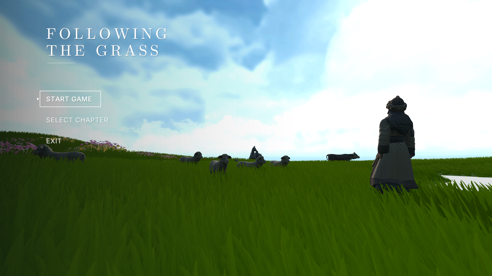
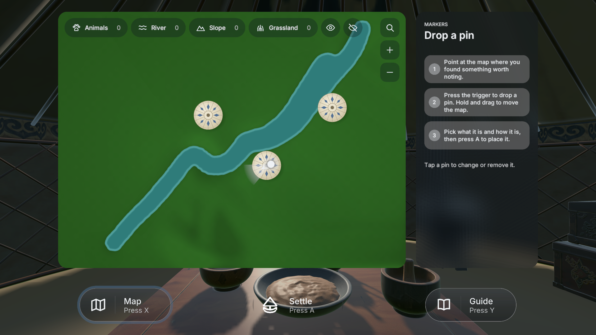
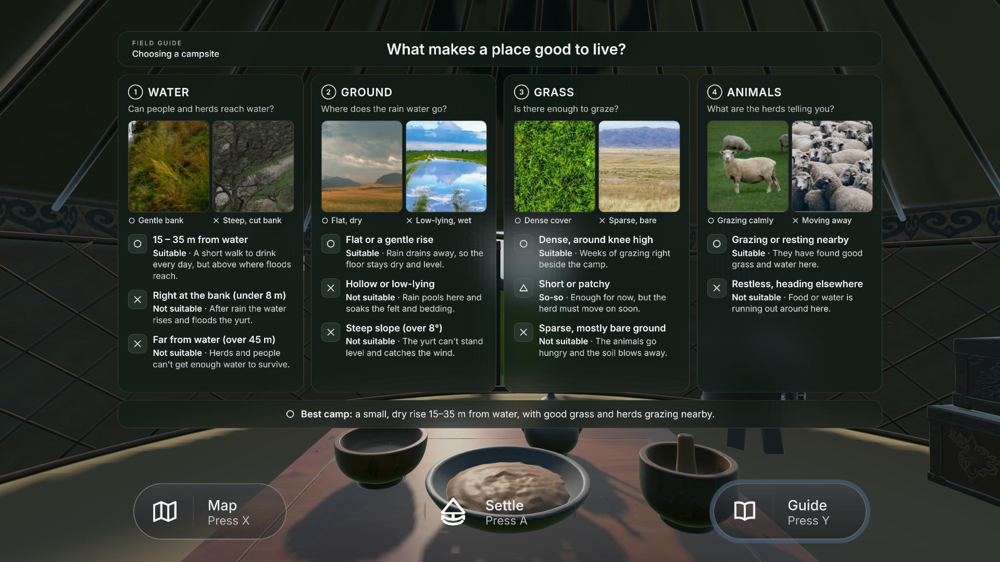

# Week 10 — UI and Dialogue Design

This week I worked on how the player receives information: through the main menu, the in-game map and guide panels, and conversations with Bataa. I wanted the interface to feel like part of the grassland while keeping its instructions easy to read in VR. I also connected the dialogue to the character's facial animation and reviewed where the mouth still needs more detail.

## A visual style for VR

The main menu keeps the title and choices together on the left, with the character and grassland filling the rest of the view. The title uses a restrained serif style to give the project its own identity; the menu options use simpler lettering so they are quick to scan. Keeping the scene visible behind the menu also reminds the player what kind of place they are entering.

*The menu leaves the grassland visible beside the main choices.*

Inside the game, I used dark green panels, pale text, rounded cards and simple line icons. The green links the interface to the grass and gers, while the darker surface helps the text stay separate from a bright or detailed background. The map groups its controls by purpose, and the Guide page uses numbered sections and short headings to make its information easier to scan. The Map, Settle and Guide labels are paired with icons, so players can recognise each action without reading a long explanation.

*The map places the route and its controls in one panel.*

*The guide breaks campsite choices into four short topics.*

This direction follows the main VR readability principles in Meta's design guidance: use a clear type hierarchy, legible lettering, and enough contrast between text and its background. The in-game panels are set up at about 1.8 metres, within Meta's suggested comfortable range for indirect interaction. Kojić et al. (2020) also found that comfortable VR reading depends on text size, viewing distance, contrast and the length of the text. That is why I separated the campsite advice into small cards instead of presenting it as one dense block. The panels should still be checked in the headset, because their apparent size and contrast can change with the device and the viewing conditions.

## Writing the guide's dialogue

Bataa's opening conversation follows the player's first steps. He introduces himself through his experience of herding, then explains the immediate goal: finding a suitable place for the next camp. He names water, land and animals as things to consider, and ends by inviting the player to visit the herd. Each line therefore connects a piece of information to something the player can see or do next.

I kept the conversation direct and welcoming so it feels like meeting a guide in the landscape, rather than reading a separate tutorial. The player is given one clear reason to continue at a time: meet Bataa, consider the camp, then approach the animals. Barnabé's study of video-game tutorials and guide characters helped me think about how one character can carry both story and practical instruction. The conversation aims to make Bataa feel like a person in this place while helping the player understand the route.

*Bataa's subtitles connect his introduction to the landscape around him.*

## Connecting dialogue to the character

I used LipSync Pro in Unity to play the recorded lines with their matching LipSyncData phoneme timings. The character's face has corresponding mouth shapes such as AI, E, U, O, MBP and Rest. A small jaw driver also uses those shape weights to move the lower jaw. In Blender, I adjusted the mouth topology and facial shapes so the speech animation had geometry it could drive; I then matched those shapes to the phoneme names used by the Unity component. Because shape keys depend on the same vertex layout, I kept the topology aligned while building and matching the poses. This keeps the audio, mouth poses and character in the same dialogue sequence.

The test also exposed a limit in the model. The mouth surface is closed off, so the inside of the mouth has little visible depth or detail. The lips can change shape, but the viewer cannot clearly see a mouth cavity, teeth or tongue. This makes the speech look less natural than the timing alone suggests. The next modelling pass should open and shape the mouth interior, then retest the phoneme poses across several lines.

## Reflection

The menus, map and guide page now share a visual language that fits the grassland and gives the player clear choices. Bataa's dialogue turns landscape information into a short sequence of actions, and the LipSync setup connects his voice to his facial shapes. My next step is to review the panels in the headset and refine the mouth interior so the character's speech feels more convincing up close.

## References

Barnabé, F. (2021) ‘Entre règles et narration : étude narratologique des tutoriels de jeu vidéo et des « personnages-guides »’, *Cahiers de Narratologie*, 38 (2020). [https://doi.org/10.4000/narratologie.11676](https://doi.org/10.4000/narratologie.11676).

Blender Documentation Team (2025) ‘Shape Keys — Workflow’, *Blender Manual*. [https://docs.blender.org/manual/en/latest/animation/shape_keys/workflow.html](https://docs.blender.org/manual/en/latest/animation/shape_keys/workflow.html).

Kojić, T., Ali, D., Greinacher, R., Möller, S. and Voigt-Antons, J.-N. (2020) ‘User Experience of Reading in Virtual Reality: Finding Values for Text Distance, Size and Contrast’, *Proceedings of the 12th International Conference on Quality of Multimedia Experience (QoMEX)*, pp. 1–6. [https://doi.org/10.1109/QoMEX48832.2020.9123091](https://doi.org/10.1109/QoMEX48832.2020.9123091).

Meta (2026) ‘Typography’, *Meta Horizon OS Developers*. [https://developers.meta.com/vr/design/styles_typography/](https://developers.meta.com/vr/design/styles_typography/).

Meta (2026) ‘Hands UI Best Practices’, *Meta Horizon OS Developers*. [https://developers.meta.com/vr/design/hands-ui-best-practices/](https://developers.meta.com/vr/design/hands-ui-best-practices/).

Rogo Digital (n.d.) ‘Your First Character’, *LipSync Pro Documentation*. [https://rogodigital.gitbook.io/lipsync-pro/getting-started/your-first-character](https://rogodigital.gitbook.io/lipsync-pro/getting-started/your-first-character).
