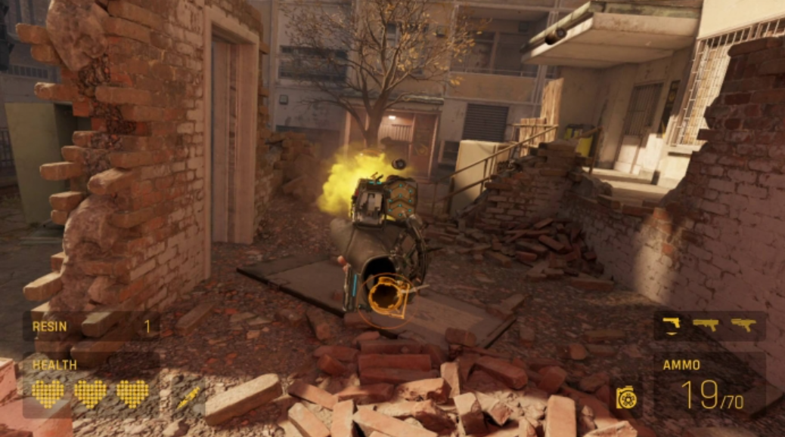
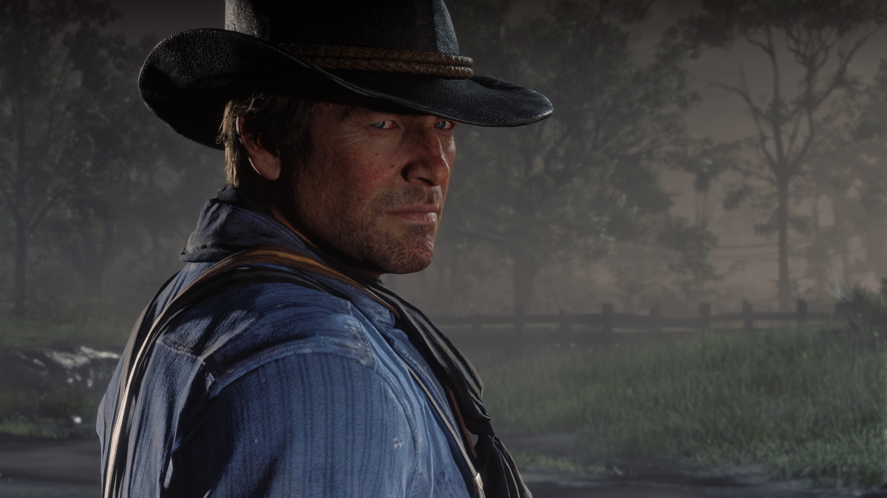
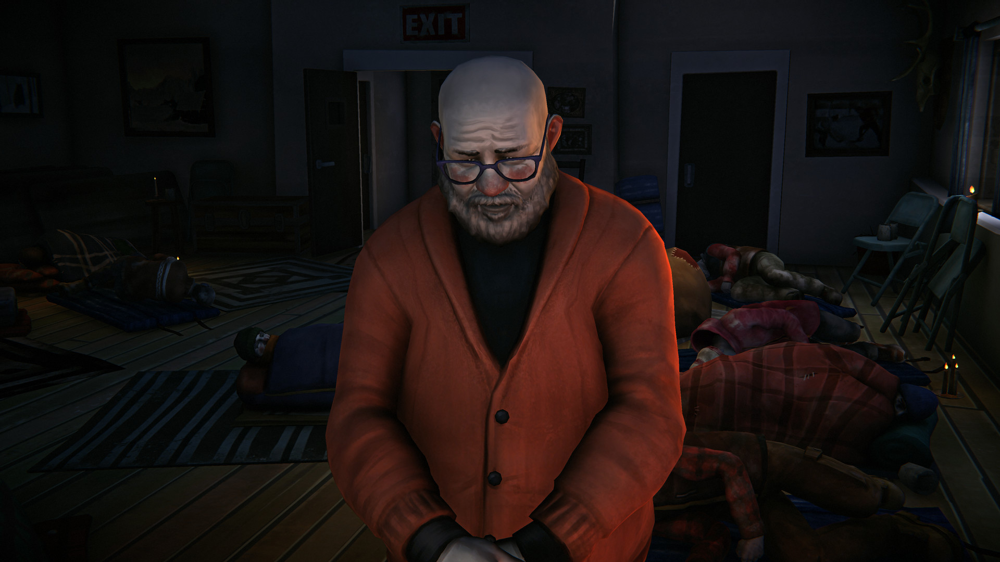
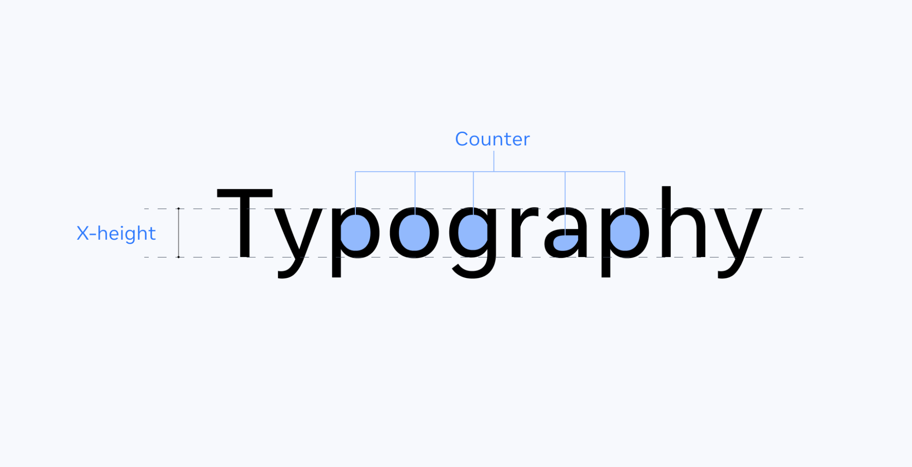
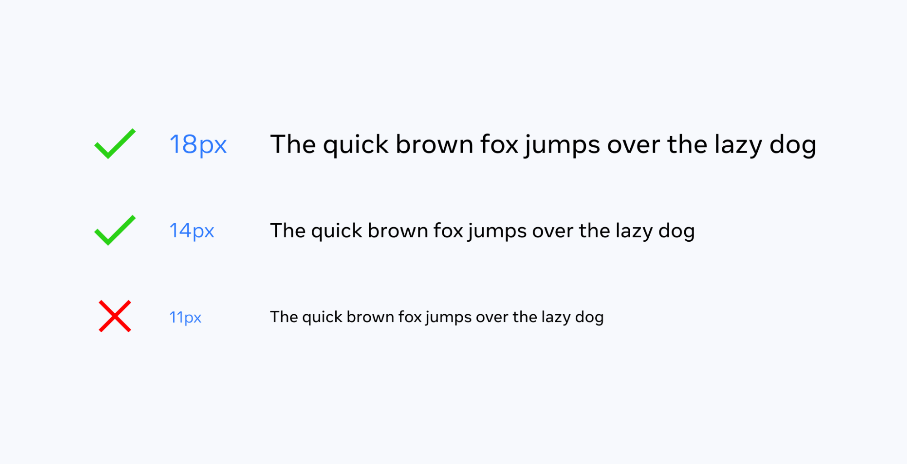
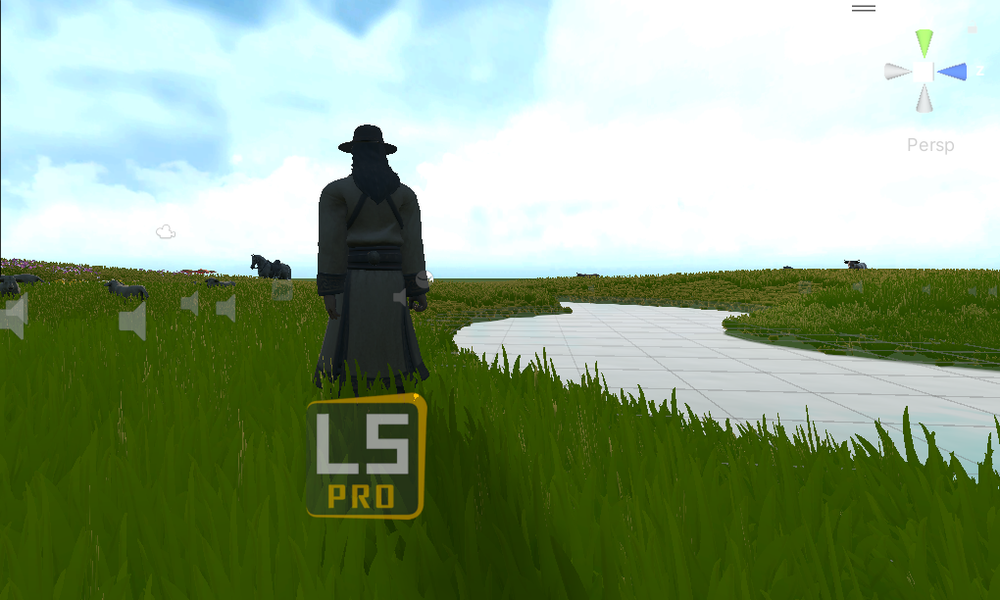
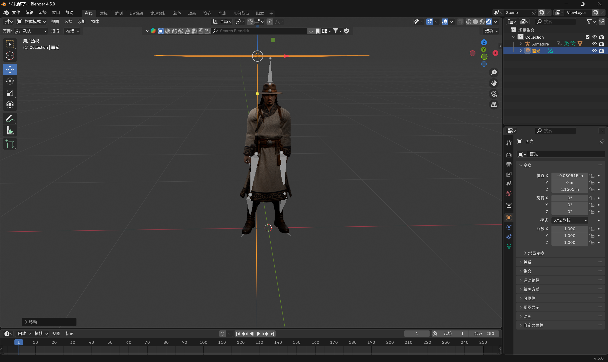
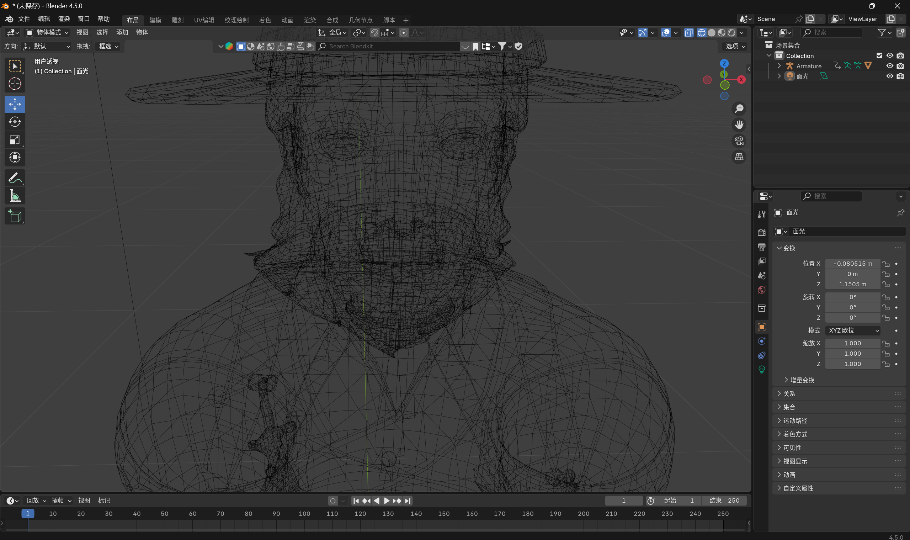

# Week 10 — Dialogue UI, Subtitles and Lip Sync

This week I focused on one moment in the game: the first conversation with Bataa, the herder who guides the player across the grassland. I wanted that conversation to be easy to read in a headset, to give the player a clear reason to move on, and to feel connected to the character through his mouth movement.

## Designing the dialogue UI

*The three source images for the dialogue UI: the subtitle bar, the continue arrow and the talk icon.*

The dialogue UI is built from three small pieces that I drew myself and imported into Unity. The talk icon is a rounded square with corner brackets and a speech bubble. It appears over Bataa when the player is close enough to speak to him, so the player can see at a glance that this character can be interacted with. The subtitle bar is a dark strip with soft, faded edges rather than a hard frame, so it sits on top of the landscape without closing it off like a window. The small white arrow at the end of a line tells the player that the line is finished and that they can press A to continue. The panels share the same frosted-glass material as the rest of the game's interface, and all text is set in Inter, so the conversation looks like part of one system rather than a separate screen.

*Half-Life: Alyx (Valve, 2020). Information is kept in the world, and on-screen UI is minimal.*

*Red Dead Redemption 2, official Steam store screenshot (Rockstar Games, 2019). Conversations are framed close on the character, so the face carries the scene.*

*The Long Dark, official Steam store screenshot (Hinterland Studio, 2017). Story characters are met face to face, and the UI stays out of the frame.*

Before designing, I looked at how other games handle speech. Half-Life: Alyx keeps nearly everything in the world and uses only small, quiet prompts, which matters in VR, where a large panel blocks the view the player is standing in. Red Dead Redemption 2 uses short subtitles placed low on the screen and a context prompt close to the character, so the player's attention stays on the person speaking. The Long Dark uses plain white text over a soft dark band that stays readable against both snow and bright sky, which is close to my own problem, since the game moves through four seasons with very different backgrounds. From these I took one principle: the world comes first, and the dialogue UI should be small, neutral and only visible when it is needed.

*Meta Horizon OS typography guidance: a generous x-height and open counters make text easier to read in a headset (Meta, 2026a).*

*Meta Horizon OS guidance on minimum type sizes (Meta, 2026a).*

The design decisions also follow VR design guidelines. Meta recommends placing interface elements at a comfortable distance and inside the player's natural field of view, so that reading does not require turning the head or refocusing the eyes (Meta, 2026b). For this reason the subtitle bar sits at a fixed height just below the line of sight, while the talk icon is attached to Bataa's position in the world instead of the screen. Meta's typography guidance explains that headset resolution and lens blur make thin, small or coloured text hard to read, and it recommends a clear sans-serif typeface at a sufficient size with strong contrast (Meta, 2026a). This is why the subtitles are white Inter on a dark band and why I avoided coloured text altogether. Kojić et al. (2020) also found that distance, size and contrast strongly affect how comfortable reading is in VR, which supports keeping each subtitle short, still and high in contrast. Finally, the prompts name the real controller buttons, A and B, so the instruction on screen matches what the player is holding.

## Subtitles and dialogue: guiding the player

The subtitles are written to be read while the player is also looking around. Each line is only one or two short sentences, because long paragraphs in a headset tend to be skipped. Every line begins with a speaker label, so the player knows who is talking even when they are not facing Bataa. The conversation also never advances on a timer. The player presses A to move on, which means a slower reader or someone looking at the landscape is never cut off.

The content of the dialogue does the work of a tutorial. Instead of opening with an instruction screen, Bataa introduces himself first: he says who he is and that he has herded livestock on these grasslands for most of his life. This gives him authority as a guide and establishes the place. He then asks the player to help with the herd, which turns the first goal into a request from a person rather than a task from a menu. Finally he points the player towards the next location, and from there the map and route markers take over. This follows Barnabé (2021), who argues that tutorials are most effective when instructions are part of the fiction and are delivered by a character inside the world. The player learns what to do because someone in the world needs their help.

## Lip sync with LipSync Pro and Blender

*Setting up LipSync Pro on the guide character in the grassland scene.*

To make Bataa's mouth move with his lines, I used LipSync Pro by Rogo Digital in Unity. LipSync Pro breaks speech into a small set of mouth shapes, called phonemes: AI, E, U, O, MBP and a resting pose (Rogo Digital, n.d.). For each recorded line, I created a lip-sync data file that marks when each phoneme happens, and the component blends between the shapes as the audio plays.

*Bataa's model in Blender, where the mouth shapes were prepared.*

*Wireframe of the head. The edge loops around the mouth are what the mouth shapes deform.*

The mouth shapes were prepared in Blender as shape keys on Bataa's head mesh. A shape key only stores how far each vertex moves from the base mesh, so every shape key has to use exactly the same vertices, in the same order, as the original model (Blender Documentation Team, 2025). I therefore kept the topology fixed while sculpting each pose and only moved existing vertices, never adding or removing any. When the model is exported to Unity, the shape keys become blend shapes, and I matched each LipSync Pro phoneme to the blend shape with the same name. Because the lips alone looked stiff, I also added a script that rotates the jaw bone according to how open the current phoneme is, so wide vowels such as AI and O open the mouth further than closed sounds such as MBP.

## Limitation: the closed mouth

The lip sync works, but it is less convincing than I hoped. The original character model and its texture were made with the mouth closed. In the wireframe, the lips form one continuous surface, with no mouth cavity, teeth or tongue behind them. When the shape keys and the jaw open the mouth, the gap shows the stretched lip texture or nothing at all, instead of a dark interior with teeth. I tried adding a separate set of teeth, but without a proper cavity in the mesh and UV layout, the result still looked flat. Fixing this properly would mean remodelling the inside of the mouth, adding teeth and a tongue, and repainting the texture, which was beyond the time I had this week. As a compromise I kept the mouth movement small. Subtle movement still reads as speech from a normal conversation distance, and it hides the missing interior much better than wide movement does.

## References

Barnabé, F. (2021) 'Narrative tutorials: teaching players through the fiction', *Cahiers de Narratologie*, 39. Available at: https://doi.org/10.4000/narratologie.11676

Blender Documentation Team (2025) *Shape Keys: Workflow*. Blender Manual. Available at: https://docs.blender.org/manual/en/latest/animation/shape_keys/workflow.html

Hinterland Studio (2017) *The Long Dark* [Video game]. Vancouver: Hinterland Studio. Store page: https://store.steampowered.com/app/305620/

Kojić, T., Ali, D., Greinacher, R., Möller, S. and Voigt-Antons, J.-N. (2020) 'User experience of reading in virtual reality: finding values for text distance, size and contrast', *2020 Twelfth International Conference on Quality of Multimedia Experience (QoMEX)*. Available at: https://doi.org/10.1109/QoMEX48832.2020.9123091

Meta (2026a) *Typography*. Meta Horizon OS Developers. Available at: https://developers.meta.com/horizon/design/styles_typography/

Meta (2026b) *Hands UI Best Practices*. Meta Horizon OS Developers. Available at: https://developers.meta.com/horizon/design/hands-ui-best-practices/

Rockstar Games (2019) *Red Dead Redemption 2* [Video game, PC]. New York: Rockstar Games. Store page: https://store.steampowered.com/app/1174180/

Rogo Digital (n.d.) *Your First Character*. LipSync Pro Documentation. Available at: https://rogodigital.gitbook.io/lipsync-pro/getting-started/your-first-character

Valve (2020) *Half-Life: Alyx* [Video game]. Bellevue: Valve Corporation.
