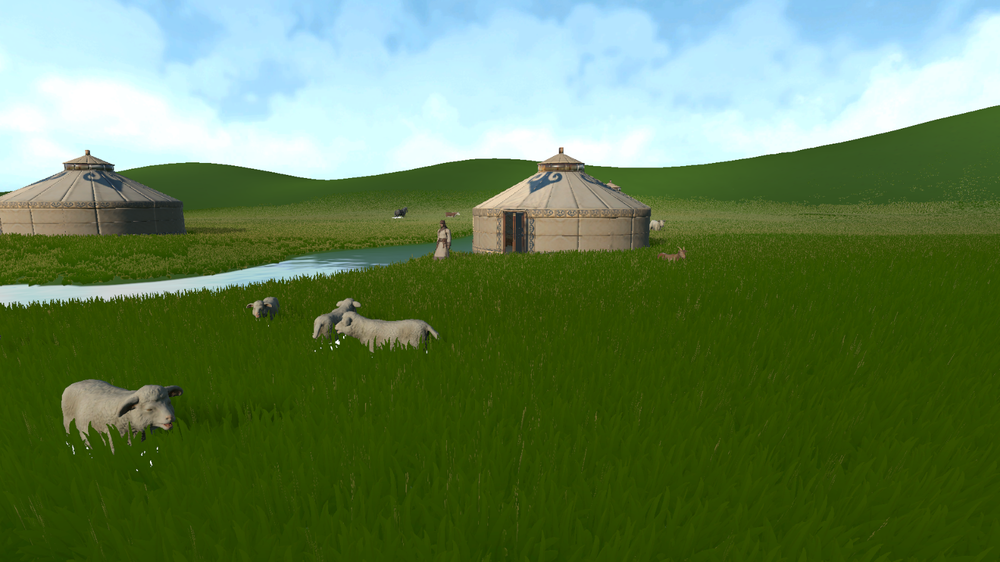
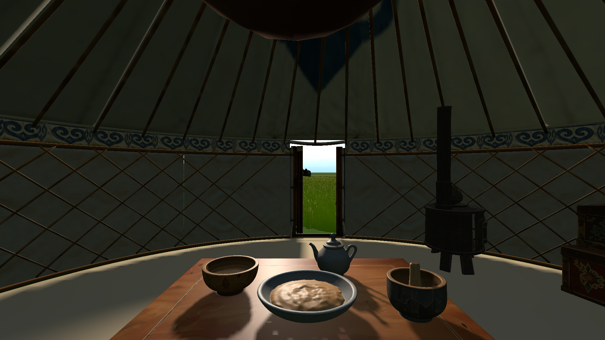
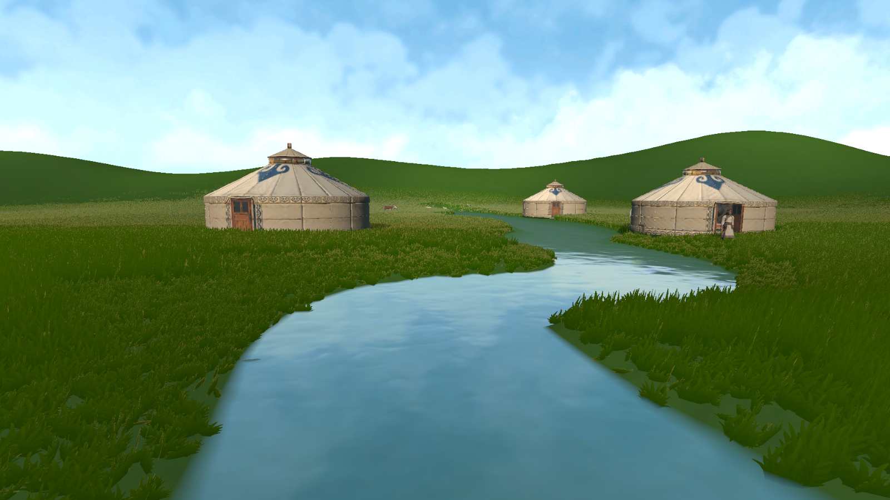

# Week 11 — Designing the Grassland Soundscape

This week I worked on how sound can make the spring landscape feel open, lived in and easy to navigate. I treated the soundscape as several layers: a quiet outdoor background, sounds triggered by the player's movement, the more sheltered feeling inside a ger, and the river becoming clearer as the player approaches it. I want these layers to support the calm pace of the scene without competing with Bataa's dialogue.

## Wind, grass and animal life

Wind should be the broadest sound in the meadow: a soft, steady layer that gives the open space a sense of air. A lighter rustle in the grass can sit beneath it, while footsteps remain close to the player and happen only when they move. Occasional sheep and cow calls add smaller points of life across the field. This separation helps the grassland feel active without making every sound equally loud.

The current spring scene already has a looping bird-and-lark ambience, grass footsteps, and occasional spatial animal calls. The grass footstep sound plays when the player is moving on the ground. A dedicated spring wind loop and continuous grass rustle are not connected yet, so the animated meadow is still quieter than it looks. Adding those layers is the next sound task; they should stay gentle so they leave room for conversation and the other environmental cues. Haehn, Schlittmeier and Böffel (2024) examine ambient and character sounds as distinct parts of the player experience, which helped me think about the landscape bed, footsteps and animal calls as separate layers to balance.

*The open meadow is the setting for the wind, grass and distant animal layers.*

## Entering the ger

The transition into a ger should feel quieter and more enclosed than walking through the field. The sound setup detects when the player enters a ger area, gradually lowers the outdoor ambience, and changes the footsteps from the grass clip to a different indoor walking clip. This gives the doorway a small acoustic change as well as a visual one.

There is not yet a separate felt, doorway or roof sound, so the interior is suggested through the quieter background and changed footsteps rather than a full set of ger-specific effects. I would like to add a very subtle fabric or door movement sound later, then check that it feels natural and does not play every time the player makes a small movement.

*The entrance marks the change from the open field to the quieter interior.*

## Letting the river come closer

The river is both part of the landscape and a sound landmark. Instead of keeping it equally loud everywhere, the sound source follows the nearest point on the river. Its volume fades in from about 45 Unity units away and reaches its strongest level at about 9 units. The fade is smoothed, so it should become clearer as the player approaches the bank rather than switching on suddenly. The river source also uses a mix of 2D and 3D audio, with distance settings to help place it in the scene.

Meta's spatial-audio guidance describes direction and distance as important cues for locating sounds in immersive spaces. Unity's Audio Source settings provide spatial blend and distance roll-off controls that support this kind of change. In this scene, the sound of water can quietly guide the player toward the river while leaving the meadow calm when they are farther away.

*The river gives the player a sound landmark to approach and follow.*

## Reflection

The main sound structure is now in place: outdoor ambience, movement sounds, a quieter ger threshold, animal calls and water that grows louder near the bank. The next pass is to add a restrained spring wind and grass-rustle layer, then listen to the mix while moving between the meadow, ger and river. I will keep the changes gradual so the sound helps the player read the landscape without interrupting its relaxed mood.

## References

Haehn, L., Schlittmeier, S.J. and Böffel, C. (2024) ‘Exploring the Impact of Ambient and Character Sounds on Player Experience in Video Games’, *Applied Sciences*, 14(2), 583. [https://doi.org/10.3390/app14020583](https://doi.org/10.3390/app14020583).

Meta (2025) ‘Spatial audio’, *Meta Horizon OS Developers*. [https://developers.meta.com/vr/design/spatial_audio/](https://developers.meta.com/vr/design/spatial_audio/).

Unity Technologies (2021) ‘Audio Source’, *Unity User Manual*. [https://docs.unity.cn/2021.1/Documentation/Manual/class-AudioSource.html](https://docs.unity.cn/2021.1/Documentation/Manual/class-AudioSource.html).