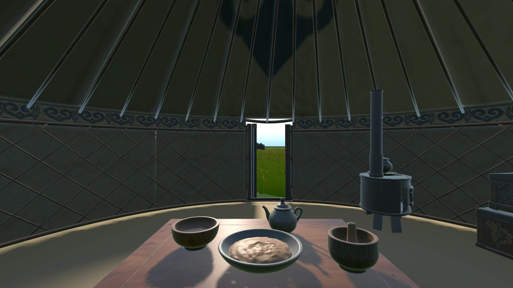
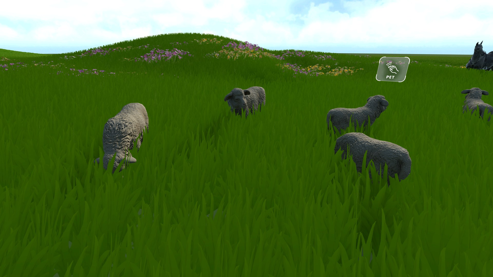
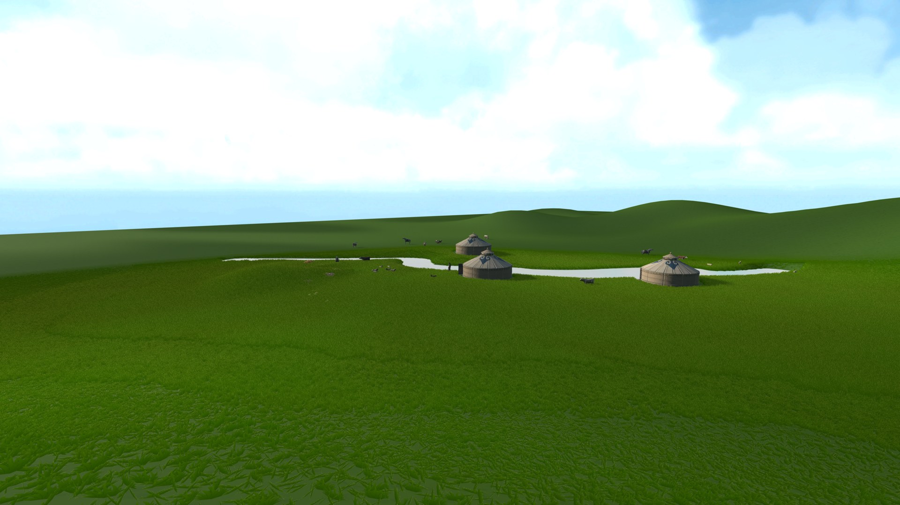
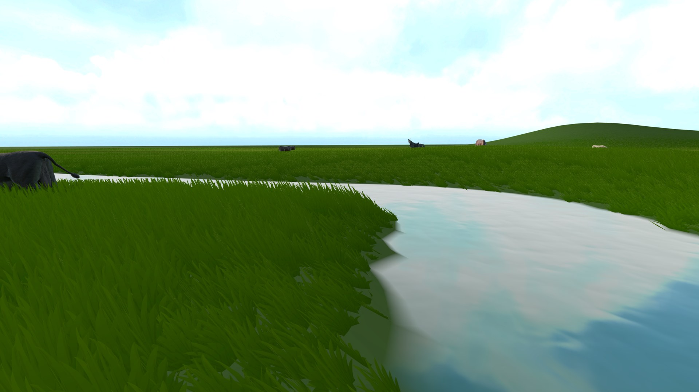
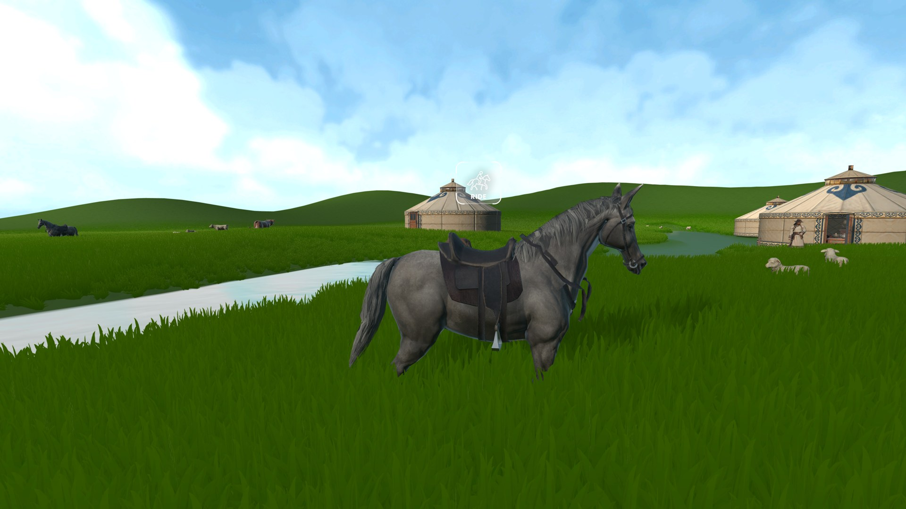
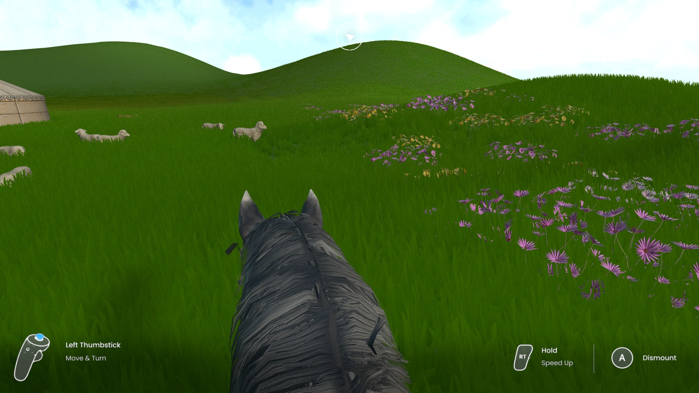
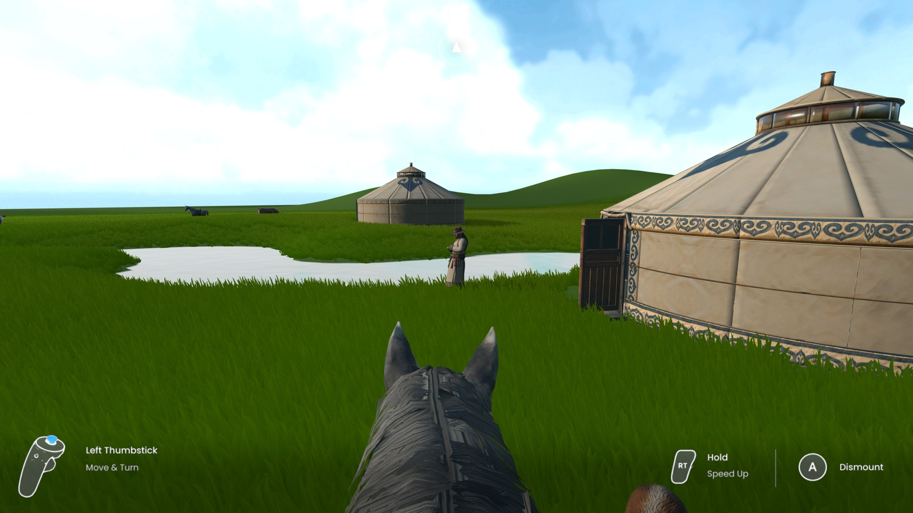

# Week 12 — Making the Whole Flow Work

This week the goal was not to add new scenes but to make sure the game could be played from start to finish without breaking. I went through the full flow several times, from the main menu and difficulty select into each seasonal chapter, talking to the guide, interacting with the animals, riding the horse and finally choosing a place to settle. Most of the work was connecting systems that already existed and fixing the problems that only appeared once they were used together.

## Playing through the spring chapter

To check the flow, I played the spring chapter from the first moment to the return to camp and captured each step.

*The chapter begins inside the yurt, looking out through the open door to the grassland.*

The player starts inside the family yurt. The open door frames the grassland outside, so the first thing the player sees is where they are going, and walking out through it is the first action of the game.

*The sheep grazing near the camp. A small pet icon floats above the sheep closest to the player.*

Just outside the camp, the herd is grazing. As the player walks among the sheep, a small icon appears above whichever one is closest, inviting the player to reach out and pet it.

*From the top of the hill, the camp, the river and the herd can be seen together.*

Climbing the hill behind the camp gives the first overview of the land. From here the player can see how the yurts sit beside the river and where the animals gather, which is the kind of observation the settle task later asks them to make.

*At the river bank. The water reflects the sky, and animals graze on the far side.*

Coming down to the river, the player sees the water close up. This is where they learn that the camp needs to be near water, but not so close that it floods.

*The saddled horse beside the river, with the ride prompt above the saddle.*

*Riding in first person. The controller hints in the corners show how to steer, speed up and dismount.*

The saddled horse waits by the river. Walking up to it shows the ride prompt, and pressing the button puts the player in the saddle. Once mounted, the view drops to the rider's eye height behind the horse's neck, and a small set of hints at the bottom of the view shows how to steer, speed up and get off.

*Riding back into camp, with Bataa waiting between the yurts.*

The loop ends by riding back into camp, where Bataa is waiting between the yurts. From here the player can talk to him again, open the map or move on to choosing a place to settle.

## Talking to the guide and petting the sheep

Both of these interactions are deliberately simple scripts. The conversation with Bataa is triggered by distance. When the player walks close enough, a talk prompt appears above him, and pressing the interact button starts the conversation. While he is talking, the other interactions are paused so that one button press cannot trigger two things at once. Petting works in a similar way. The game finds the sheep nearest to the player and shows a small prompt above it. When the player holds the button, that sheep stops wandering, its neck and head sway slowly as if it is being stroked, and it bleats every few seconds. When the player lets go, it goes back to grazing. There is no complex physics here: a stroke is suggested by a small animation layered on top of the sheep's normal idle, and the sound does most of the work.

I kept these interactions simple on purpose. They are not challenges but moments of contact with the herd, and they exist to make the animals feel like living things the player is responsible for, rather than scenery. A more complicated system would have taken time away from making the main flow reliable.

## Riding the horse

For the horse, I did not build the animation system myself. I used Horse Animset Pro by Malbers Animations, an asset from the Unity Asset Store that includes a rigged horse, a full set of walking, trotting, galloping and turning animations, and a controller that blends between them from simple forward and turn values (Malbers Animations, 2016). Riding is a feature that needs dozens of animations and careful blending to look believable, and using an existing asset let me spend my time on how the player gets on the horse and controls it, rather than on animating a horse from scratch. I wrote my own interaction script on top of it. When the player is close to the horse, a ride prompt appears over the saddle. Pressing the button places the player on the saddle, swaps the horse to its riding animator and hands the movement input to the horse instead of the player's body. Pressing the same button again brings the player back down to the ground.

## Different control logic for VR and PC

The game runs both in a headset and on a computer, and the two need different controls even though the actions are the same. The script checks at runtime whether a headset is active and reads input from the right source. In VR, the player walks and steers the horse with the left thumbstick, and holding the right trigger makes the horse gallop. The A button on the right controller is used to talk to Bataa and to mount or dismount, and the player pets a sheep by looking at it and holding the trigger, which casts a short ray from the centre of view to find the animal. On the PC version, the same actions are mapped to the keyboard and mouse. WASD moves the player and steers the horse, holding the right mouse button makes the horse gallop, and the E key is used for talking, mounting and petting. Because a mouse cannot reach into the scene the way a hand can, petting on the PC is not aimed. Holding E simply pets whichever sheep is nearest and has its prompt showing.

The main difference is how the player looks around. In VR, the camera always follows the real movement of the player's head, so I never rotate the view for them, because moving the camera against the player's own head movement is one of the main causes of motion sickness. On the PC, the mouse controls the view directly. Keeping the actions the same and changing only the input underneath meant that every part of the flow could be tested on the computer and then checked again in the headset.

## Problems: head clipping and a new rider

Once the player was on the horse, a new problem appeared. In first person, the camera sits inside the rider's head, and when the player turned to look behind, the camera passed through the rider's own head and shoulders and then through the horse's neck. In a headset this is very uncomfortable, because the player suddenly sees the inside of a model right in front of their eyes. I solved this in two ways. First, I locked the view while riding, so the player can only look up to about ninety degrees to either side of the direction the horse is facing. They can still look around the landscape, but they can no longer turn far enough to see through their own body. Second, the rider's head is hidden while mounted, and the body is moved slightly back from the horse's neck so that the two models no longer overlap.

The original rider from the horse asset also did not fit the game. It was a western cowboy, which did not suit a herder on the Mongolian grassland. I replaced it with the same player character used when walking on foot and bound that body to the saddle. The hips are placed on the saddle point, the camera is placed at eye height above it, and the body follows the horse's movement. Now the player sees the same arms and clothes on the horse as on the ground, which keeps the sense of being one person throughout the game.

## Current progress

At this point the full flow of the game works from beginning to end. The main menu leads into a difficulty select, and each difficulty opens one seasonal chapter with its own terrain, weather and herd. In each chapter, the player can meet and talk to the guide, pet the sheep, ride the horse across the grassland, open the map to mark what they have seen, and use the guide pages to judge the land before choosing where to settle. The settle system then scores the chosen spot on water, slope, wind, drainage and grass, and gives the player a result. All of these steps run on both the PC and the VR versions. What remains is mostly polish: tuning the difficulty of each season, improving the lip sync and some of the animations, and testing with other players to see whether the guidance is clear without my help.

## References

Malbers Animations (2016) *Horse Animset Pro (Riding System)*. Unity Asset Store. Available at: https://assetstore.unity.com/packages/3d/characters/animals/horse-animset-pro-riding-system-79902
