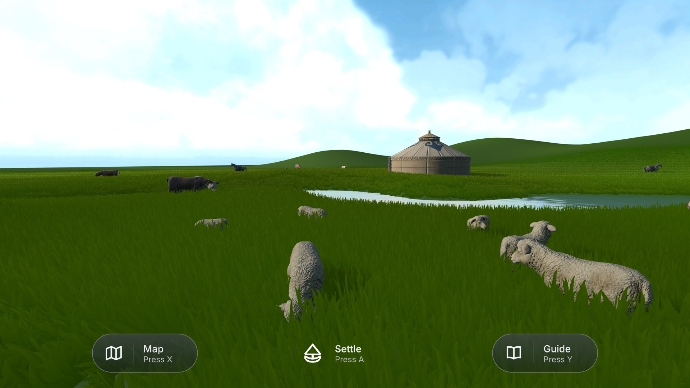
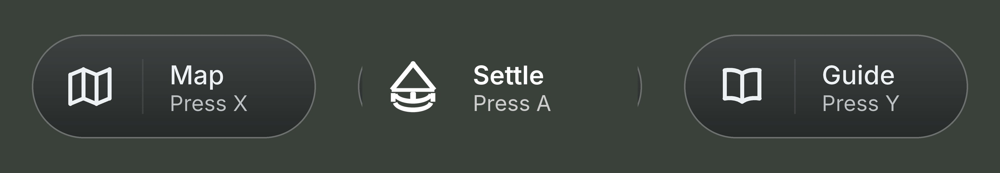
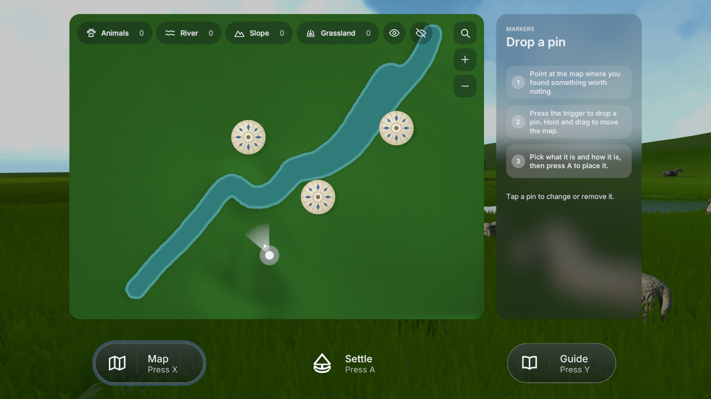
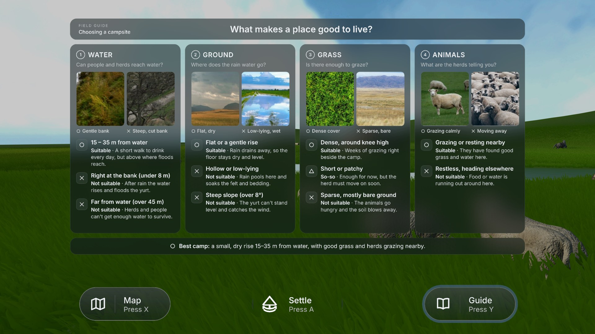
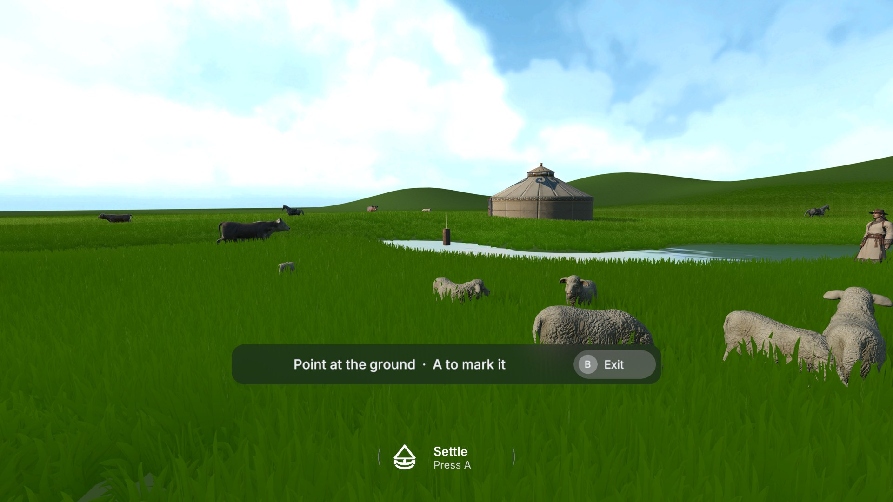
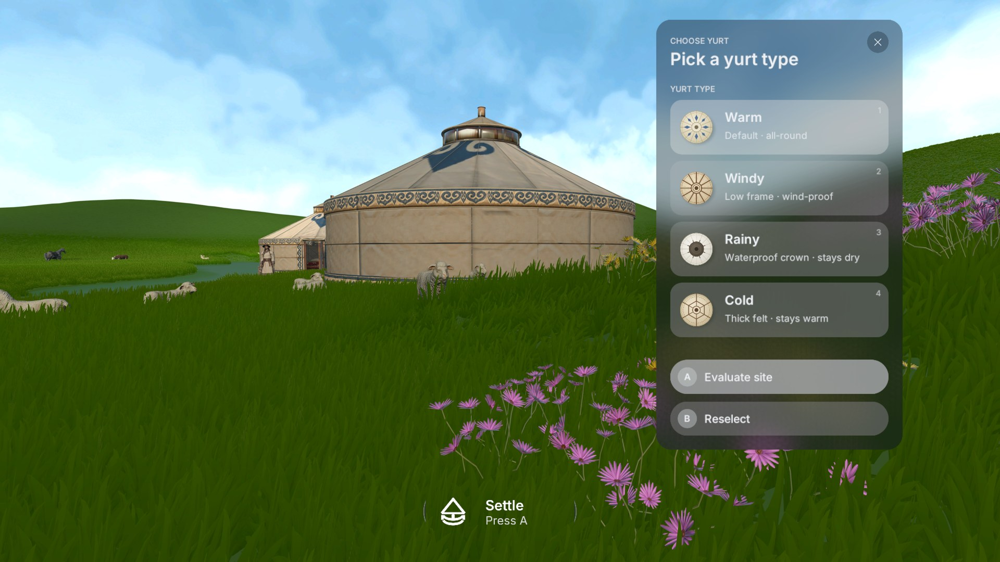
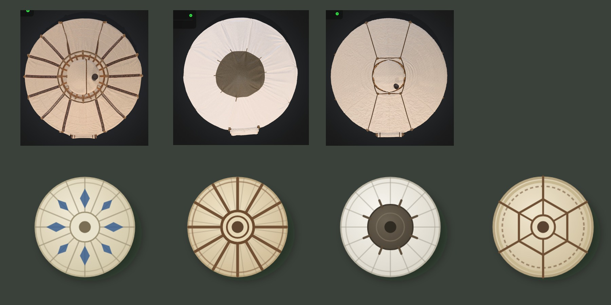
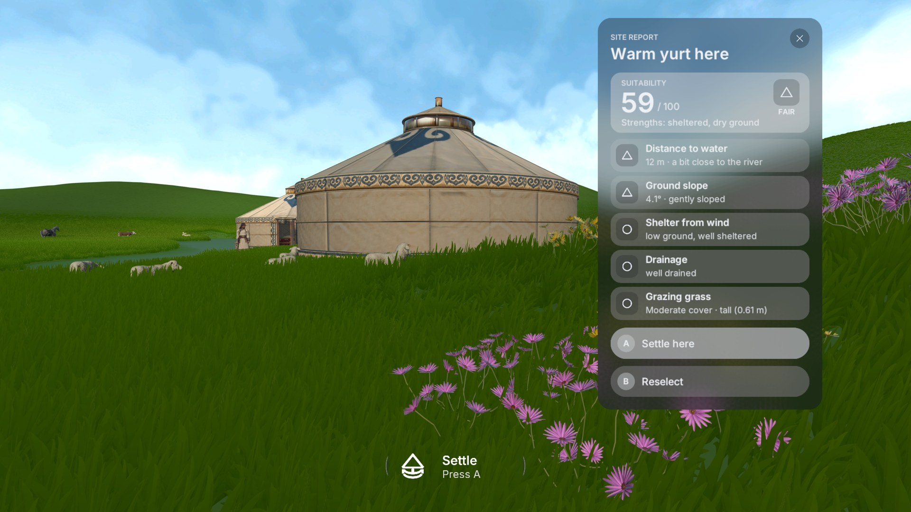
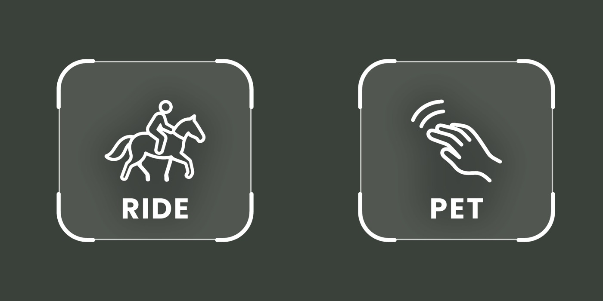
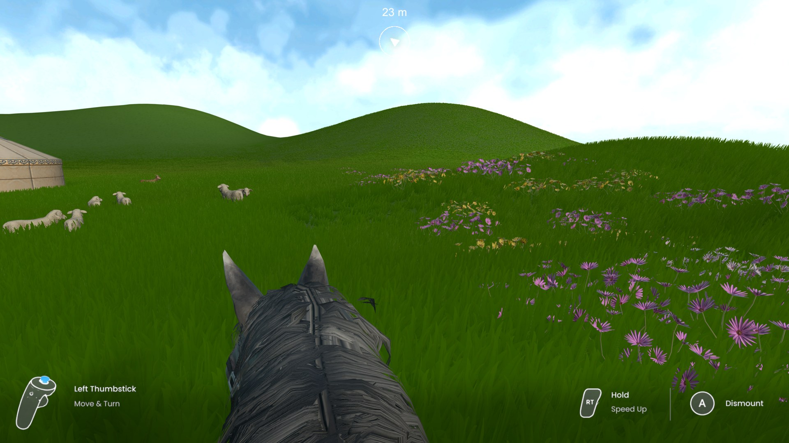

# Week 13 — UI Design Across the Game

This week I brought all of the game's interface together and checked it as one system. Earlier I had designed pieces separately, such as the dialogue panel and the map, but now every screen the player meets in a chapter has been finished: the three main buttons, the map, the guide, the settle tool with its yurt icons, and the interface for riding. All of them use the same frosted-glass panels, white Inter text, thin outlines and rounded corners, so that moving from one to another feels like using one tool rather than several.

## Three buttons: Map, Settle and Guide

*The three main buttons at the bottom of the view in the spring chapter.*

*The source images for the Map, Settle and Guide buttons in their selected state.*

The whole game is built around one question: where should this family set up camp? The three buttons at the bottom of the view are the three tools the player has to answer it, and they are arranged in the order the player is likely to use them. Map sits on the left because it is for recording what the player notices while exploring. Guide sits on the right because it is for checking that knowledge against what a herder would look for. Settle sits in the middle because it is the final decision that the other two lead towards. Each button shows an icon, a name and the controller button that opens it, so the player never has to remember a mapping. In VR these are X, A and Y, which matches where those buttons sit on the two controllers. Settle is also drawn more lightly than the other two, without a full pill shape, because it only becomes important once the player has explored enough to choose.

I kept the bar low and small on purpose. In VR, a panel that is always visible in the middle of the view quickly becomes tiring and blocks the landscape, which is the main thing the player is supposed to be reading. Sitting low in the view, the bar is easy to find with a glance down and easy to ignore when the player is looking at the land.

## The map: recording what the player notices

*The map page, with the river, the existing camp, the player's position and filters for different kinds of markers.*

The map is not there to tell the player where to go. It shows only the shape of the river, the existing yurts and the player's own position and direction, and leaves the rest empty. The player fills it in themselves by dropping pins where they notice something important, such as animals grazing, water that can be reached, a slope or a patch of good grass. Each kind of pin has its own small icon and can be shown or hidden with the filters along the top. The panel on the right explains the steps in short numbered lines, which is useful the first time and easy to ignore after that.

The purpose is to turn exploring into observation. Instead of simply walking around, the player builds up their own picture of the land, which they can bring back to when deciding where to settle. This reflects how herders actually choose a camp: by reading water, grass and the movement of animals over time, not by looking it up.

## The guide: what makes a place good to live

*The guide page, with four columns for water, ground, grass and animals.*

The guide is the game's knowledge page. It answers the question "What makes a place good to live?" in four columns: water, ground, grass and animals. Each column asks one simple question, shows two photographs that contrast a good example with a poor one, and lists a few conditions marked as suitable, partly suitable or unsuitable, with a short reason for each. A single line at the bottom sums up the best camp: a small, dry rise not too far from the water, with good grass and animals grazing calmly nearby.

I used real photographs here instead of illustrations, because the player is expected to compare them with what they see in the game world. The symbols for suitable, partly suitable and unsuitable are a circle, a triangle and a cross rather than green, yellow and red, so that they still work for players who cannot tell those colours apart and keep the interface free of coloured text.

## Settling: marking a spot and choosing a yurt

*The first step of settling. The player points at the ground and presses A to mark the spot.*

*After marking the spot, a yurt appears there and the player chooses which type to build.*

Settling happens in three short steps, and the interface changes with each one so that the player only sees what they need at that moment. First, a single line tells the player to point at the ground and press A to mark it, with B to leave. Once a spot is marked, a full-size yurt appears on it, so the player can judge the place at real scale before committing to it. A panel then asks them to pick a yurt type. Each option has an icon, a name and a short note on what it is good for. The warm yurt is the all-round choice, the windy yurt has a low frame that resists wind, the rainy yurt has a waterproof crown that stays dry, and the cold yurt uses thick felt to keep warm.

## The yurt icons

*Top: overhead renders of the yurt models. Bottom: the four yurt icons designed from them.*

The four yurt icons are based on how each yurt looks from directly above. I rendered the yurt models from overhead, then simplified each roof into a flat round icon that keeps only what makes it different. The warm yurt keeps the traditional blue pattern around the crown. The windy yurt shows strong, evenly spaced roof poles, which suggest a firm frame. The rainy yurt has a large dark waterproof cover over the crown, and the cold yurt shows a heavier frame and an inner ring of stitching for its thick felt. All four keep the same circular shape, crown in the centre and soft cream colours, so they read as one family, and the player can tell them apart by pattern rather than by colour. Viewing the yurt from above also matches the map, where the existing camp is drawn with the same kind of icon.

## The site report

*The site report for a warm yurt, with an overall score and five conditions.*

After choosing a type, the player asks for an evaluation and gets a site report. At the top is a single score out of one hundred with a short summary of the site's strengths. Below it, the same five conditions that the guide teaches are listed: distance to water, ground slope, shelter from wind, drainage and grazing grass. Each one has a measured value in plain words and the same circle, triangle or cross symbol as the guide. The player can then settle here or go back and choose again. Because the report uses the same categories and symbols as the guide, the player can see exactly why a spot scored well or badly and connect it to what they read earlier, so the report becomes feedback rather than just a grade.

## Riding

*The ride and pet prompts that appear over the horse and the nearest sheep.*

*The riding interface. The controller hints sit in the bottom corners, and a small marker at the top shows the direction and distance back to camp.*

The interaction prompts for the horse and the sheep share one design: a rounded square with corner brackets, a simple white line drawing and one word underneath. They appear above the animal only when the player is close enough to use them, and they always turn to face the player. Using the same frame for talking, petting and riding means the player learns it once and recognises it everywhere.

When the player is riding, the three main buttons are replaced by a riding interface, because the map and settle tools should not be used from the saddle. The bottom corners show how to ride on the actual controllers: the left thumbstick to move and turn, the right trigger held to speed up, and A to get off. A small marker at the top of the view shows the direction and distance back to camp, so the player can ride out freely and still find their way home without opening the map. Everything sits at the edges of the view, leaving the centre clear for the horse's head and the landscape ahead.
