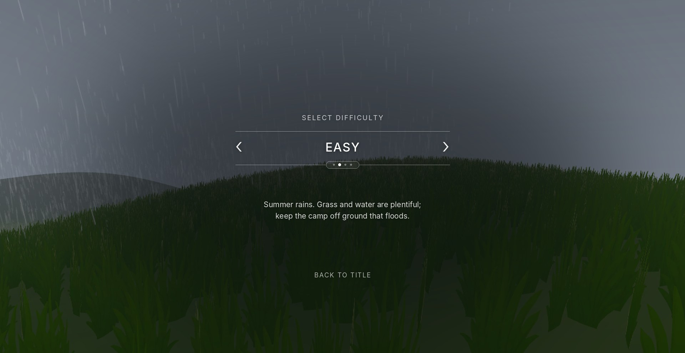
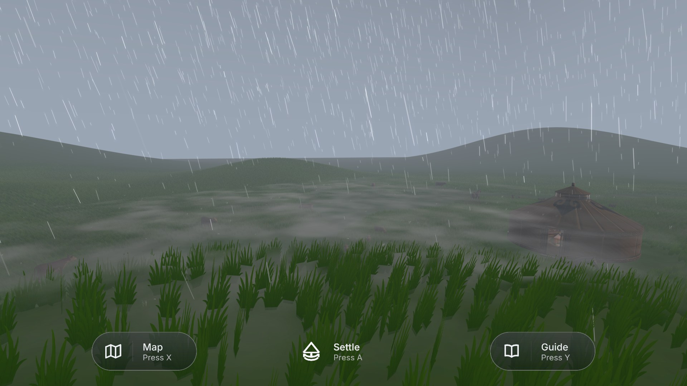
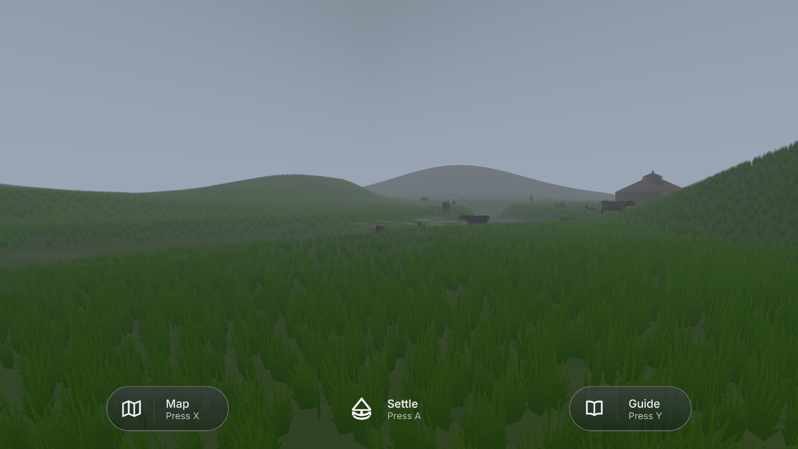
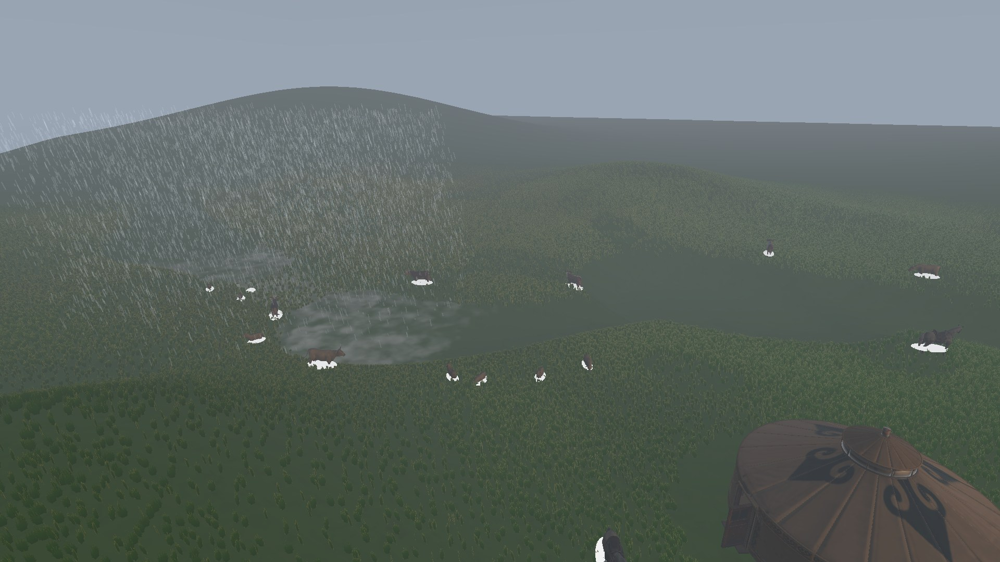
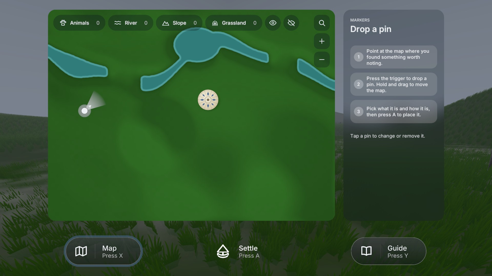
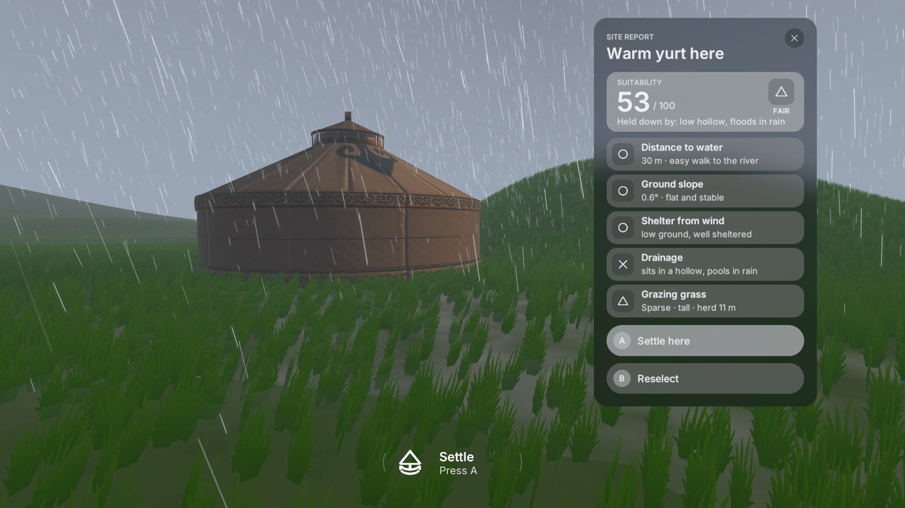
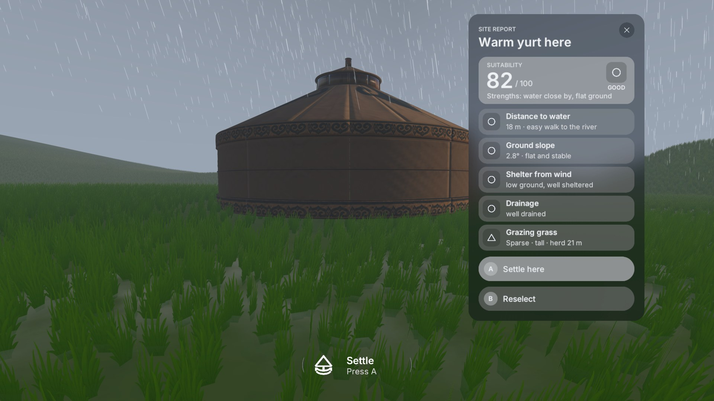

# Week 15 — The Summer Chapter

This week I worked on the second chapter of the game, the summer level. Before writing, I checked what the level actually shows in its final version, because the scene file is called "Raineasy" and that name alone does not say which season it is. In the game, this level is the Easy difficulty, and it is set in the rainy season of summer. The difficulty screen describes it as "Summer rains. Grass and water are plentiful; keep the camp off ground that floods." So in this chapter, the problem is not a lack of water. The problem is too much of it. The player has to find dry, safe ground in a landscape where rain collects in every low place.

*The difficulty screen for the summer chapter. The short description tells the player what this season is about before they enter it.*

## The grassland in summer

*The summer grassland in rain, seen from the hill above the camp. The low ground between the hills holds water.*

*Tall summer grass on the gentle slopes. In the rain, it hides small dips in the ground.*

In summer, the steppe is at its greenest, so the grass in this level is taller and thicker than in the spring tutorial. It reaches roughly knee height and covers the whole map in one even colour. This looks rich, but it also makes the level harder to read. In spring, the player could see the shape of the ground clearly. In summer, the tall grass hides small hollows and changes in height, so a spot that looks flat and green may actually be a shallow dip that fills with water when it rains. The player has to look at the ground more carefully instead of trusting the colour of the grass.

The weather adds to this. It rains throughout the level, and there is light fog in the distance. The rain follows the player, and its sound is always present, which reminds them of the main danger of this season. The fog makes far hills fade into grey, so the player cannot see the whole valley at once from the camp. To understand the land, they have to walk or ride to higher ground and look down. I made the rain stop inside the yurts, so stepping into a yurt feels like reaching shelter. This also shows, in a simple way, why a well-placed yurt matters in this season.

## Water: a river and a lake

*The lake in the low basin north of the camp. The cattle, sheep and horses gather around the water.*

*The summer map. A river and a lake run along the north of the area, and the existing camp sits to the south.*

The spring tutorial had one clear river that ran close to the camp. In summer, the water is split into two shapes: a river that winds along the north of the map and a wider lake in a basin between the hills. Together they cover a much larger area. Summer camps are traditionally placed along rivers and in well-watered lowlands, where people and animals can reach drinking water easily and the grass is good (Ono and Ishikawa, 2020). I followed this, so water is never far away in this chapter. However, the lowland near the water is also the land most likely to flood. The level puts the most useful resource and the biggest risk in the same place, and the player has to find the balance between them.

For this reason, the settle tool in summer rewards a middle distance. If the yurt is closer than about seven metres to the water, the water score drops, because the camp would sit on wet ground. Between about twelve and thirty-five metres, the score is at its best, and it slowly falls again when the camp is too far for a comfortable walk. This matches the advice given in the guide page, which recommends a camp fifteen to thirty-five metres from water.

## Animals

The summer level has the largest herd so far, with twelve sheep, six cattle, three horses and a goat. They are not spread evenly. Most of them graze in the basin around the lake, because that is where the water and the best grass are. This is meant to be read as a clue. In real herding, how long a family stays at a camp depends strongly on how much good pasture is nearby, especially in spring and summer (Michler et al., 2023). Herders also read the behaviour of their animals as a sign of the condition of the land (Fernández-Giménez, 2000). In the game, the herd shows the player where water and grass are, without the map having to say so.

Because of this, summer is the first chapter where the herd is part of the score. The settle tool measures the distance from the chosen spot to the nearest animals. A camp within about twenty metres of the herd gets full marks for this condition, while a camp more than about fifty-five metres away gets almost none, and the site report shows the distance in the grazing row. The player learns that a good camp is not only about the ground under the yurt but also about staying close to the animals that the family lives from.

## Camp placement

*A camp placed in a grassy hollow. It looks dry, but the report gives a cross for drainage and explains that the site is "held down by a low hollow, floods in rain".*

*A camp on a gentle rise west of the lake. It is close to water and the herd, with good drainage and flat ground.*

In summer, the most important part of the score is flooding. The settle tool compares the height of the chosen spot with the ground around it, over a wider area than in spring. If the spot is lower than its surroundings, it is treated as a place where rain will collect. In summer, this flood check makes up the largest share of the score, more than distance to water, flatness, grass or the herd. When a site is badly placed, the report does not only give a lower number. It also names the main reason in plain words, such as "low hollow, floods in rain" or "far from water and herds". The yurt types also matter here. The rainy yurt, with its waterproof crown, softens the flood penalty, so a player who reads the season correctly can choose the right yurt as well as the right place.

The screenshots above show the same warm yurt in two places. In a hollow that looks dry and grassy, it scores 53 out of 100, with a cross for drainage. On a slight rise west of the lake, it scores 82, with good marks for water, slope, wind and drainage. The existing family yurt near the start also sits in a slight dip and only scores about 65, so simply copying where the family already lives is not the best answer. There are three good areas in the level, all on small rises at a safe distance from the water and near the herd, rather than one perfect spot.

## Why summer is harder than the tutorial

Although this chapter is labelled Easy, it is a clear step up from the spring tutorial, and I designed it this way on purpose. Gee (2005) explains that good games teach a skill in a simple form first and then ask the player to use it again in a more demanding situation, gradually removing the help. The tutorial teaches the basic idea of reading water, ground and grass. Summer asks the player to use that knowledge when it is less obvious.

The difficulty comes from five changes. First, visibility is lower. Rain and fog mean the player cannot read the whole valley from the camp and has to climb or ride to see it. Second, the ground is harder to read, because tall grass hides hollows that would be obvious in spring. Third, the water is larger and more spread out, so the player has to choose between several possible areas instead of following one river. Fourth, a new condition, distance to the herd, is added to the score, so the player has to watch the animals as well as the land. Fifth, the score itself is stricter about flooding, and the most obvious place, next to the existing yurt, is not the best choice. At the same time, the chapter stays fair. The difficulty screen tells the player what to watch for before they start, the guide page already explains the right distance from water, and the site report names exactly what went wrong. The player is never left guessing. They are simply asked to look more closely than before.

## References

Fernández-Giménez, M.E. (2000) 'The role of Mongolian nomadic pastoralists' ecological knowledge in rangeland management', *Ecological Applications*, 10(5), pp. 1318–1326. Available at: https://doi.org/10.1890/1051-0761(2000)010[1318:TROMNP]2.0.CO;2

Gee, J.P. (2005) 'Learning by design: good video games as learning machines', *E-Learning*, 2(1), pp. 5–16. Available at: https://doi.org/10.2304/elea.2005.2.1.5

Michler, L.M., Kaczensky, P., Oyunsaikhan, G. et al. (2023) 'To move or not to move: factors influencing small-scale herder and livestock movements in the Dzungarian Gobi, Mongolia', *Regional Environmental Change*, 23, 131. Available at: https://doi.org/10.1007/s10113-023-02126-y

Ono, C. and Ishikawa, M. (2020) 'Pastoralists' herding strategies and camp selection in the local commons: a case study of pastoral societies in Mongolia', *Land*, 9(12), 496. Available at: https://doi.org/10.3390/land9120496
