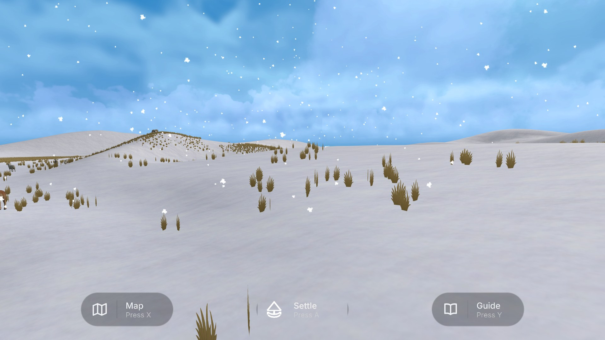
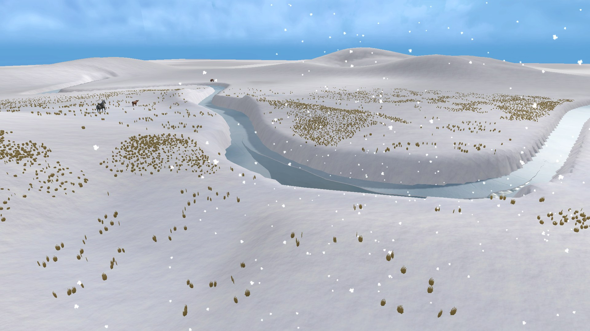
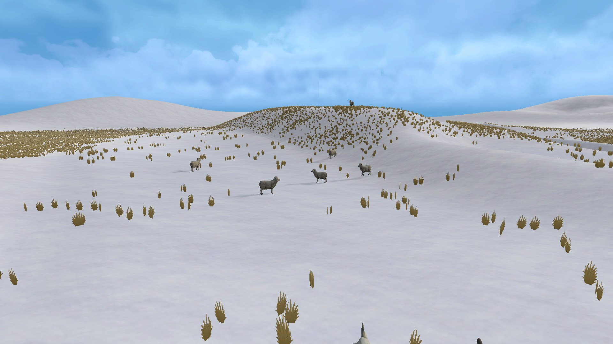
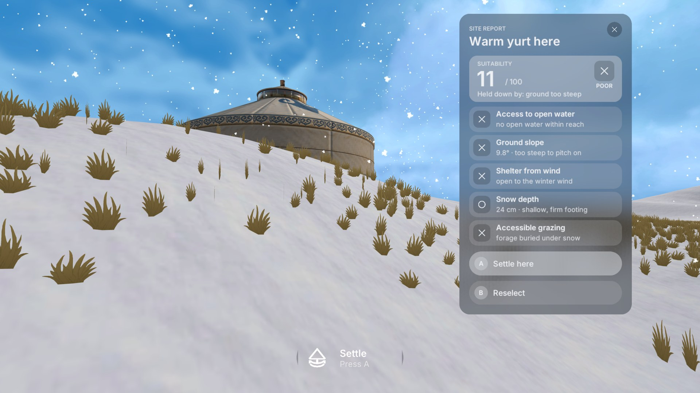
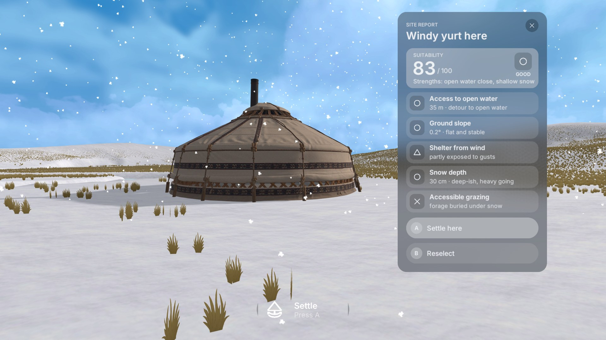

# Week 17 — The Winter Chapter

This week I worked on the last and hardest chapter of the game, deep winter. On the difficulty screen it is labelled Hard, with the description "Deep winter. Find shelter, open water and grass that still shows above the snow." That one sentence sums up the three problems the player has to solve at once. In spring and summer, the main question was how far to stay from the water. In winter, almost everything the family needs is either frozen, buried or exposed to the wind, and the good answers are rare and hidden.

## Snow over the grassland

*The winter steppe near the family camp. Snow covers the ground, and only tufts of dry grass show through.*

The terrain is the same kind of rolling steppe as before, but it is now covered by snow of different depths. I painted the ground with two snow layers, a shallow one and a deep drift layer, and gave the level a separate snow depth map that the game reads when the player chooses a camp. Where the wind blows across open slopes, the snow is thin and dry grass sticks out above it. On the sheltered side of ridges, the wind drops the snow it carries, so deep drifts build up there. This is the opposite of what a beginner might expect. The place that feels safest from the wind is often where the snow is deepest.

The grass also changes. Instead of green summer grass, the level uses short, dry, brown tufts. The player has to look for patches where these tufts are still visible, because that is where animals can still graze. Snow keeps falling during the level, and the player and the animals leave footprints and tracks behind them, which makes the snow feel like a real surface rather than a white texture. The deeper the snow, the slower it is to walk through, and the game uses this when it calculates how far the camp is from water.

## A frozen river with a few open reaches

*The river in winter. Most of it is covered by ice and snow, and only a few short sections stay open. Steep snowy banks make some parts hard to reach.*

In the earlier chapters, water was easy to see and easy to reach. In winter, the river is mostly frozen. Only three short reaches stay open, and these are the only places where the family and animals can drink. The settle tool therefore no longer measures the distance to the river. It measures the walking route to the nearest open water. The route cannot cross ice, and deep snow along the way makes it count as longer. A camp that looks close to the river on the map may actually be a long walk from drinkable water, and the site report says this in plain words, for example "35 m, detour to open water" or "no open water within reach".

The banks also matter. On one side of the river, there is a gentle entry where the ground slopes down to the water. On the other side, a steep bank covered in snow forms a barrier. Being too close to the river is also a problem in winter. If the camp is within about eight metres of the water, the report warns about "thin ice at the river edge", and the score is capped very low. Herders in Mongolia often rely on snow and limited open water for winter, and good winter camps are scarce precisely because they need pasture, shelter and access to water at the same time (Michler et al., 2023).

## Animals in the snow

*Sheep grazing on a windward slope where the snow is shallow and dry grass still shows.*

The herd is the same size as in summer, with twelve sheep, six cattle, three horses and a goat, but they are placed differently. Most of the sheep graze on the windward slopes, where the wind has scoured the snow thin and the grass is reachable. The cattle stay on the flatter ground. Every animal leaves tracks in the snow as it moves, so the player can follow where the herd has been. As in summer, the animals act as a clue, but the clue is now more complicated. Where the sheep graze, there is food, but that is also where the wind is strongest, so it is not automatically a good place for the yurt.

The danger behind this chapter is the Mongolian winter disaster known as dzud. Rao et al. (2015) describe dzud as a harsh winter that causes mass livestock deaths, with different types caused by deep snow, ice that seals the grass, strong winds and extreme cold. Most animals die because they cannot reach food. I used this idea directly in the scoring. Deep snow that buries the grass, wind exposure and lack of open water are the three things that lower a winter camp's score the most.

## Camp placement

*A camp on a steep, exposed slope near a drift. It scores 11 out of 100: too steep, open to the wind, far from open water, with the grazing buried.*

*The best area in the level, on flat ground east of the river. With the windy yurt, it scores 83. Even here, the grazing row still shows a cross.*

Winter uses its own set of rules in the settle tool, and the site report changes its five rows to match: access to open water, ground slope, shelter from wind, snow depth and accessible grazing. Shelter has the largest share of the score, followed by open water, snow depth, accessible grazing, flat ground and avoiding cold hollows where cold air settles. On top of this, there are hard limits. If the snow is deeper than about forty-five centimetres, the yurt would be buried and the score cannot go above 40. If the site is fully open to the wind, it cannot go above 50. If there is no open water within about ninety metres of walking, it cannot go above 45. If the ground is too steep or the camp is on the thin ice edge, it cannot go above 30. The report names the most important problem directly, for example "deep drift buries the yurt" or "full force of the winter wind".

This creates real trade-offs between places that each look good for one reason. The lee side of a ridge is sheltered but filled with deep drift. The windward slope has shallow snow and visible grass but is fully exposed. The river edge has water but thin ice. Even the three existing family yurts score poorly in winter, because the nearest open water is now a long walk away. When I tested a large grid of possible sites with the warm yurt, fewer than one percent scored above 60, and none reached 80. The best area is a small patch of flat ground east of the river, near one of the open reaches. There, the warm yurt reaches about 74, and only the windy yurt, whose low frame resists the wind, goes above 80. The cold yurt, with its thick felt, also helps by softening the penalties for snow and cold hollows. So in winter, choosing the right yurt type is no longer a small bonus. It is part of finding a good answer at all.

## Why winter is the hardest chapter

Each chapter builds on the one before. Spring teaches the basic reading of water, ground and grass. Summer adds flooding and the herd. Autumn adds wind and the walking route to water. Winter then asks the player to use all of these at the same time, and it adds snow depth on top. Gee (2005) describes this as one of the strengths of good games: skills are learned in a simple form first, then combined and tested again in harder situations, with less help each time.

The difficulty comes from four things. First, the main resources are hidden. Water is under ice, and grass is under snow, so the player has to look for the few places where they still show. Second, the rules pull against each other. Shelter from wind usually means deep snow, and visible grass usually means exposure, so no spot is good at everything. Third, the score is much stricter. In earlier chapters, many places were acceptable. In winter, most of the map scores below 40 and only a small area works, which reflects how scarce good winter camps really are (Michler et al., 2023). Fourth, the yurt type now matters to the result. Winter and spring camps in Mongolia are traditionally placed in foothills sheltered from strong winds (Ono and Ishikawa, 2020), and the windy and cold yurts are the game's way of letting the player adapt to these conditions.

At the same time, the chapter tries to stay fair. The difficulty screen tells the player what to look for, every report names the main problem in plain words, and the animals, the visible grass and the open water all point towards the answer. The player is not meant to find the perfect spot by luck, but to read the winter land the way a herder would.

## References

Gee, J.P. (2005) 'Learning by design: good video games as learning machines', *E-Learning*, 2(1), pp. 5–16. Available at: https://doi.org/10.2304/elea.2005.2.1.5

Michler, L.M., Kaczensky, P., Oyunsaikhan, G. et al. (2023) 'To move or not to move: factors influencing small-scale herder and livestock movements in the Dzungarian Gobi, Mongolia', *Regional Environmental Change*, 23, 131. Available at: https://doi.org/10.1007/s10113-023-02126-y

Ono, C. and Ishikawa, M. (2020) 'Pastoralists' herding strategies and camp selection in the local commons: a case study of pastoral societies in Mongolia', *Land*, 9(12), 496. Available at: https://doi.org/10.3390/land9120496

Rao, M.P. et al. (2015) 'Dzuds, droughts, and livestock mortality in Mongolia', *Environmental Research Letters*, 10(7), 074012. Available at: https://doi.org/10.1088/1748-9326/10/7/074012
