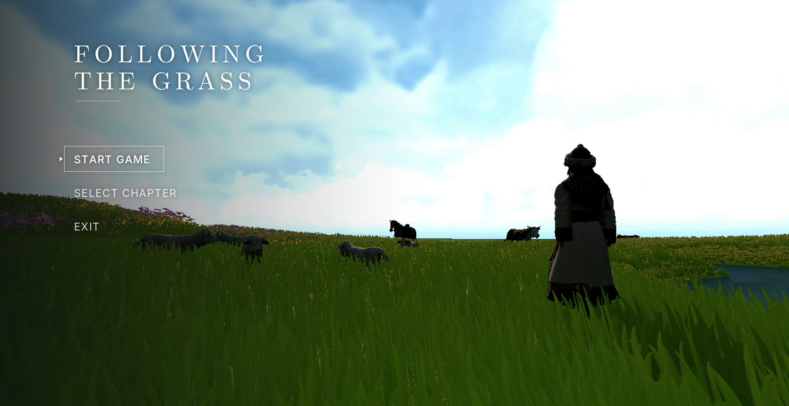
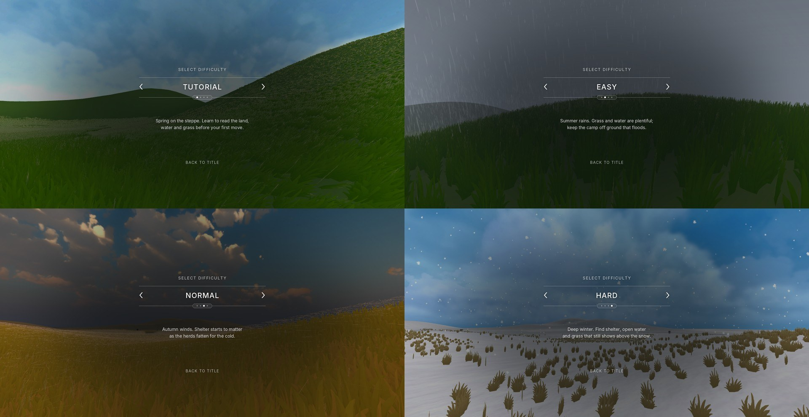
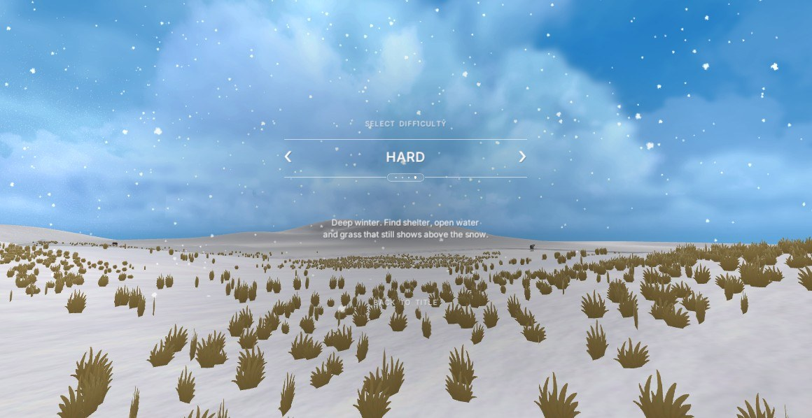

# Week 18 — Cover and Level Select Design

This week I designed the first two screens the player sees: the cover, which is the title screen with the main menu, and the level select screen, where the player chooses a season and difficulty. These screens are short, but they set the tone for the whole game. Before the player has walked a single step, they should already understand that this is a quiet game about a family, their herd and the open steppe, and that each level is a different season.

## The cover

### Reference

*Reference: the main menu of The Witcher 3: Wild Hunt (CD Projekt Red, 2015). A single character in a dramatic scene, with a short menu in a narrow column on the left.*

For the cover, I looked at the main menu of The Witcher 3. What I liked about it is that the menu is not a separate page. It sits on top of a live scene with the main character in it, so the cover already shows the world and the mood of the game. The menu itself is only four short words in a narrow column on the left, and the rest of the screen is given to the image. I wanted the same idea for my game: a live view of the grassland with a herder in it, and a menu that takes up as little space as possible.

### Final cover

## The level select screen

### Reference

*Reference: a game difficulty screen found online. One option at a time, with arrows on each side, small dots below and a one-line description.*

For the level select screen, I used a reference that shows one difficulty at a time in the centre of the screen. The player switches between options with arrows on the left and right, a row of small dots shows how many options there are and which one is selected, and a single sentence below explains what this option means. I liked that it does not show a list of all the levels at once. Each choice gets the whole screen, which makes the decision feel more important.

### Seasons as difficulty

*Design mockup for the Tutorial option. The spring grassland fills the background behind the selector.*

*The four options side by side: Tutorial in spring, Easy in summer rain, Normal in autumn and Hard in winter.*

In my game, each difficulty is also a season, so I made the background change with the selection. When the player moves from one option to the next, the scene behind the selector fades to that season's landscape: green spring hills for Tutorial, grey summer rain for Easy, a golden autumn evening for Normal and a snowfield for Hard. The weather effects run in the background too, so rain and snow are visible behind the text. This means the player does not only read that winter is hard, they can see the snow before they choose it. The order of the seasons also matches the real yearly cycle of moving camps, which gives the difficulty levels a natural order.

Each option has one short description that tells the player what to pay attention to in that season. Spring says to learn to read the land, water and grass. Summer warns about ground that floods. Autumn says that shelter starts to matter. Winter asks the player to find shelter, open water and grass that still shows above the snow. These sentences work like a short briefing. Together with the guide and the site report inside the game, they make sure that the player always knows what kind of problem each season brings before they start.

### Final level select

*The final level select screen with Hard selected. Snow falls in front of the winter background.*

The final layout keeps all the elements in a single centred column: a small "Select Difficulty" label, the name of the option between two arrows and two thin lines, the row of dots, the description, and "Back to Title" at the bottom. The text is white, the lines are thin, and there are no boxes or panels, which matches the cover so that the two screens feel like one sequence. Only the background changes between options. Keeping the interface the same and letting the world change makes the season the main message of the screen.

## References

CD Projekt Red (2015) *The Witcher 3: Wild Hunt* [Video game]. Warsaw: CD Projekt.

Fagerholt, E. and Lorentzon, M. (2009) *Beyond the HUD: user interfaces for increased player immersion in FPS games*. MSc thesis. Chalmers University of Technology.
