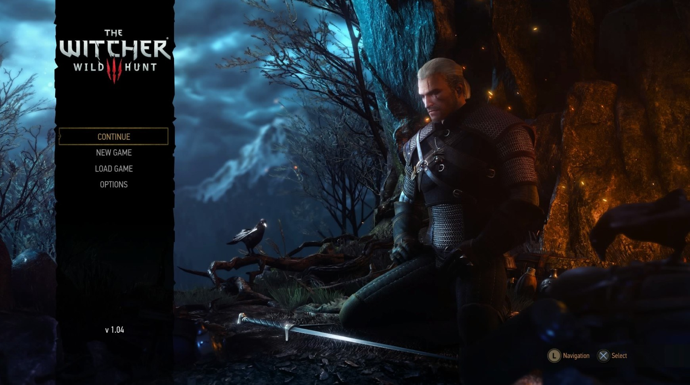
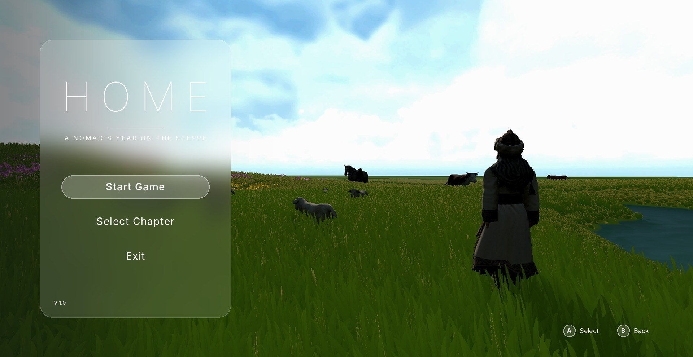
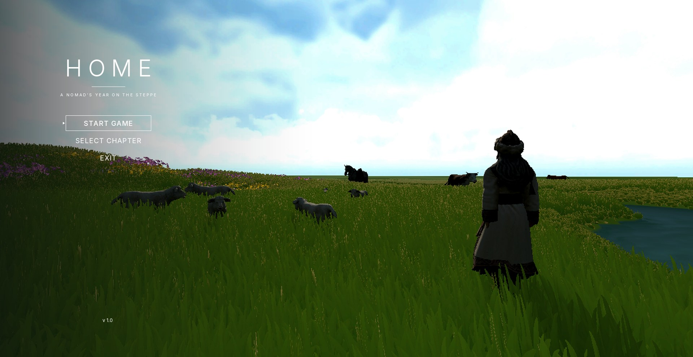
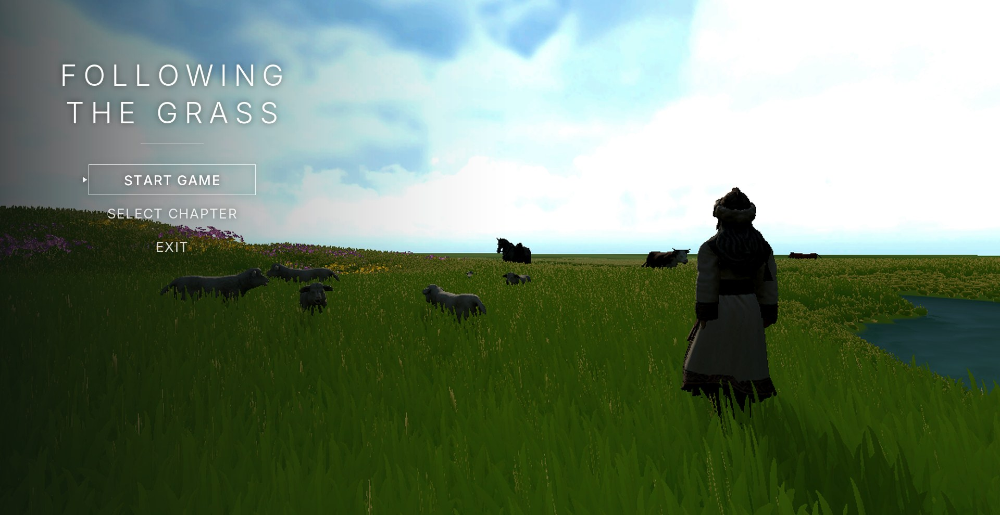
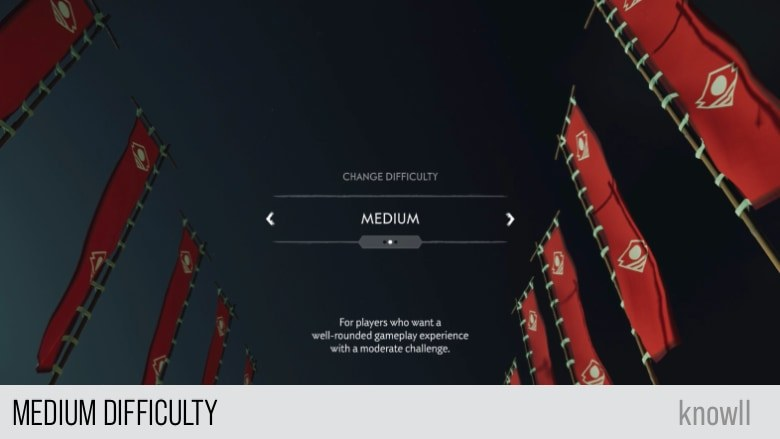
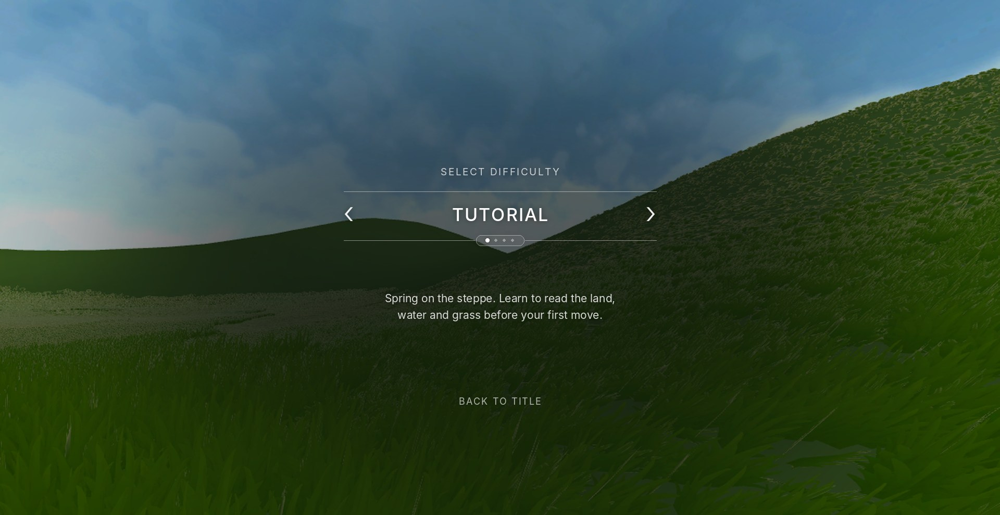

# Week 18 — Cover and Level Select Design

This week I designed the first two screens the player sees: the cover, which is the title screen with the main menu, and the level select screen, where the player chooses a season and difficulty. These screens are short, but they set the tone for the whole game. Before the player has walked a single step, they should already understand that this is a quiet game about a family, their herd and the open steppe, and that each level is a different season.

## The cover

### Reference

*Reference: the main menu of The Witcher 3: Wild Hunt (CD Projekt Red, 2015). A single character in a dramatic scene, with a short menu in a narrow column on the left.*

For the cover, I looked at the main menu of The Witcher 3. What I liked about it is that the menu is not a separate page. It sits on top of a live scene with the main character in it, so the cover already shows the world and the mood of the game. The menu itself is only four short words in a narrow column on the left, and the rest of the screen is given to the image. I wanted the same idea for my game: a live view of the grassland with a herder in it, and a menu that takes up as little space as possible.

### First version

*The first version. The menu sits inside a frosted glass panel, with the working title "HOME" and button hints in the corner.*

The first version used the working title "HOME" and placed the menu inside a tall frosted glass panel on the left, in the same style as the in-game interface. The scene behind it already showed the final idea: a herder seen from behind, standing in the grass and looking out over the river and the grazing animals. Seeing the character from behind invites the player to look where they are looking, so the landscape becomes the subject of the cover. However, the glass panel felt too heavy for a title screen. It looked more like a settings window than a cover, and it blocked a large part of the grassland.

### Removing the panel and changing the title

*The second version. The panel is removed, and the menu sits directly on the scene.*

*The third version, with the new title "Following the Grass".*

In the next version, I removed the panel completely and placed the title and menu directly on the scene, with a soft dark gradient on the left to keep the white text readable against the bright sky. This let the grassland run across the whole screen. I then changed the title from "HOME" to "Following the Grass". The new title describes what nomadic herders actually do: they move through the seasons to wherever the grass is good. It also hints at the structure of the game, where each chapter follows the grass into a new season. The title is set in a thin serif typeface with wide letter spacing on two lines. The serif gives it a calmer, more literary feeling than the sans-serif used in the game's interface, which suits a title rather than a tool.

### Final cover

*The final cover. The title is larger, and the three options sit in a short column below it, with only the selected option highlighted by a thin outline.*

In the final version, the title is larger and placed higher, and the menu is reduced to three options: Start Game, Select Chapter and Exit. Only the selected option has a thin outline and a small marker, and the others are plain text. There are no colours other than white, and nothing moves except the grass, the clouds and the animals in the scene. The menu stays on the left third of the screen, and the herder stands on the right third, so the eye moves from the title across the grassland to the figure. In VR, the same layout appears as a panel in front of the player, so they see the cover as a place they are standing in rather than a flat picture. Fagerholt and Lorentzon (2009) describe how interfaces that are placed into the game world, instead of on top of it, can support immersion. The cover follows this idea in a simple way, because the menu is a light layer over a real scene from the first chapter.

## The level select screen

### Reference

*Reference: a game difficulty screen found online. One option at a time, with arrows on each side, small dots below and a one-line description.*

For the level select screen, I used a reference that shows one difficulty at a time in the centre of the screen. The player switches between options with arrows on the left and right, a row of small dots shows how many options there are and which one is selected, and a single sentence below explains what this option means. I liked that it does not show a list of all the levels at once. Each choice gets the whole screen, which makes the decision feel more important.

### Seasons as difficulty

*Design mockup for the Tutorial option. The spring grassland fills the background behind the selector.*

*The four options side by side: Tutorial in spring, Easy in summer rain, Normal in autumn and Hard in winter.*

In my game, each difficulty is also a season, so I made the background change with the selection. When the player moves from one option to the next, the scene behind the selector fades to that season's landscape: green spring hills for Tutorial, grey summer rain for Easy, a golden autumn evening for Normal and a snowfield for Hard. The weather effects run in the background too, so rain and snow are visible behind the text. This means the player does not only read that winter is hard, they can see the snow before they choose it. The order of the seasons also matches the real yearly cycle of moving camps, which gives the difficulty levels a natural order.

Each option has one short description that tells the player what to pay attention to in that season. Spring says to learn to read the land, water and grass. Summer warns about ground that floods. Autumn says that shelter starts to matter. Winter asks the player to find shelter, open water and grass that still shows above the snow. These sentences work like a short briefing. Together with the guide and the site report inside the game, they make sure that the player always knows what kind of problem each season brings before they start.

### Final level select

*The final level select screen with Hard selected. Snow falls in front of the winter background.*

The final layout keeps all the elements in a single centred column: a small "Select Difficulty" label, the name of the option between two arrows and two thin lines, the row of dots, the description, and "Back to Title" at the bottom. The text is white, the lines are thin, and there are no boxes or panels, which matches the cover so that the two screens feel like one sequence. Only the background changes between options. Keeping the interface the same and letting the world change makes the season the main message of the screen.

## References

CD Projekt Red (2015) *The Witcher 3: Wild Hunt* [Video game]. Warsaw: CD Projekt.

Fagerholt, E. and Lorentzon, M. (2009) *Beyond the HUD: user interfaces for increased player immersion in FPS games*. MSc thesis. Chalmers University of Technology.
