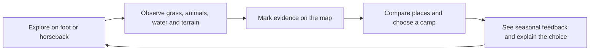
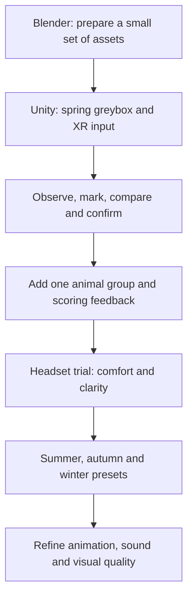

# Week 05 — Four Seasons, One Decision

*Following the Grass — detailed prototype proposal*

I want the player to learn how to read a place before deciding to live there. The same green patch, river or sheltered slope can mean something different as conditions change. This proposal fixes the four seasonal scenarios, the first scoring rules and the skills I need to build them.

**Research question:** How can an embodied VR experience help design learners understand how environmental conditions shape Mongolian pastoral decisions, and develop greater cross-cultural contextual sensitivity?

The prototype will focus on environmental observation. It will not attempt to represent every part of pastoral life. Family relationships, access rights, labour and infrastructure also affect decisions; a campsite score cannot describe all of these.

> **Evidence and design:** My research method is a literature review. I have not conducted structured interviews. Some published studies include interviews conducted by their authors; those remain secondary evidence for this project. All empirical claims below have sources. Scenario layouts, score weights and interaction rules are my proposed design decisions, pending testing.

## 1. The playable experience

The player joins a herding household, explores the surrounding land, records observations and chooses a camp location. A guide introduces grass, animals, water and terrain in the spring tutorial. Later scenarios offer less guidance. The player can revisit observations before confirming a choice.

Each level will be a compact, deliberately arranged landscape. Longer journeys use horseback travel. Distances and seasonal time are compressed for the experience; the map is not a geographical reconstruction of real migration routes.

## 2. The four-season system

| Scenario | Landscape and resources | Animal cues to prototype | Main decision |
|---|---|---|---|
| **Spring — guided introduction** | Fresh growth mixed with shorter and more heavily used patches. A visible river, gentle slopes and an exposed ridge make comparisons clear. | Small groups graze and move between available patches; individual animation timings vary. | Learn to compare forage, water access and shelter together. |
| **Summer drought — easy exploration** | Moderate-height grass with uneven cover; dry stretches interrupt the river, with a remaining pool or lake. The camp is within a short ride of several options. | Herd routes respond to available forage and reachable water. Activity changes are readable but not exaggerated. | Balance useful pasture against water access. A green-looking area alone is insufficient. |
| **Autumn — intermediate planning** | A mixture of mature, drying and locally greener vegetation. Low ridges create choices between exposed pasture and sheltered ground. | Animals continue grazing; feedback introduces the need to consider the coming cold period. | Compare current resources with a location's suitability as conditions worsen. |
| **Winter — difficult exploration** | Standing dry grass remains beneath patchy shallow and deep snow. Ridges, drifts and low areas alter access. Much of the river is frozen, with limited accessible water. | Sheep and goats use reachable grazing patches; blocked routes lead to pauses or detours. Cattle use designated passable areas. These are simplified behaviours to validate. | Find accessible forage and water while accounting for exposure and movement routes. |

Seasonal forage and mobility are supported by Jordan et al. (2016) and Michler et al. (2023). Winter preparation and difficulty accessing pasture through snow are discussed by Soma and Schlecht (2018). The exact combinations above are my scenario designs.

**Grass:** height, cover, colour and edible forage will be separate properties. A tall patch can contain little usable food, and snow can hide vegetation without removing it. I will establish short, medium and tall visual categories first. Centimetre cutoffs need species- and season-specific evidence before they become scoring thresholds. The vegetation review reports different responses across steppe types, which argues against one universal density rule (Munkhzul et al., 2021).

**Water and terrain:** players should inspect the approach to a source as well as its location. Frozen water does not automatically mean that all water is unavailable. Snow can also be a winter water source in some pastoral settings (Michler et al., 2023). The winter scenario will state which sources the household can use. It will not ask players to judge real ice safety from appearance.

**Animals:** their movement should respond to the same resource and route data used by the level. They should not independently reveal a hidden “correct campsite”. An unsettled animation is a designed clue, not a diagnosis of anxiety. 

## 3. Scoring criteria and their evidence

The literature supports the relevance of the criteria. It does **not** provide a validated 100-point campsite assessment. I am proposing the following rubric to make consequences understandable.

| Criterion | What the prototype assesses | Player evidence | Literature basis and limit |
|---|---|---|---|
| **G — Accessible forage** | Usable forage within the local grazing area, including whether animals can reach it. | Cover, plant condition, exposed vegetation and grazing activity. | Vegetation quantity and quality vary across pasture types and seasons (Jordan et al., 2016; Munkhzul et al., 2021). Colour and height are incomplete proxies. |
| **W — Usable water** | Whether the household has a usable source and a practical route to it. | Flowing or standing water, an accessible bank, blocked approaches and the scenario's source information. | Water access is one influence on mobility (Jordan et al., 2016). Exact distance penalties are design values. |
| **T — Camp and route suitability** | A stable place for the ger and passable routes connecting camp, pasture and water. | Ground shape, slope, obstacles and snow-blocked routes. | Topography forms part of pastoral movement decisions (Jordan et al., 2016). The papers do not establish a universal acceptable slope angle. |
| **H — Weather exposure** | The camp's exposure under the current scenario, including wind and cold in winter. | Ridge position, wind cues, shelter and local snow accumulation. | Winter shelter and preparedness matter (Michler et al., 2023; Soma and Schlecht, 2018). Local wind and snow patterns are authored approximations. |

## 4. Why I am moving from TouchDesigner to VR

I will use **Unity with a VR headset and controllers** for this prototype. TouchDesigner gesture interaction and room projection are outside the first build.

The main task now involves looking across terrain, approaching animals and comparing places from a consistent first-person position. Head tracking and stereoscopic views suit that task. Slater's account of presence links the feeling of being in a virtual place to the actions and sensory responses supported by the system (Slater, 2009). This supports my choice of format; it does not establish that VR teaches culture better than projection.

Unity also gives me one place to combine the environment, animal states, audio, map, scoring and controller input. A projection setup would add room calibration and a separate gesture pipeline to my current workload. Controller actions give the first prototype a small, repeatable set of interactions while I concentrate on the learning task.

| Situation | Planned VR input |
|---|---|
| Look and inspect nearby details | Turn the head and move physically within the tracked play area. |
| Talk, inspect or select a map entry | Point with a controller and press the trigger. |
| Touch a sheep | Move the controller near the animal and make a short stroking movement. |
| Travel farther | Mount a horse; use the left thumbstick to move/turn, right trigger to accelerate and A to dismount. |
| Compare and confirm a camp | Open the map, select observations and confirm the proposed location. |

Room-scale movement cannot cover the whole virtual landscape. Horse travel provides the longer-distance option, and headset tracking remains active while riding. I will check comfort, readable UI and alternative travel options in an early headset trial. Unity's XR Interaction Toolkit provides interaction and locomotion building blocks for this work (Unity Technologies, n.d.).

## 5. Skills and build order

## References — Harvard style

Jordan, G., Goenster, S., Munkhnasan, T., Shabier, A., Buerkert, A. and Schlecht, E. (2016) ‘Spatio-temporal patterns of herbage availability and livestock movements: A cross-border analysis in the Chinese-Mongolian Altay’, *Pastoralism*, 6, article 12. Available at: https://doi.org/10.1186/s13570-016-0060-2.

Michler, L.M., Kaczensky, P., Oyunsaikhan, G., Bartzke, G.S., Devineau, O. and Treydte, A.C. (2023) ‘To move or not to move—factors influencing small-scale herder and livestock movements in the Dzungarian Gobi, Mongolia’, *Regional Environmental Change*, 23, article 131. Available at: https://doi.org/10.1007/s10113-023-02126-y.

Munkhzul, O., Oyundelger, K., Narantuya, N., Tuvshintogtokh, I., Oyuntsetseg, B., Wesche, K. and Jäschke, Y. (2021) ‘Grazing effects on Mongolian steppe vegetation—A systematic review of local literature’, *Frontiers in Ecology and Evolution*, 9, article 703220. Available at: https://doi.org/10.3389/fevo.2021.703220.

Slater, M. (2009) ‘Place illusion and plausibility can lead to realistic behaviour in immersive virtual environments’, *Philosophical Transactions of the Royal Society B: Biological Sciences*, 364(1535), pp. 3549–3557. Available at: https://doi.org/10.1098/rstb.2009.0138.

Soma, T. and Schlecht, E. (2018) ‘The relevance of herders’ local ecological knowledge on coping with livestock losses during harsh winters in western Mongolia’, *Pastoralism*, 8, article 3. Available at: https://doi.org/10.1186/s13570-017-0108-y.

Unity Technologies (n.d.) *Locomotion overview: XR Interaction Toolkit 3.1.1*. Available at: https://docs.unity.cn/Packages/com.unity.xr.interaction.toolkit%403.1/manual/locomotion.html (Accessed: 29 October 2026).

