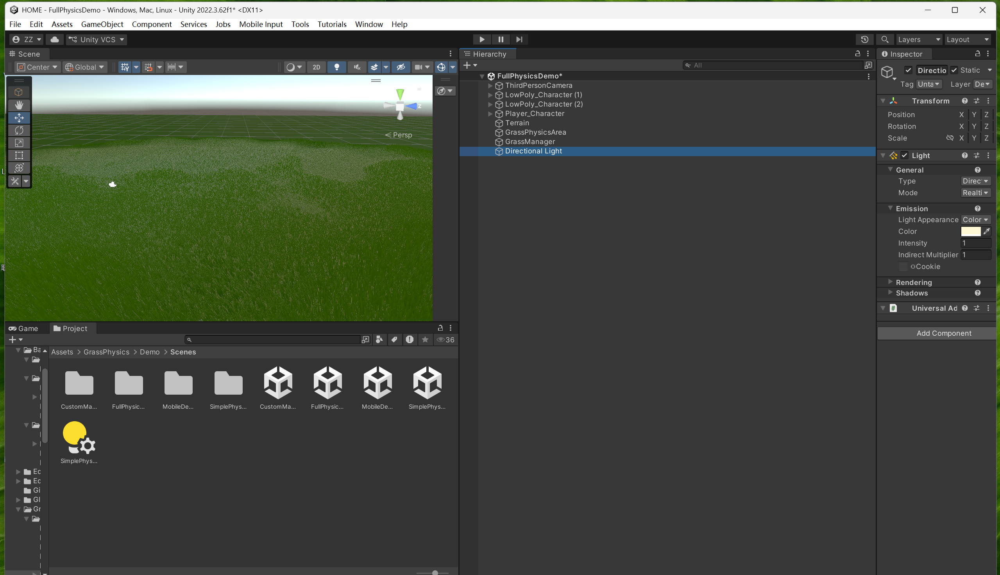
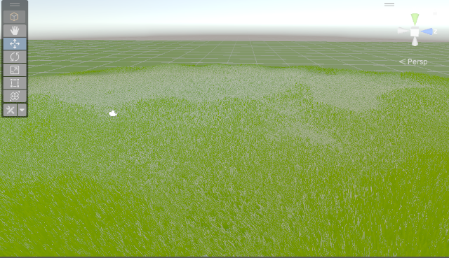
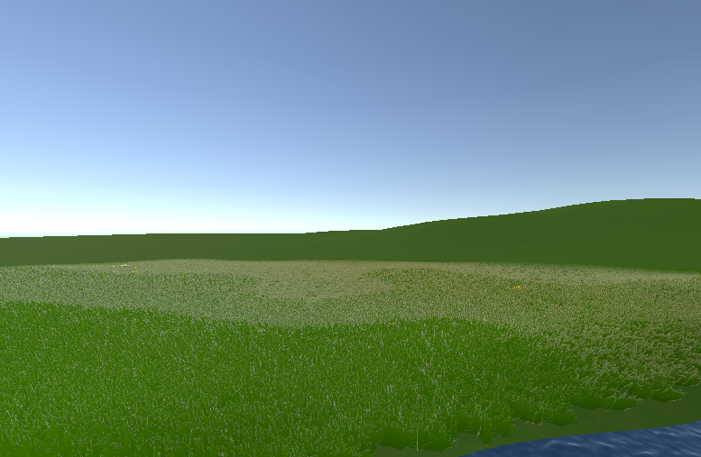
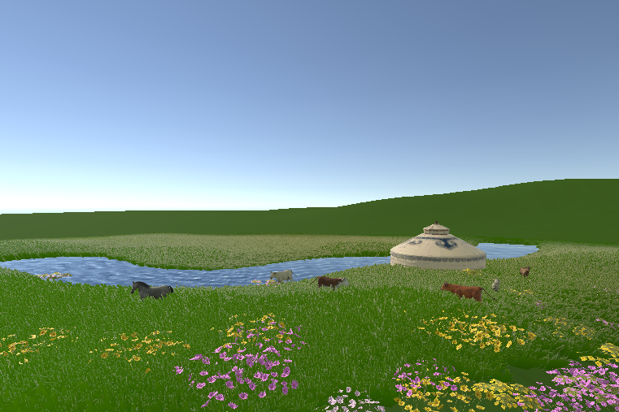
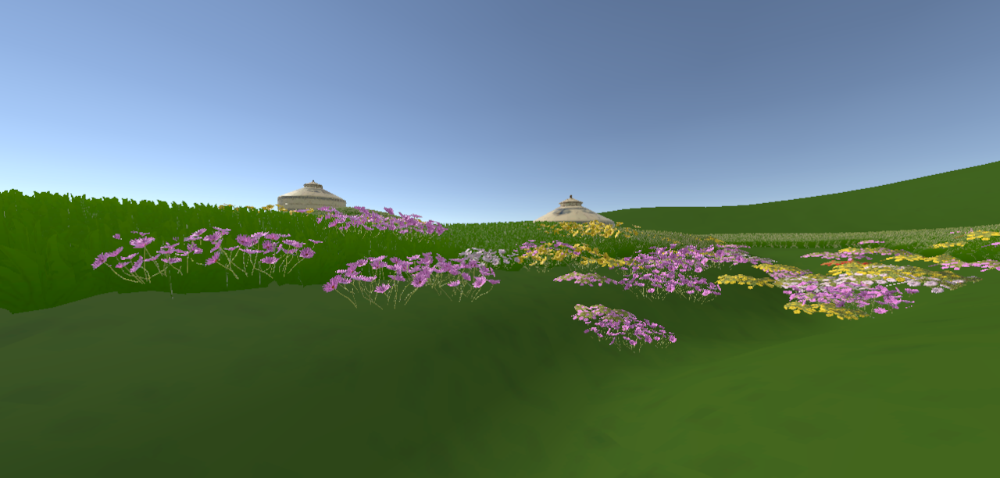
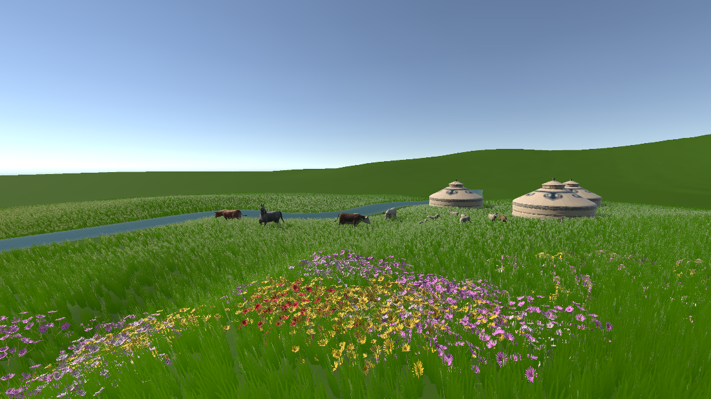

# Week 07 — Spring Grassland Blockout

This week I began building the spring grassland in Unity. The work moved from a first grass coverage test to a larger landscape with a river, flowers, livestock and Mongolian gers. The scene is an early blockout: I was testing scale, density and places that could draw the player into exploring.

## Building the grass surface

I used [Grass Physics Asset by ST Shaded Technology](https://assetstore.unity.com/packages/vfx/shaders/grass-physics-asset-125101) for the grass system. Mesh patches gave the ground a fuller grassland appearance, and I tested a wind response. I chose this approach instead of scattering detailed individual grass models everywhere because the project is intended for VR, where grass coverage has to be balanced against the hardware budget. The grass density and rendering cost still need profiling on the target headset.

The first editor view shows the Terrain, GrassPhysicsArea and GrassManager in the scene hierarchy. A live Scene View capture from the active FullPhysicsDemo scene records the grass setup; it is a grass test scene and does not contain the later river composition.

*The first grass setup, with the Terrain, GrassPhysicsArea and GrassManager visible in the hierarchy.*

I tested the grass coverage, started extending the playable landscape and began adding a river. The recovered process image shows the first field test and the water entering the edge of the scene.

## Adding landmarks and life

I added flowers as visual points of interest so that the player would have reasons to move through the grassland. I then placed cattle, sheep and horses, followed by a ger. The flowers, livestock and other environmental models came from public free assets. The ger, character and furniture were custom-made for the project.

## Testing coverage and terrain shape

I compared dense grass with a deliberately sparse lawn to see how much coverage the scene needed. The test made the open ground and the flower clusters easier to judge. I then reshaped the terrain with surrounding slopes and added two more gers, giving the meadow a more enclosed feel and creating additional destinations.

The first play-mode start view brought the main elements together: river, grass, flowers, livestock and three gers. This helped me check how the scene reads from a player's starting position rather than only from the editor.

## Reflection

The early tests showed that grass coverage changes the whole feeling of the landscape. Dense mesh grass makes the meadow read as continuous, while open patches give room for routes and landmarks. The flowers, river and gers began to break up the broad green surface and suggest places to explore. The next pass should refine grass transitions and river banks, then measure the cost of the chosen density on the VR target hardware.

