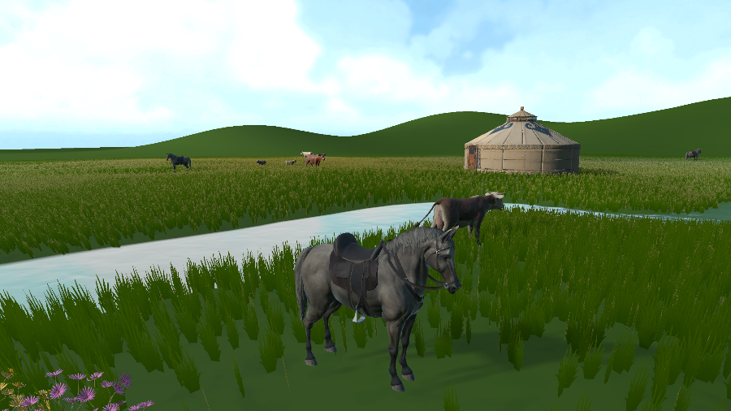
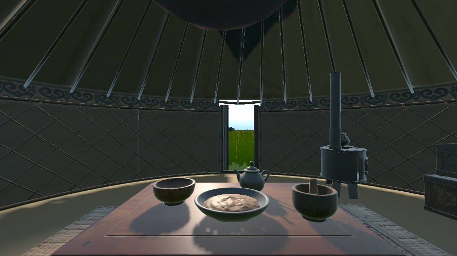

# Week 08 — Landscape Tuning and Ger Interior

This week I returned to the spring grassland to tune its natural details and work out what the player should experience first. I focused on the height and coverage of the grass, how the river responds to the sky, and how the ger interior could feel like an everyday living space.

## Tuning the landscape

I adjusted the grass height and coverage to make the field feel more like a meadow than a uniform carpet. The height changes how much of the ground and nearby objects remain visible, while the coverage affects how open or enclosed each part of the landscape feels. I wanted the grass to fill the wide field while leaving enough variation around the river, flowers and gers for the player to read the scene and notice places to explore.

I also worked on the river with the URP Water asset. I tried different water textures and added a spring skybox, then checked whether the water surface responded to the sky. Seeing the sky reflected in the river helped connect the water to the rest of the scene. It also gave me a way to judge whether the river felt like part of the landscape, rather than a flat strip placed across it.

*The river sits among the grass, flowers and gers.*

I compared the water material from a closer view beside the river. Here I was checking the surface texture, its pale blue colour and how the bright sky appeared on the water. The grass along the bank helped me judge whether the edge felt connected to the ground. The main purpose of this test was to make the river look more natural within the meadow.

*Checking the water texture and sky reflection against the grassy bank.*

## Choosing a starting place

At first I planned to place the player outside the ger. After reading Nguyen’s (2024) discussion of home bases, I started thinking about the spawn point as more than a place where the player appears. The paper describes home bases as places players can dwell, feel familiar and safe, and return to. I took this as a reminder that the first space a player sees can help set the feeling of the whole experience. I began to think of the spawn point as an emotional anchor.

This changed what I wanted to build around the start of the game. Instead of presenting only the open grassland, I wanted the player to first encounter a lived-in ger, with familiar objects that suggest daily routines. The outside view still shows the initial idea, while the open entrance leads into the interior I began arranging.

*The first plan placed the player outside the ger.*

*The open entrance leads into the living space.*

## Furnishing the ger

I added four main pieces of furniture: a tea table, an iron stove, a storage chest and a daybed. I placed small items on the table and added a rug and floor cushion to give the interior more signs of use. The table suggests eating and drinking, the stove gives the space a practical centre, and the chest and bed make it feel like somewhere to keep belongings and rest. Together, these objects make the ger read as a home within the larger grassland, rather than only as a landmark outside.

*The furniture gives the ger a sense of everyday use.*

From the player's view, the table and stove sit within the same small space as the doorway to the grassland. Seeing the open field from beside the household objects helps connect the interior to the wider world outside.

*The table and stove frame the grassland beyond the entrance.*

## Light and shadows

I tested how light entered through the gaps around the ger’s roof crown. The opening brings a small view of the sky into the interior and gives the roof structure a clear focal point. I also adjusted the shadows cast by the objects. This helped the furniture sit more naturally in the space and made the light and darker areas easier to read together.

*The roof opening brings light into the ger.*

## Reflection

This week connected the landscape work with the player’s first moments in it. Grass height and coverage change how open the meadow feels, while the water and skybox help the river sit within the scene. Inside the ger, furniture, light and shadows begin to make the starting space feel lived in. My next step is to check the interior from the player’s eye height and continue tuning the grass and water for the VR experience.

## Reference

Nguyen, A.-T. (2024) ‘The Dynamic Roles of Home Bases: Finding Home in Game Worlds’, *Proceedings of DiGRA 2024: Playgrounds*. [https://doi.org/10.26503/dl.v2024i1.2226](https://doi.org/10.26503/dl.v2024i1.2226).
