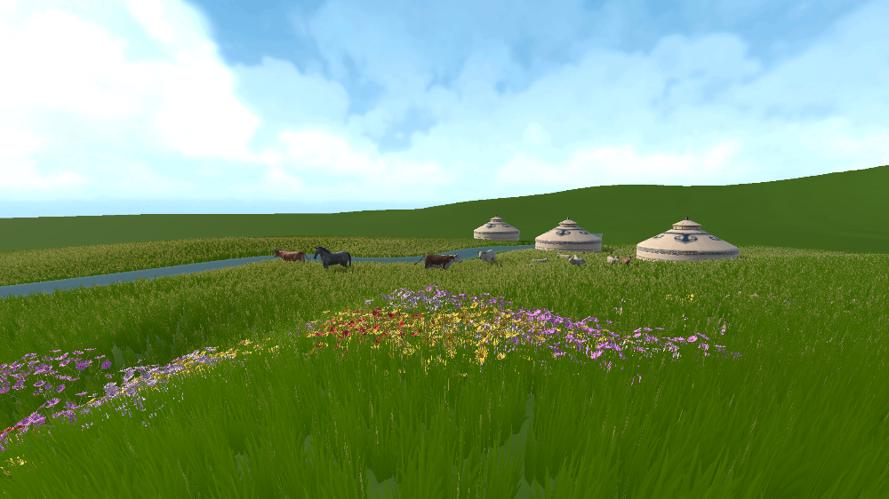
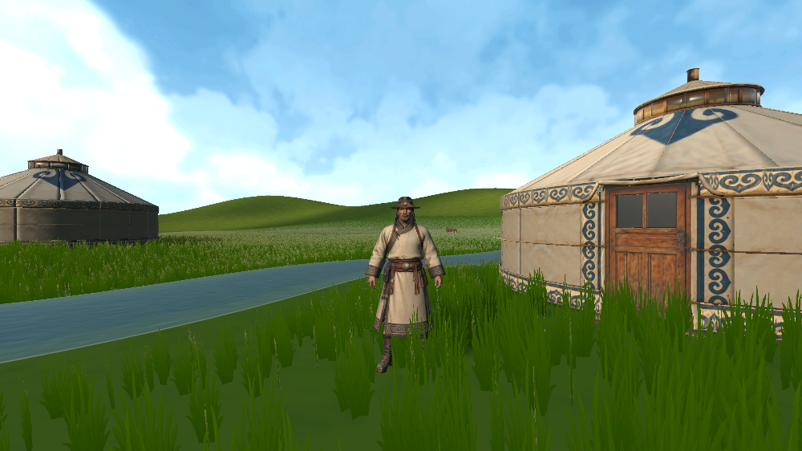
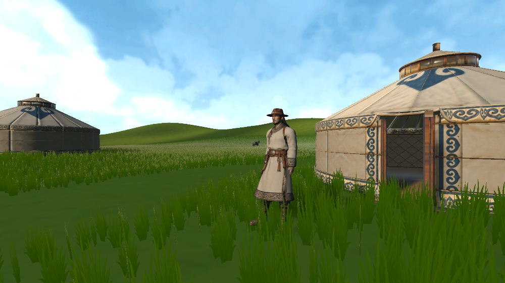
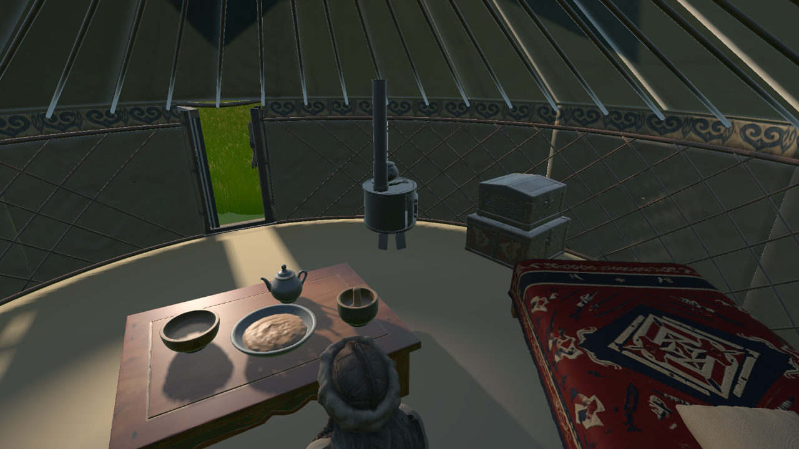
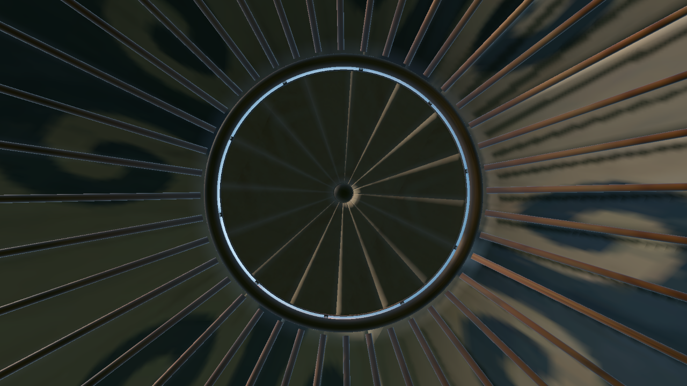

# Week 08 — Landscape Tuning and Ger Interior

This week I began tuning the spring landscape and shaping the player’s first moments inside the ger.

## Tuning the landscape

I adjusted the grass height and coverage so the field felt less like one even carpet. I also tested water textures with the URP Water asset. After adding a spring skybox, I checked that the sky’s colour appeared on the water surface. The reflection helped the river feel connected to the landscape instead of reading as a flat strip.

*The skybox and river bring the water into the wider landscape.*

## Choosing a starting place

At first I planned to place the player outside the ger. Nguyen (2024) describes game home bases as places where players can pause, feel familiar and safe, and return to. I applied that idea to the spawn point, which I began to see as an emotional anchor. I decided to build the ger interior around it so the player can meet the world through a lived-in space.

*The initial starting point was outside the ger.*

*The entrance opens onto the living space inside.*

## Furnishing the ger

I added four main household pieces: a tea table, an iron stove, a storage chest and a daybed. A rug and floor cushion help the interior feel used. The objects make the ger feel like a place where someone lives, not just a landmark in the grassland.

*The furniture gives the starting space a sense of everyday use.*

## Light and shadows

I tested light passing through the gaps around the roof crown. I also adjusted the furniture shadows so they sit more naturally across the floor while keeping the interior details visible.

*The roof openings let light reach the interior.*

## Reflection

Treating the ger as the player's first place to belong gives the spawn a clearer emotional starting point. The next step is to check the interior at VR eye height and keep tuning the grass, water and shadows for comfort and performance.

## Reference

Nguyen, A.-T. (2024) ‘The Dynamic Roles of Home Bases: Finding Home in Game Worlds’, *Proceedings of DiGRA 2024: Playgrounds*. [https://doi.org/10.26503/dl.v2024i1.2226](https://doi.org/10.26503/dl.v2024i1.2226).
