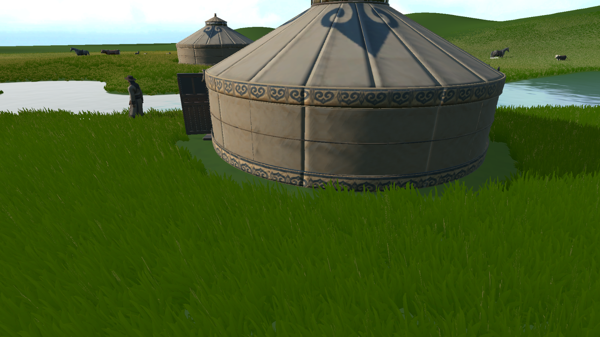
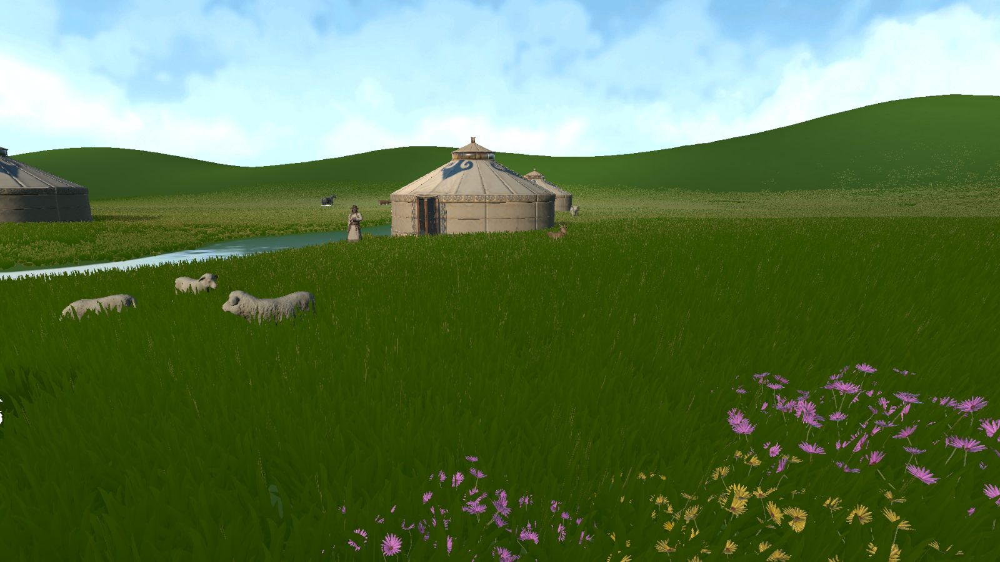
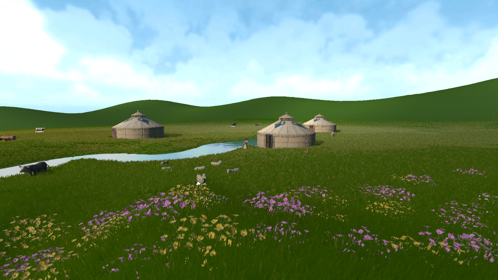
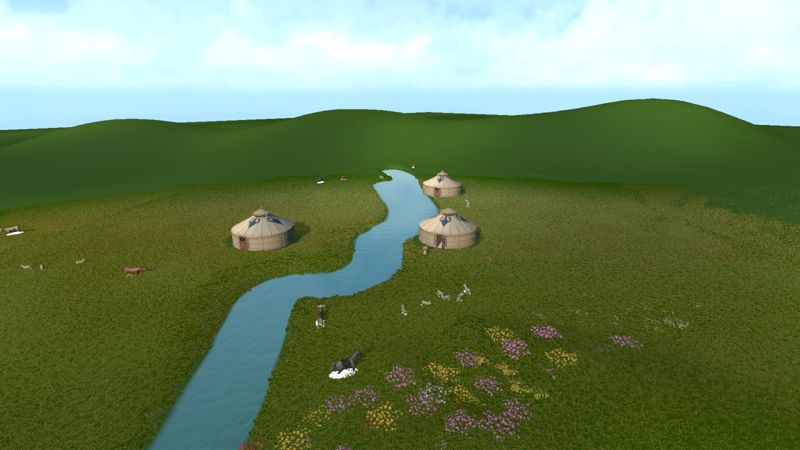
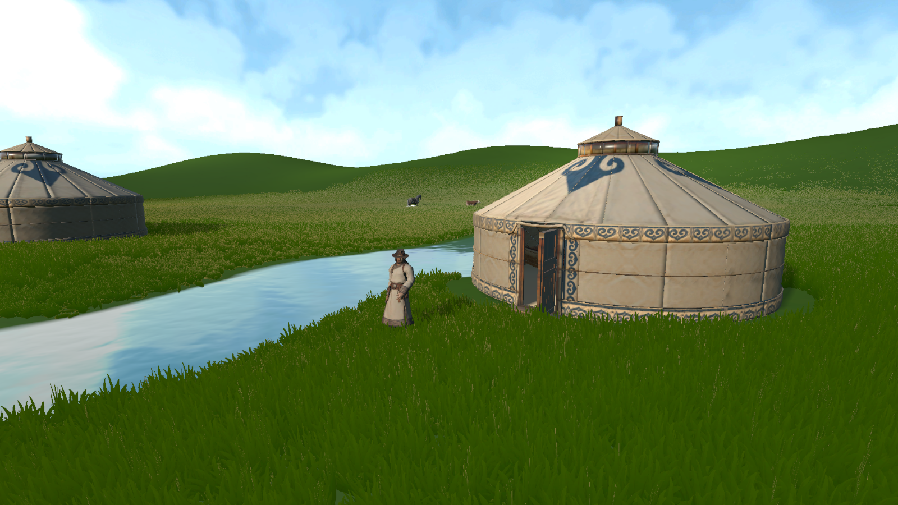
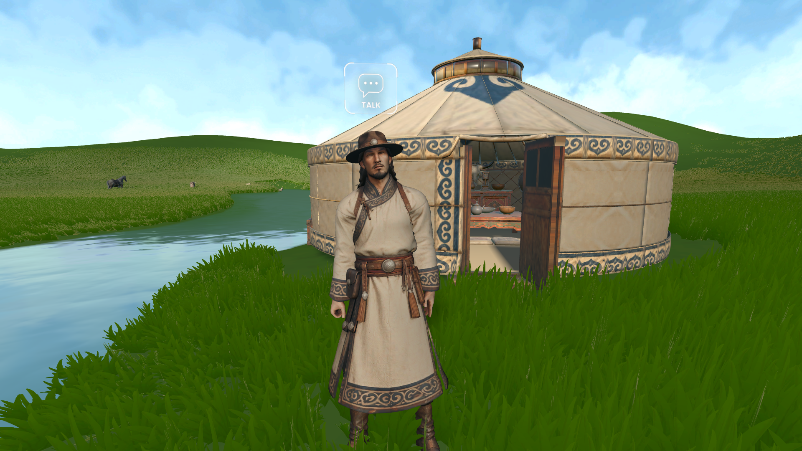
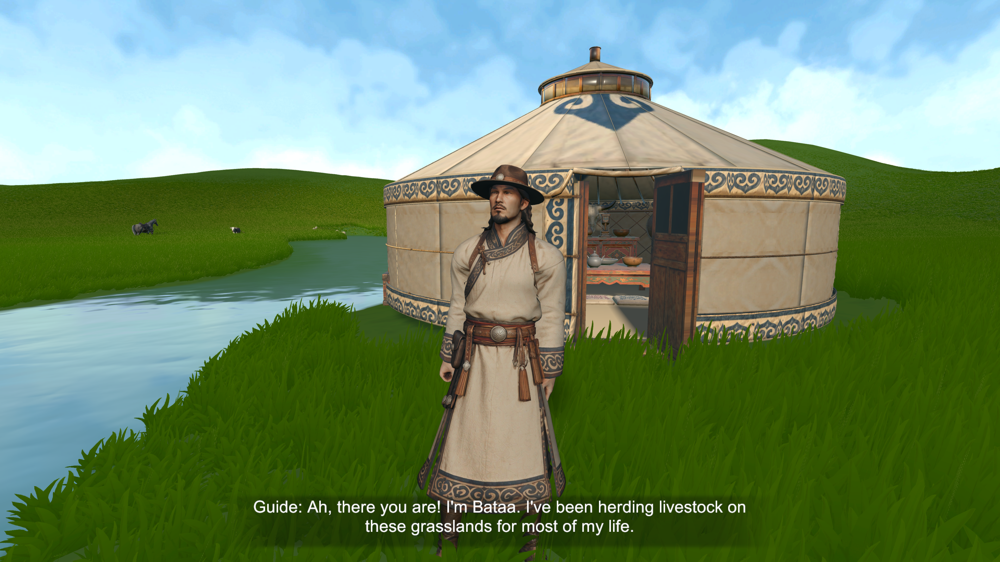
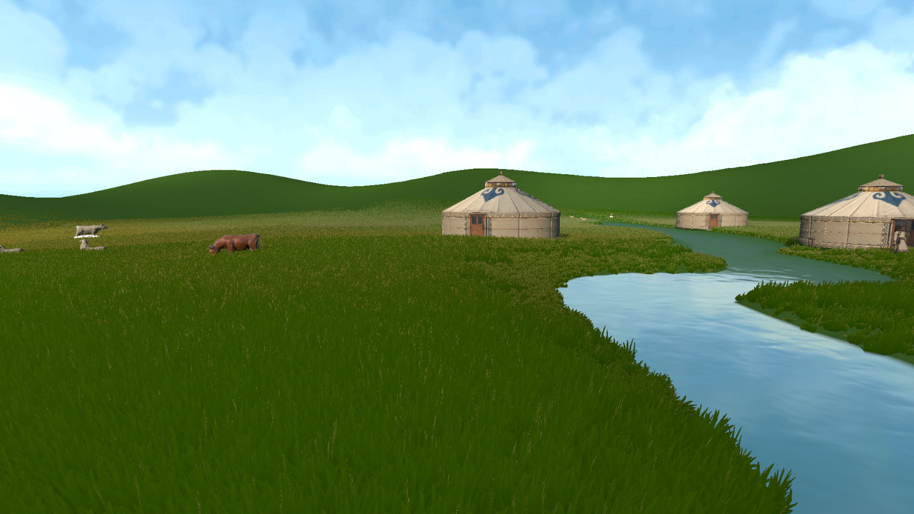
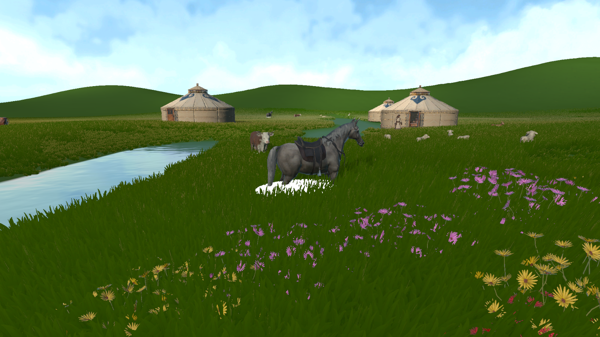

# Week 09 — Establishing the Grassland and Player Route

This week I focused on making the spring grassland feel complete and giving the player a clear, calm route through it. I adjusted the shape of the terrain, changed the river, and planned three places where people could live. I also connected the ger, a guide and the animals so that the landscape gives the player a reason to keep moving.

## Shaping the grassland

Most of the field now has tall grass, while the short grass is kept very low and clearly different. This contrast helps separate open ground from dense meadow. It also gives the player simple visual clues: when the grass changes, the character has entered a different part of the landscape. I wanted these changes to be easy to notice so the player can gradually learn the space without relying on map markers everywhere.

Feichtinger and Lankes (2025) discuss how visual cues, boundaries and landmarks can help players orient themselves in 3D game worlds while still leaving room to explore. I applied this idea through the grass itself. Tall and short areas make the field easier to read, and the open patches give the eye a place to rest among the taller growth.

*The low, open ground around the ger contrasts with the tall grass outside.*

*Flowers break up the dense grass, while the ger remains easy to recognise.*

I also settled the shape of the surrounding hills. They keep the landscape enclosed enough to feel like a place, but their slopes stay gentle so the overall pace remains unhurried. From higher points, the player can look across the grassland and see the river, gers and animals. These views help players understand where they are and give them a reason to explore beyond the main route.

*The higher ground gives a clear view of the river and the places ahead.*

## Changing the river and planning places to live

I changed the river’s route so it runs through the playable landscape and links several important parts of the scene. It is now a visible line that the player can follow between the starting ger, the livestock and the other living areas. The river also helps the landscape feel joined together, rather than divided into separate patches.

I planned three places to live in areas that appear suitable for setting up gers: each has access to water, open space and a view across the surroundings. Keeping the sites at separate points gives the player destinations along the way and makes the grassland feel inhabited across a wider area. Ono and Ishikawa’s (2020) study of pastoral communities in Mongolia describes summer camps near rivers and lowland valleys, with a convenient environment among the factors in choosing a camp. I used that as a reference for placing the living areas near the river.

The animals are mostly gathered close to the water, where they become easier for the player to notice and approach. Research on livestock in Mongolia also found differences in terrain use: horses and cattle were more often found on level ground, while sheep and goats used slopes more often (Takatsuki et al., 2025). This gave me a useful reference for arranging the herd across the flatter river areas and the nearby hillsides.

*The river, animals and three possible living areas share the landscape.*

*Bataa stands close to the entrance, with the river beside him.*

## Meeting the guide

When the player leaves the ger, they meet Bataa, a local guide. He starts a conversation and introduces his life on the grasslands. The dialogue gives the player a reason to listen to him before moving on; he then guides them forward and introduces the chance to interact with the animals. This makes the first steps feel like meeting someone in the world, rather than receiving a list of instructions.

Barnabé (2021) writes about guide characters as part of both a game’s instructions and its story. I used that idea to give Bataa both roles: he helps the player understand what to do next, while his presence and dialogue make the landscape feel inhabited. The route can then unfold at a relaxed pace: leave the ger, meet the guide, follow the river and approach the herd. The nearby hills remain open as a side trip for players who want to stop and look across the landscape.

*The player can start a conversation with Bataa.*

*The conversation introduces Bataa and his life on the grasslands.*

*The herd gives the player a reason to follow the river.*

The horse is another recognisable stop along this route. Its position near the water keeps it connected to the herd and within sight of the gers. I wanted the player to notice it while exploring, with enough surrounding space to approach it. The river, animals and distant homes can stay visible together, helping the player remember where they came from.

*The horse creates another point to approach along the river.*

## Reflection

The grass, hills, river, settlements and guide now work together to make the landscape easier to understand. The contrast between tall and very short grass creates recognisable areas; the river and three living places give the player a route; and Bataa turns that route into part of the story. The next step is to check whether a new player can follow the scene from the ger to the guide and animals, while still feeling free to explore the hills.

## References

Barnabé, F. (2021) ‘Entre règles et narration : étude narratologique des tutoriels de jeu vidéo et des « personnages-guides »’, *Cahiers de Narratologie*, 38 (2020). [https://doi.org/10.4000/narratologie.11676](https://doi.org/10.4000/narratologie.11676).

Feichtinger, C. and Lankes, M. (2025) ‘Where am I? Design Pointers for Enhanced Spatial Orientation in 3D Games’, *Proceedings of the 20th International Conference on the Foundations of Digital Games*. [https://doi.org/10.1145/3723498.3723826](https://doi.org/10.1145/3723498.3723826).

Ono, C. and Ishikawa, M. (2020) ‘Pastoralists’ Herding Strategies and Camp Selection in the Local Commons: A Case Study of Pastoral Societies in Mongolia’, *Land*, 9(12), 496. [https://doi.org/10.3390/land9120496](https://doi.org/10.3390/land9120496).

Takatsuki, S., Morinaga, Y. and Bat-Oyun, T. (2025) ‘Habitat Use and Food Habits of Horses, Cattle, Sheep, and Goats in the Forest-Steppe Zone of Mongolia’, *Mongolian Journal of Biological Sciences*, 23(1), pp. 37–53. [https://doi.org/10.22353/mjbs.2025.23.06](https://doi.org/10.22353/mjbs.2025.23.06).
